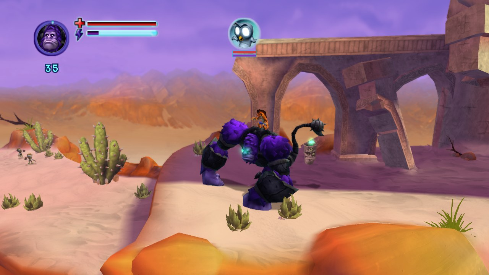
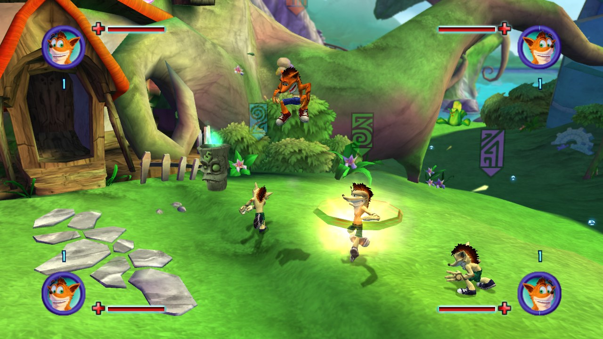

<div align="center">

# Mind over Recomp

**An unofficial native PC port of *Crash: Mind over Mutant***<br>
<sub>Xbox 360 · 2008 · Radical Entertainment — statically recompiled, then rebuilt piece by piece with native code</sub>

<br>

[](https://github.com/Maxilure/MindOver-Recomp/releases/latest)
[](#-download-and-play)
[](#-download-and-play)
[](LICENSE)
[](https://github.com/rexglue/rexglue-sdk)

**[Features](#-features)** · **[Download](#-download-and-play)** · **[Controls](#-controls)** · **[Going native](#-going-native)** · **[Building](#%EF%B8%8F-building-from-source)** · **[Docs](#-documentation)**

<br>



</div>

<br>

> [!WARNING]
> **Alpha.** The game is playable but hasn't been played through to the end yet. Expect bugs and crashes, and keep a backup of your saves.

> [!IMPORTANT]
> **No game files are included.** You need your own Xbox 360 disc of *Crash: Mind over Mutant* (USA), dumped to an `.iso`. The game is built on your computer from it.

## 📖 About

*Crash: Mind over Mutant* only ever came out on consoles. **Mind over Recomp** aims to preserve it as a real PC game and give it the upgrades it deserves.

It isn't an emulator: the game's Xbox 360 program is [translated into C++ ahead of time](docs/02-how-the-port-works.md) with [ReXGlue](https://github.com/rexglue/rexglue-sdk) and built as a native Linux or Windows program. The parts that still pretend to be an Xbox are then replaced, one by one, with the port's own code.

## ✨ Features

<table>
<tr>
<td width="50%" valign="top">

### 🎨 Its own renderer
A native Vulkan renderer that matches the original's look, runs much lighter than emulating the Xbox's GPU, and goes up to 4K and, in 0.3.0, wider than 16:9 (up to 32:9).

</td>
<td width="50%" valign="top">

### ⚡ 60 fps and beyond
**60 fps** at the original game speed. 120, 144 and uncapped work too *(experimental)*.

</td>
</tr>
<tr>
<td valign="top">

### 👥 Up to four players
Co-op for **four** instead of two, with a Players screen, outfits for everyone and a camera that keeps you all in view *(experimental)*.

</td>
<td valign="top">

### ⌨️ Keyboard, mouse and any controller
Rebindable keys, the mouse in every menu, mouse aiming, and button prompts that show your keys or your controller's buttons.

</td>
</tr>
<tr>
<td valign="top">

### ⚙️ Options in the game's own look
Display, graphics, audio, controls, gameplay and language settings, changed live from the main menu or the pause menu.

</td>
<td valign="top">

### 💾 Unlimited, named saves
As many saves as you like in the game's own save screen, renamed and deleted there. Each one is a plain file, with backups.

</td>
</tr>
<tr>
<td valign="top">

### 🌍 Every language on the disc
Text and voices picked separately from the disc's languages, plus the whole game in Brazilian Portuguese.

</td>
<td valign="top">

### 🏆 Achievements
The game's 48 achievements, kept by the port, with their own screen and pop-up.

</td>
</tr>
</table>

<div align="center">

</div>

<sub>Screenshots are from the port's own renderer. The game's imagery belongs to its owners (see [License and disclaimer](#%EF%B8%8F-license-and-disclaimer)).</sub>

## 📥 Download and play

<div align="center">

### **[⬇ Download the latest release](https://github.com/Maxilure/MindOver-Recomp/releases/latest)**

</div>

| | Windows |
|---|---|
| **System** | Windows 10 / 11, 64-bit |
| **Download** | `MindOverRecomp-…-windows-x86_64.zip` |
| **Free space** | ~8 GB, on an NTFS drive (not OneDrive) |

It needs a **Vulkan** graphics card (only NVIDIA tested so far) and **16 GB RAM** recommended. The release comes ready-built: only your own disc supplies the game's files.

**Windows**
1. Unpack the `.zip` and start **Mind over Recomp.exe**, the installer. If Windows warns about an unknown program: **More info → Run anyway**.
2. Choose **Install the game**, pick your `.iso` and a folder, then **Next: install**. It takes a minute or two.
3. Play **Crash Mind over Mutant** from the Start menu.

**Updating (Windows):** open **Mind over Recomp** from the Start menu and press **Update now** when it shows a new version. Saves and settings stay; the version it replaces is kept and put back by itself if the update fails. On 0.2.0 to 0.2.2-alpha.4 it's the **Update to …** button there; it finishes by itself (it downloads the game a second time). The manual way also works: the new release's **Mind over Recomp.exe** → **Update an installed game**. Uninstall from **Mind over Recomp** or Windows' *Installed apps*.

**Linux:** no ready-built release yet (it comes later). Build it from source: [Building](docs/01-building.md).

> [!TIP]
> Problems? See **[Troubleshooting](docs/06-troubleshooting.md)** and the [known issues](docs/06-troubleshooting.md#known-issues). Found a bug? Fill in the [bug form](https://github.com/Maxilure/MindOver-Recomp/issues/new/choose) and attach the `user/logs` folder from the game's folder.

## 🎮 Controls

| Action | Keyboard and mouse | Controller |
|---|---|---|
| Move / walk | <kbd>W</kbd> <kbd>A</kbd> <kbd>S</kbd> <kbd>D</kbd> / hold <kbd>Ctrl</kbd> | left stick |
| Jump | <kbd>Space</kbd> | <kbd>A</kbd> |
| Light / heavy attack | left / right mouse button | <kbd>X</kbd> / <kbd>Y</kbd> |
| Spin | <kbd>Q</kbd> or middle mouse button, with **Simple Spinning** on (Options → Gameplay) | rotate the left stick (or <kbd>LB</kbd> with Simple Spinning) |
| Block | <kbd>Shift</kbd> | <kbd>RT</kbd> |
| Jack a titan / use a save totem | <kbd>E</kbd> | <kbd>B</kbd> |
| Titan special / pocket a titan | <kbd>F</kbd> / <kbd>R</kbd> | <kbd>LT</kbd> / <kbd>RB</kbd> |
| Map / pause | <kbd>Tab</kbd> / <kbd>Esc</kbd> | <kbd>Back</kbd> / <kbd>Start</kbd> |
| Menus: choose / back | <kbd>Enter</kbd> / <kbd>Esc</kbd>, or the mouse | <kbd>A</kbd> / <kbd>B</kbd> |

Keys can be changed in **Options → Controls**. Friends join by pressing a button on their controller; the **Players** screen (pause menu, or **Extras** in the main menu) shows who plays with what.

<details>
<summary><b>Port keys</b></summary>
<br>

| Key | What it does |
|---|---|
| <kbd>F1</kbd> | Tools menu: cheats, photos, developer tools |
| <kbd>F2</kbd> | Hide / show the HUD |
| <kbd>F11</kbd> | Fullscreen on / off |

Using cheats turns achievements off until a save is loaded.

</details>

## 🧩 Going native

The game's code already runs natively. What's still emulated is the **Xbox 360 around it**: the system services the game asks for. Each one the port answers itself is one less piece of pretend Xbox.

<!-- native-progress:begin -->
<!-- Written by tools/native_progress.py --readme: edit the tool, not this block. -->
**Xbox services replaced: 61 of 66 (92%)** `▰▰▰▰▰▰▰▰▰▱`

| Xbox piece | Replaced | Becomes |
|---|---|---|
| Graphics driver | `▰▰▰▰▰▰▰▰▱▱` 15 / 20 | the port's own Vulkan renderer, then the emulated GPU off |
| Profiles and sign-in | `▰▰▰▰▰▰▰▰▰▰` 4 / 4 | no profiles at all: who plays = which controllers play |
| Saves and storage | `▰▰▰▰▰▰▰▰▰▰` 11 / 11 | plain save files in one folder: no storage devices, no content packages |
| Controllers | `▰▰▰▰▰▰▰▰▰▰` 3 / 3 | the input manager fed directly (keyboard and mouse, any SDL controller, rumble) |
| Sound output | `▰▰▰▰▰▰▰▰▰▰` 5 / 5 | each mixed frame straight to the PC's audio |
| XMA sound decoder | `▰▰▰▰▰▰▰▰▰▰` 2 / 2 | a software decoder instead of the emulated sound chip |
| System pop-ups and notifications | `▰▰▰▰▰▰▰▰▰▰` 5 / 5 | PC behaviour (the port's own messages); gone once profiles and saves are native |
| System messages | `▰▰▰▰▰▰▰▰▰▰` 3 / 3 | no dashboard music player, no friends-list status: the port answers itself |
| Console settings | `▰▰▰▰▰▰▰▰▰▰` 8 / 8 | the port's own answers (one fixed TV mode for the game; language from the port's setting) |
| Quit and launch | `▰▰▰▰▰▰▰▰▰▰` 4 / 4 | quit the program cleanly |
| Network | `▰▰▰▰▰▰▰▰▰▰` 1 / 1 | not needed (no online features) |

Not counted: 89 kernel basics (threads, locks, memory, files), already thin translations to the PC's own.
<!-- native-progress:end -->

## 🛠️ Building from source

Players don't need this: the Windows release comes ready-built. Linux needs clang 20+, CMake 3.25+, Ninja, Python 3, Git and `glslc`. The full walkthrough, Windows included, is in **[Building](docs/01-building.md)**.

<details>
<summary><b>Build commands</b></summary>
<br>

```bash
git clone --recursive https://github.com/Maxilure/MindOver-Recomp.git
cd MindOver-Recomp

# the launcher (its Setup tab does everything below)
cmake -S launcher -B out/build/launcher -G Ninja -DCMAKE_BUILD_TYPE=Release \
      -DCMAKE_C_COMPILER=clang -DCMAKE_CXX_COMPILER=clang++
cmake --build out/build/launcher && out/build/launcher/crash_mom_launcher

# or by hand: unpack the disc, build the SDK with our patches, then the game
python3 tools/xiso_extract.py "Crash - Mind over Mutant (USA).iso" game/
(cd thirdparty/rexglue-sdk && git apply ../../patches/rexglue-sdk/*.patch \
  && cmake --preset linux-amd64 -DCMAKE_INSTALL_PREFIX=$PWD/../rexglue-install \
  && cmake --build out/build/linux-amd64 --config Release --target install \
  && cmake --build out/build/linux-amd64 --config RelWithDebInfo --target install)
cmake --preset linux-amd64-relwithdebinfo
cmake --build --preset linux-amd64-relwithdebinfo --target crash_mom_codegen
cmake --preset linux-amd64-relwithdebinfo   # first time only: picks up the generated code
cmake --build --preset linux-amd64-relwithdebinfo -j 6
tools/play.sh                               # one log per session in logs/
```

</details>

<details>
<summary><b>Repository layout</b></summary>
<br>

```
crash_mom_manifest.toml    recompiler config: every analysis fix and hook, commented
CMakeLists.txt             builds the port (generated code + ReXGlue + src/)
src/                       the port's own native code
  pddi/, native/           the game's renderer calls, and the port's Vulkan renderer
  decomp/                  game functions rewritten in plain C++ (faster, checked against the original)
  effects/                 graphics settings (motion blur, depth of field...)
  input/                   keyboard, mouse, controllers, button prompts
  players/                 up to four players, the Players screen, the co-op camera
  saves/                   the save files and the save list
  options/                 the Options screen
  audio/                   sound output and the XMA decoder
  language/                text and voice languages, the port's translations
  achievements/            achievements, their pop-up and screen
  ui/                      the port's menus and HUD pieces in the game's look
  gameplay/, cheats/       gameplay options, the Cheats menu
  data/                    changed copies of game data, built at run time from your disc
  debug/                   developer tools (console, crash reports...)
launcher/                  the Windows installer and the Linux launcher (no game code)
languages/                 translations of the port's own texts
assets/                    the port's own pictures (markers, jack symbol) and button prompts
tools/                     disc extraction, disassembler, play/debug and release scripts
patches/rexglue-sdk/       our fixes to the ReXGlue SDK (applied to the submodule)
docs/                      guides, and findings about the game's internals
thirdparty/rexglue-sdk     the recompiler + runtime (git submodule, pinned)

# made on your machine, never committed:
*.iso, game/               your disc and its extracted files
generated/default/         C++ produced by the recompiler
out/, logs/, cache/        builds, logs, caches
user/                      YOUR files: saves, settings, controls, photos, logs
```

</details>

## 📚 Documentation

| | |
|---|---|
| 🧠 [How the port works](docs/02-how-the-port-works.md) | static recompilation, explained |
| 🔧 [Building](docs/01-building.md) | every build step, the launcher, releases |
| 🩺 [Troubleshooting](docs/06-troubleshooting.md) | common problems on Linux and Windows |
| ✨ [Enhancements](docs/05-enhancements.md) | what only this port adds |
| 🗺️ [Roadmap](docs/03-roadmap.md) | where the project is going |
| 🎨 [Native renderer](docs/04-native-renderer.md) | the port's own Vulkan renderer |
| 🔬 [Findings](docs/findings/) | everything learned about the game's internals |

## 🤝 Contributing

Contributions of any kind are welcome: code, reverse engineering, testing, bug reports, corrections. **Speak another language?** The port's own texts are machine-translated into 11 languages and need checking: see [languages/](languages/README.md), no programming needed. Every human contribution is credited in [CREDITS.md](CREDITS.md).

> [!NOTE]
> **Developed with extensive AI assistance** (Claude, via Claude Code). The code, reverse-engineering notes and documentation were largely written by the AI; the maintainer sets the direction, tests every change on the real game and reviews the results. Findings are checked against the running game, not by experts: treat them as working notes, and please report errors.

## 💛 Credits

- **Maxilure**: project lead, direction, playtesting, art
- **[YWZsaXRv](https://github.com/YWZsaXRv)**: the Windows setup script the installer builds on
- **[zanettevini](https://github.com/zanettevini)**: Brazilian Portuguese translation, native quit and launch code, native controller code (with Codex)
- **[ReXGlue](https://github.com/rexglue/rexglue-sdk)** and **[Xenia](https://github.com/xenia-project/xenia)**: the recompiler and runtime this port is built on
- **[Xelu's Free Controller & Key Prompts](https://thoseawesomeguys.com/prompts/)** by Nicolae "Xelu" Berbece: the button prompt pictures
- **[Icons8](https://icons8.com)**: the Windows installer's icon
- **Claude** (Anthropic): AI assistant that wrote most of the code and documentation

The full list, bug reporters and libraries included, is in [CREDITS.md](CREDITS.md).

## ⚖️ License and disclaimer

- The code in this repository is licensed under the **[GNU General Public License v3.0](LICENSE)**.
- The patches in `patches/rexglue-sdk/` modify ReXGlue's source and stay under ReXGlue's **BSD 3-Clause** license, like the SDK itself (which also builds on [Xenia](https://github.com/xenia-project/xenia)'s code).
- The screenshots in `docs/images/` show the game's own imagery and are not covered by these licenses.
- The marker pictures in `assets/markers/` were drawn for this port, after the save-slot numbers of *Crash of the Titans* (Radical Entertainment, 2007), to match the game's own markers.
- The jack symbol in `assets/icons/` is a silhouette of Aku Aku's mask made for this port, traced from a render of *Crash of the Titans*' mask model.
- The keyboard, mouse and controller pictures in `assets/prompts/` are from [Xelu's Free Controller & Key Prompts](https://thoseawesomeguys.com/prompts/) by Nicolae "Xelu" Berbece, released into the public domain (**CC0**).
- The Windows installer's icon, `launcher/icon/installer.ico`, is the "Support" icon by [Icons8](https://icons8.com), licensed **[CC BY-ND 3.0](https://creativecommons.org/licenses/by-nd/3.0/)** and used unchanged. The game's own icon is made on the player's computer from their disc (`tools/make_icon.py`); it is not in this repository.

<sub>This is an unofficial fan project for game preservation. It is not affiliated with, endorsed by, or sponsored by Activision, Sierra Entertainment, Radical Entertainment, or Microsoft. *Crash Bandicoot* and *Crash: Mind over Mutant* are trademarks of their respective owners. This repository contains no game code, assets or data: you need your own legally obtained copy of the game.</sub>
