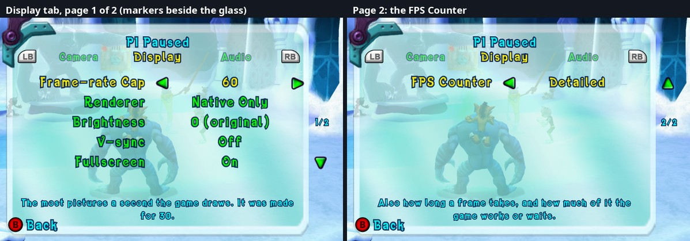
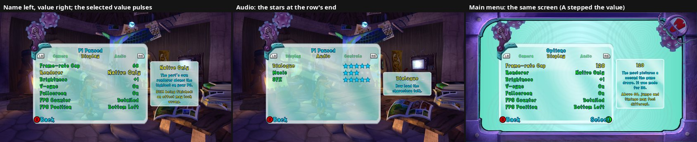
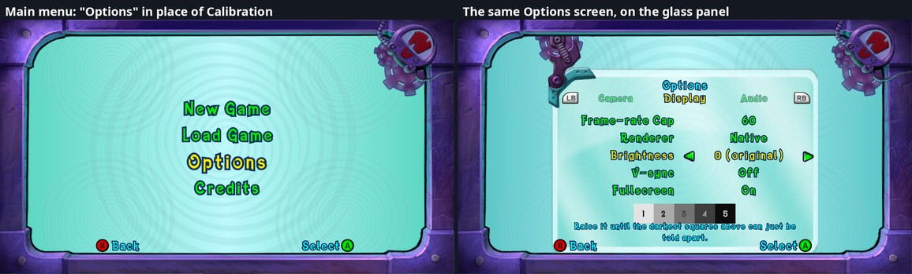

# 31. The Options screen: tabs, port settings and live changes

Status: built (first version). Pause -> Options opens the port's Options
screen: the game's glass panel and menu look, with tabs (Display, Graphics,
Audio, Controls, Camera), and every change takes effect at once. Code:
`src/options/` (page, settings, screen) and `src/ui/scrooby.*` (helpers for
the game's menu library). Builds on the menu research of findings/30.

*Left: the Display tab, page 1 of 2 (the arrows show the selected value
can move both ways; beside the glass: "1/2" and a down arrow). Right: page
2, the FPS Counter row. (The first layout: since section 7 the description
sits in a card on the right and the page markers under the rows.)*

*The current layout (section 7): the selected row's value, picture,
description and warning in a glass card beside the game's glass panel,
fitted to what it says, in game and in the main menu (drawn smaller
there).*

## 1. What the original screen is

The in-game Options state (956 in `Frontend.bfig`) runs two actions:

* `CInGameOptionsScreenAction` (Enter `sub_820CDAD0`, Update `sub_820CDCC0`):
  only the panel's slide-in (the glass panel page and the options page moved
  in from 800 units, the background faded, the two cogs turned as they move)
  and the "P1 Paused" title.
* `CMenuAction` (Enter `sub_820D2828`, Update `sub_820D2A00`, Exit
  `sub_820D2F08`): the generic driver behind every Scrooby menu screen. It
  finds the page and the menu by the name hashes in its track (track +20
  page, +28 menu), then each frame moves the cursor (IsButtonPressed buttons
  45 up / 16 down, sounds `down_left` / `up_right` of the `FE_SFX` bank) and
  walks value lists (27 left / 40 right).

`CMenuAction` holds **special code for one menu name**: when the menu's
name hash equals the global at `0x825A0598` (the hash of
`InGameOptionsMenu`, filled at start-up), Enter lights the star pictures
(`sub_820D2F80`: `DialogueStar1-5`, `MusicStar1-5`, `SFXStar1-5`, lit =
frame 0 + the colour word at `0x825078E4`, unlit = frame 1 + `0x4BFFFFFF`)
and sets the Invert Axis value; Update changes a volume or Invert Axis BY ROW
NUMBER (0 Dialogue, 1 Music, 2 SFX, 3 Invert Axis) and plays the Music
preview while row 1 is selected.

The game's own options:

| Option | Read / write | Notes |
|---|---|---|
| Dialogue volume | `sub_82266240` / `sub_82266268` (f1) | 0.0-1.0 in steps of 0.2 (a star); sound `FE_SFX_Volume_D` "Dialogue" on a change |
| Music volume | `sub_822661F0` / `sub_82266218` | `sub_822615D0` / `sub_822615E8` = Music row selected / left (its preview) |
| SFX volume | `sub_82266290` / `sub_822662B8` | sound `FE_SFX_Volume_S` "SFX" |
| Invert Axis | front end +8588 + `sub_82266130(front end, player)` | a byte per player (1 = on); read only by the aiming reticle (`CReticleAimingBehaviour`, `sub_82255160`), which flips its vertical aim |

## 2. The page

The data patch (`options_page.cpp`) replaces the page
`InGame_Options_XENON.pag` in every in-game menus package (`InGame.prj`,
one per level group) with one made of copies of the page's own elements:
the Dialogue row (a menu item: label text + value text) for each row, a
star picture, the "Paused" title, plus the map screen's arrow picture
(`TitleArrowLeft` of `InGame_Map.pag`, a down arrow) for the value
selector. The page and menu keep their names, so the state's tracks find
them as before.

Layout (Scrooby units, findings/30 s.1; x as first built, everything on
the glass is 100 units further left since section 7): tabs at y 312, three at a time:
the current one in the middle (0.97 x size, yellow), the previous and next
ones beside it (0.8 x, half see-through: there is more to either side,
wrapping around), the font's LB / RB pictures at both ends;
up to five rows from y 270, 35 apart; labels right-aligned ending at x 300;
values centred in a selector from x 312 to 568 with an arrow at each end;
stars centred in the same place; the description and warning at 0.72 x
size (first above the game's Back prompt, now in the card: section 7).

Things learnt building it:

* **A menu item's texts aren't found by name** in the page
  (`sub_82371AD0` returns 0): the item holds them, +140 the drawn text (the
  label) and +144 the value text, both Text objects.
* **Texts don't wrap** by themselves: the description is broken into lines
  at spaces in code ("\n").
* **The font has no `<` or `>`.** Its arrow characters (U+00BA, U+00BB)
  don't match (the left one is an outline), hence the map's arrow picture,
  turned with `sub_823710C8(element, angle, axis)` (the call the screen
  action uses for its cogs; degrees, around the element's centre; +90 makes
  the down arrow point left).
* **A pointer into a node's child list goes stale when the list grows**: the
  counter's patch first kept a pointer to its template text and appended
  copies to the same list; the first append moved the list, the next copies
  read freed memory and damaged the heap (aborts in `malloc` / at exit, at
  random moments). Caught deterministically with glibc's malloc checks
  (`LD_PRELOAD=libc_malloc_debug.so.0 MALLOC_CHECK_=3 MALLOC_PERTURB_=165`):
  copy first, then append.
* Element sizes: `sub_82370A58` resets an element's transform,
  `sub_82371198(element, scale)` scales it around its centre.

## 3. The screen's code

`options_menu.cpp` wraps the three `CMenuAction` methods. For our menu
(recognized by the track's menu hash, before Enter has found the menu
itself) the original runs with the `InGameOptionsMenu` global zeroed for
the call: the special code doesn't recognize the menu, the generic part
(up / down, its sounds, skipping rows that aren't selectable) still works.
Then:

* left / right = the same IsButtonPressed buttons 27 / 40, through the
  port's menu-owner rule (findings/26 s.21: the player who paused answers);
* tabs = LB / RB (or Back) on the owner's controller, as the game last read
  it (the XInputGetState wrapper reports every state);
* unused rows: texts hidden (element +110 bit 0x80), item not selectable
  (+137 bit 0x80);
* A on an action row (Rebind Keys) opens the F6 Controls window.

What the rows are and do lives in `options_settings.cpp`: label, values,
description and warning per value, how to read / write / apply each.

**Pages.** A tab shows five rows at a time; a longer one is cut into pages.
The menu's own up / down (Scrooby `Menu::MoveNext` `sub_8237A668` /
`MovePrevious` `sub_8237A550`, already hooked by the save list) asks the
screen first: past the last / first row of a page it turns to the next /
previous page (wrapping around), the cursor lands on its first / last row,
and the menu plays its usual sound. Under the rows (first beside the glass): the
map's arrow (turned over for "up") where there are more rows that way, and
"1/2" between them.

**The prompts.** Lower right: "Select A" (A changes the value; section
8), set by the screen in game too, where the state's own prompts were Back
only: the font's A picture and the game's own text, by the key the main
menus' prompts use (`FE_Button_Text_Select`, `sub_82371CE0(text, key)`:
in the game's language). **The X button** can belong to a row: while that
row is selected (and its value allows it) the upper right prompt (page
`FE_Buttons`, `UpperRightButton` / `UpperRightText`) says what X does. The Renderer row's X is **Dual Mode** (= F8,
the native picture in a second window) on Emulated and Native, the two
values where both renderers draw.

**The Brightness guide** is the original's calibration screen picture
(`FE_calibration_greyscale.tga`, page `GameStart_VideoCalibration` of the
main menus' package), copied into the in-game packages. A picture element
draws at its picture's own size hanging from the top of its box (the box's
width and height don't scale it): drawn at 0.6 x by code.

| Tab | Row | Values | Where | Applied |
|---|---|---|---|---|
| Display | Frame-rate Cap | 30 (original), 60, 120, 144, 165, 180, 240, Unlimited (+ a hand-set value) | `fps_cap` | read every frame (findings/07) |
| | Renderer | Emulated Only, Emulated, Native, Native Only (the default since 2026-10-10: `native_only` on) | `emulated_only`, `native_only` + the shown picture | `NativeRenderer::SetShowNative` (= F9); the emulated GPU's drawing on / off at once; Emulated Only = the native renderer idle, F9 / F8 locked (both read when asked) |
| | Brightness | -5 ... 0 (original) ... +5 | GPU flag `gamma_ramp_power` (SDK patch 0015) = 2^(-step/10) | the emulated GPU re-uploads the game's gamma ramp with the power applied at its next swap; the native renderer applies the same curve to the same ramp (measured: +3 = the level 182 -> 192.5/255 in both pictures) |
| | V-sync | Off, On | `present_vsync` (frame_rate.h) | On = the window's present mode FIFO (the SDK's `vulkan_allow_present_mode_immediate` / `_mailbox` / `_fifo_relaxed` all off; the swapchain made again with `Presenter::OnSurfaceResizeFromUIThread`: mode 2 in the log) AND the frame pacer capped at the monitor's refresh rate (SDL: the window's display, else the primary; an Unlimited or higher cap becomes the refresh rate, 30 stays the original pacing). A first version only switched to mailbox (no tearing, but no limit): not what V-sync means to players |
| | Fullscreen | Off, On | the SDK's `fullscreen` | its change callback resizes the window |
| | FPS Counter | Off, Simple, Average, Detailed | `fps_overlay` (`src/fps_overlay.*`) | the port's own counter (no MangoHud), ALWAYS on screen: drawn by the port itself on the overlay layer over the finished picture (ImGui's foreground draw list, both renderers) with the game's own font `Titans_Small`, read from package b4c85fe7 at run time (`src/ui/game_font.*`: Pure3D texture font 0x22000, white palettized pages split into a dark outline layer under a coloured letter layer). Coloured against the cap; text changes 4 times a second. The GAME's frames: FPS of the last 0.25 s, average of 5 s, 1% low of 10 s, frame / game / swap ms (GAME without the frame pacer's wait). Not in F10 photos (guest picture only). (Earlier versions: an ImGui window; a HUD-only text; then texts on the game's pages `FE_Buttons.pag` + `InGame.pag`, which vanished during every menu transition: a screen's exit fade closes its pages, and between two screens none is drawn.) |
| | FPS Position | Top Left, Top Centre, Top Right, Bottom Left, Bottom Right | `fps_overlay_position` | five texts per page (one per place, in the 16:9 picture's corners past the 4:3 canvas), only the chosen one shown |
| Graphics | Anti-aliasing | Off, 2x (original), 4x, 8x (up to what the GPU can do) | `anti_aliasing` | the MSAA count of the game's multisampled surfaces, native only (greyed out with the emulated picture), re-created at the next frame (findings/35) |
| | Texture Sharpness | Original, Sharper, Sharpest | `texture_sharpness` | a mip level bias of 0 / -0.5 / -1 on the mipmapped textures, native only (greyed out with the emulated picture); the game already uses 16x anisotropic filtering (findings/36) |
| | Motion Blur | Off (original), Low, Medium, High | `motion_blur` (`src/effects/post_effects.*`) | the port's own effect, native renderer only (greyed out while the emulated picture shows: findings/35 s.4), read by the recorder every frame (findings/34) |
| | Depth of Field | Off, Original, Strong | `depth_of_field` | the game's MaxRadius x 0 / 1 / 2 on the way into its renderer, both pictures (findings/34 s.3) |
| Audio | Dialogue, Music, SFX | 0-5 stars | `volume_dialogue`, `volume_music`, `volume_sfx` (`src/options/global_options.*`) | the game's own volumes, kept in `user/settings.toml` instead of each save (section 6) |
| Controls | Invert Axis | Off, On | `invert_axis_player1`-`4` | the game's own, per controller slot, kept in `user/settings.toml` (section 6) |
| | Rebind Keys | (action) | | opens F6 |
| Camera | Co-op Camera | Frame Everyone, Original | `coop_camera` | read every frame (findings/28) |
| | Camera Follows | Nearest Player, Middle | `coop_camera_near_focus` | read every frame |

No row for `coop_mask_from_anywhere` (findings/26 s.35): in the original, B
already makes a mask nearly everywhere (on screen through the ordinary
check, off screen through the catch-up); the rule only differs when a
player is on screen and the partner isn't, which only the co-op camera
causes. It's a fix, not a choice, and stays on.

Port settings changed on the screen are written to `user/settings.toml` when
it closes: only those keys (a key back on its default is removed), every
other line kept, through a temporary file and a rename. The game's own
options (volumes, Invert Axis) are such keys too (section 6).

## 4. The main menu's Options

The Xbox main menu has no Options, but the PS2 route is still in the data:
the PS2 main menu page (`GameStart_Start_PS2`) has an `OptionsItem`
(string `GameStart_MainMenu_Options`, translated in all the front end's
languages), the tree has the PS2 menu's `ExitOptions` (node 77) into
`OptionsScreen` (96, decision `sub_8211B818`: the cancel flag takes ExitBack
106 back to the main menu), which shows the screen `GameStart_Options` with
the PS2 page `GameStart_OptionsPS2` (Widescreen, Sound, Vibration,
Progressive Scan, Credits) through `COptionsScreenAction`.

A second data patch, of the main menus' package (`cdd70a8c`, `GameStart.prj`):

* `GameStart_Start_Xenon.pag`: a copy of the PS2 `OptionsItem` as the third
  item, in place of Calibration (the original's TV brightness test screen:
  a grey scale and an instruction, no setting; its picture is now the
  Brightness row's guide). Four items, as laid out by the game.
* `GameStart_OptionsPS2.pag`: our page (same builder as in game; its menu
  keeps the name `OptionsMenu`, the state's track names it), with the
  in-game screen's glass panel, cogs and hinge made from the page's own
  pictures, and a title text carrying the same translated "Options". The
  texts start from the menus' own bank's `_Empty` (the in-game bank isn't
  loaded there); the two star pictures are copied in from an in-game
  package (the main menu package has every other picture).

Code (`options_menu.cpp`): the main menu's decision `sub_8211B6C8`
(GetMenuIndex 0-3 -> exits 86-89) is answered with our order: New Game 86,
Load Game 87, Options = exit 77, Credits 88 (the engine follows any exit's
target, findings/24 s.7; the calibration state 484 is no longer reached).
`COptionsScreenAction` keeps only what every screen needs (Enter: take the
track's updates, show `GameStart_Options` with `sub_82262730`, clear the
result flags; Exit: give the updates back, menus take input again); its PS2
rows' code doesn't run. B sets the cancel flag (front end +8593 bit 2) for
the state's decision. The Music row's preview is left out there (the main
menu plays its own music).

## 5. Not in this version
* Keyboard on / off: the keyboard driver is made at start-up only.
* Resolution above 720p: doesn't exist yet. (Motion blur joined on
  2026-10-11: Graphics tab, findings/34.)
* Animated previews of the settings. (The keys: section 9.)

## 6. Volumes and Invert Axis: one setting, not one per save

On the Xbox 360 the volumes and Invert Axis travel inside every save file.
The front end is one of the game's "saveable" objects (a second vtable at
`0x8203AD4C`, `this` = front end + 4), each with three methods:

| Slot | Function | What it does |
|---|---|---|
| 0 | `sub_82262170` | New game: resets the progress (objectives, map, combo...) AND the three volumes to 1.0 |
| 1 | `sub_822622F8` | Load: its part of the save block = Music, Dialogue, SFX (3 floats), then a flags word: bits 0-3 = Invert Axis per controller slot (front end +8588..8591), bit 4 = the save handler's "device chosen" (handler +140 bit 0x10) |
| 2 | `sub_82262410` | Save: writes the same into the block |

So loading an older save brought its volumes back, and New Game turned
everything up to full again. The volumes themselves sit in the audio
settings object `*(0x8259B23C)` (`sub_822D8130`): +4 / +8 / +12 = the music /
dialogue / SFX buses, volume float at bus +36 (`sub_822D83E8` reads,
`sub_822D83F0` writes, the setters clamp to 0-1 first).

The port keeps them in `user/settings.toml` (`volume_music`,
`volume_dialogue`, `volume_sfx` = 0-5 stars, `invert_axis_player1`-`4`),
like every other setting (the Options screen and the launcher's Settings tab
both write them). `src/options/global_options.cpp` wraps slots 0 and 1: the
original runs (the progress loads or resets as before), then the settings
go back over what it set. The front end's set-up (the player defaults
`sub_82266398`, `src/players/who_plays.cpp`) applies them at boot, the first
moment the audio object exists.

Slot 2 (`sub_82262410`) no longer saves them: after the original writes its
part, the three volumes are set to 1.0 and the Invert Axis bits cleared, the
game's own New Game values, so a save holds no settings of its own (saves
made before keep theirs, unread). Bit 4 isn't a setting and stays. The bytes
themselves can't go: the save block is a fixed-size memory image (20,174
bytes, findings/24) that every subsystem reads at fixed positions, so cutting
16 bytes would shift everything after them and break every existing save,
and the 360 / Xenia format with it.

Checked with the debug console (bus volume = `[[0x8259B23C]+4]+36 f32`):
`--volume_music=2 --volume_dialogue=3 --invert_axis_player1=true` -> after
loading a save written with full volumes: 0.4, 0.6, SFX 1.0, Invert Axis
byte 1; in the main menu before any save: the settings' values; Music
changed in Options -> applied at once and written to `settings.toml`; Pause
-> Save Game over a save with Music 0.4 / Dialogue 0.6 / Invert Axis on ->
the file's front end part (block +0x19E8 in that save) holds 1.0, 1.0, 1.0
and flags 0x10 (only bit 4), the game keeps 0.4 and Invert Axis on.

## 7. The card: a second glass panel beside the first

The description used to sit in two small lines at the bottom of the glass.
It now has a CARD of its own: a glass panel on the right with the selected
row's value (yellow), a picture where the row has one (the Brightness
guide), the description (cyan) and the warning (yellow). The row list keeps
the game's glass panel at its original size; the panel moves left to make
room.

* **Centred as a pair.** Glass x -40-460 (was 70-570), a gap of 10, card x
  470-680: the same margin (~66 units) left and right of the 16:9 picture
  (x -107-747). The game always draws 1280 x 720, and uses those sides
  itself (the map screen's strip spans x -150-790). The main menu's purple
  frame opens about x -53-690: a first layout 22 units wider went under it.
* **The button prompts go with the glass.** `FE_Buttons` (Back, Select,
  the X action; x 70-560 = the original glass's edges) serves every screen:
  its eight texts move left with the glass while the screen is up, and get
  their x back (as found) when it closes.
* **The card fits its contents.** Its width is fixed, its height = padding,
  the value, the picture, the description, the warning, with a gap between
  any two; centred on the glass's centre (y 211). Lines are broken by their
  MEASURED width: the game's own font (`Titans_Small`, read for the FPS
  counter: `src/ui/game_font.*`), 0.5 Scrooby units per font pixel at size 1
  ("Frame-rate Cap" = 351 px = 175 units, as on screen). A letter count let
  wide letters (W, M) run past the glass.
* **The game's three glass shapes.** The card shows the one nearest its
  shape: `FE_Common_GlassPanel_Rectangle_Small` (4:1, the save list),
  `..._Rectangle_Large` (2:1, the in-game panel), `..._Square` (1:1, the
  question box), switched at 2.83 and 1.41, then stretched to the card's
  height: at most 1.41 x one way, as the game stretches its own 2:1 panel to
  500 x 354. All three are found by name from the page (no copies): the
  small and square ones are in package b4c85fe7 (always loaded), the large
  one in every in-game menus package and the main menus' package.
* **Pictures: stretched or at their own size.** The u32 right after a
  picture element's box (`tools/scrooby_dump.py` calls it "frames") is the
  draw mode: 1 = stretched to the box (the game's glass panels, the cogs),
  0 = at the picture's own size, hanging from the box's top (the map's
  arrows, the calibration grey scale). The card's glass is a copy of the
  map's arrow element, so it drew its 256 x 256 picture 257 units wide in a
  210 box (contents looked off-centre) until the field was set to 1.
* **Element fields** (read with the debug console on a text whose box was
  known): +92 / +96 x / y of the box's bottom-left as a fraction of the
  640-unit width (floats; `sub_82370E20` writes units x the constant at
  0x8204701C), +88 / +90 width / height in units (u16), +16 the transform.
  The position is drawn from; the SIZE written at run time is NOT: a picture
  keeps its data size, a text lays its lines out from its data box (each
  line past the first pushed a text ~20 units low). So every card text
  keeps a one-line box, placed for its first line (the rest hang below; a
  text shrinks around its box's centre), and the glass keeps its picture's
  own box, stretched by its transform: `sub_82370FD0(element, f1 x, f2 y,
  f3 z)` scales around the box's centre (the uniform `sub_82371198` is that
  with x = y).
* **Text from the top.** A text's vertical justification (the data field
  after the horizontal one): 2 = lines hang from the box's top (every text
  in the game's pages has it).
* **Moving the shared glass page.** In game the glass, cogs and hinge are
  the page `InGame_NV_GlassPanel`, shared with the pause menu and loaded
  once. `CInGameOptionsScreenAction` (vtable 0x82023594: Enter
  `sub_820CDAD0`, Update `sub_820CDCC0`, Exit `sub_820CDD60`) keeps that
  page at +28, its layer at +32 and the two cogs at +40 / +44; every step of
  its slide (`sub_820CE2C8`) resets the layer's transform and moves it, and
  RESETS the cogs' transforms and turns them again. A transform move
  (`sub_82370EE8`) would be lost on the cogs at the next step, so the move
  goes into each element's position (+92); the turn is built around it.
  After the original Enter the four elements move left; the Exit puts them
  back BEFORE the original (which lets go of the cogs) and gives the cogs a
  fresh transform. Back in the pause menu glass and prompts are where the
  game has them (checked on photos).
* **Page markers** ("1/2" and the arrows) moved from beside the glass to
  under the rows, then into the button prompts' line (between Back and
  Select, centred on the glass): smaller arrows (0.6 x), both always shown,
  the one with no more rows that way faded.
* **The main menu's copy slides in and out** with the PS2 Options screen's
  own code (`COptionsScreenAction`, vtable 0x82024404). Its Enter is
  rewritten (the PS2 widescreen row is gone) but finds what the slide needs
  as the original does, by the name hashes it keeps: the page (+20, hash
  0x825A0828), its layer "OptionsMenu" (+28, 0x825A0838,
  `sub_82371990(page, hash)`), the hinge and cog (+32 / +36, 0x825A0850 /
  0x825A0848: our page keeps the names `OptionsMenu_PanelHinge` and `cog1`),
  plays FE_SFX "back" + "arm_wipe", and sets state +40 = 2. Its Update runs
  the original steps by state: 2 = `sub_820D9038` (opening: the
  interpolator at +44 moves the layer from the right, the cog turns; then
  state 3 and the menus take input), 4 / 5 = `sub_820D9360` (closing; at the
  end the cancel / accept flag). B sets state 4: the panel slides out before
  the decision goes back to the main menu.
* **The main menu's copy is drawn at 0.85 x**: it filled the purple frame's
  opening. Every slide step resets the layer's transform, so the scale
  (`sub_82371198` on the layer, whose box is the whole 640 x 480: around
  (320, 240)) goes on after each; the prompts are placed where the smaller
  glass has its corners.

The card's middle is where per-row PICTURES go (only Brightness has one so
far); a live preview of a setting would make the card taller there.

## 8. The rows: name left, value right, the value pulses

A playtest found the first rows odd: names right-aligned against a
centred value between two arrows left uneven gaps, the volume stars sat
in the middle, and the glass had room for more rows. Now:

* **Seven rows a page**, 30 units apart; the NAME left-aligned at the
  glass's left (30 inside), the VALUE right-aligned at its right; stars
  (0.8 x, 24 apart) end at the row's right too.
* **No arrows.** A steps the selected row to its next value, the first
  again after the last (left / right still step either way and stop at
  the ends); A on an action row (Rebind Keys) does its action.
* **The selected value pulses** like every selected item in the game. The
  pulse is the menu's own update (Scrooby Menu vtable slot 5,
  `sub_8237A070`: the selected item's label and value scaled by a sine of
  the timer at menu +148). `CMenuAction`'s Update calls it only when byte
  +41 of its FEMenu track is set, which comes from the FEMenu item in the
  state's action list in `Frontend.bfig`: after its three strings come four
  u32, and the THIRD is 1 in the pause menu's and main menu's items and 0
  in the in-game Options' Xbox branch (node 958) and the main menu's
  OptionsScreen (96). A data patch sets it to 1 in both (`fight_tree::Tree::
  Replace` puts an edited record back). An FEMenuCursor track (the pause
  states have one) was tried first: its `CMenuCursorAction` (vtable
  0x82023B4C) does nothing on the Xbox (Enter = Update = "return 1").
* **Only the value pulses.** The menu would pulse the name too: the screen
  resets the selected name's transform right after the menu's update, so
  the name only turns yellow.
* **Around the text's own centre.** A pulse scales around the centre of the
  text's box, and the value's box (250 units) is wider than its text, so it
  grew past the glass's edge. The value's box is made exactly its text
  (measured with the game's font), ending at the row's right end. A
  right-aligned text is placed by the box's RUN-TIME x and width (+92,
  +88), unlike a text's lines vertically (section 7).
* **One size, in game too.** The whole screen (glass and page layers) is
  drawn at 0.85 x in game as well as in the main menu, scaled after every
  slide step (the in-game step `sub_820CE2C8` resets both layers); the
  button prompts (page `FE_Buttons`, not in those layers) follow: each one
  shrunk by the same 0.85 around its own centre, that centre moved where
  the page's scale puts it, both undone at Exit. (Moving only their
  positions first made each button overlap its word: the gaps shrank, the
  pictures and words didn't.)

## 9. The keys, in the Controls tab (2026-10-15)

The Controls tab holds everything about playing with the keyboard and
mouse: Invert Axis, **Keyboard Icons** and **Controller Icons** (the
prompt pictures' sets, [findings/37](37-keyboard-mouse-prompts.md) s.4), one row per
move you make in play (Move x4, Walk, Spin, Jump, Light / Heavy Attack,
Block, Jack, Titan Special, Pocket, Map) with its keys as the value
as pictures (the key slots of findings/37 s.4; the card names them: "Left
Mouse, J"; the controller's button as a picture in the Controller Icons
style), and **Default Keys** (3 pages of 7). The rows are the
keyboard driver's actions ([findings/38](38-keyboard-mouse-real-keybinds.md));
the menus' own keys (Pause, Menu: ..., the D-pad = arrow keys) and the
controller's leftovers with no use in the game (right stick, LB, stick
clicks) aren't listed: they stay in the F6 window, so the menus always keep
their keys. A first version had a separate Keys tab with every action and a
"Rebind Keys" row jumping to it (playtest: the row was pointless, the menu
keys shouldn't change, the descriptions were uneven); each row now has one
short sentence plus its controller button.

* **A (or a click) on a move's row asks for its key**: the value and the
  card say "Press a Key", and the keyboard driver's capture (the one F6
  uses: `KeyboardMouseDriver::Capture`, now armed from the game thread under
  its own lock) hands the next key, mouse button or wheel notch to the
  screen instead of the game. **X** asks for a second key, **Backspace**
  (the menus' Y, so a controller's Y too) removes one. Esc cancels, and so
  does a controller's B: while a key is asked for, the XInputGetState
  wrapper zeroes the controllers (`options_menu::FilterPad`, after the
  screen has seen the pad), and the buttons held at the end stay hidden
  until let go (the B that cancelled used to reach the game a frame later
  and close the screen).
* **One key, one job**: the key is put in with `Bindings::Assign`, which
  takes it from any other move of an overlapping context, and the card
  says so ("K was Heavy Attack's key: it's Move Up's now"). A key one of the
  menus' actions holds is REFUSED instead ("Up arrow is the menus' D-Pad
  Up: pick another key"): Move Up on the Up arrow had taken it from the
  D-pad, and the arrows stopped moving through menus. A key that's only a
  menu key in the other context stays allowed (Jump on Enter: Enter still
  confirms in menus).
* A key repeat no longer counts as the new key (the held Enter that opened
  the question was caught at once): `HandleDown` ignores a key that is
  already down.
* Changes work at once (`SetBindings`) and are written to `controls.toml`
  (the same file F6 writes).
* **Default Keys** asks in the game's own Yes / No box (the quit question's,
  front end +172: `ShowConfirmMessage` `sub_8225F758` with any text name,
  then our words in its text element at front end +192 under heap 7; the
  answer = box +44 bit 0x40 once the box's "showing" bit +4 0x40 drops).
  While it asks, the Options state's decision (in game 956, main menu 96)
  is held at "stay" through `fight_tree::SetFrontEndDecision` (B would close
  the screen under the box), the rows keep their selection, and the page's
  content is hidden (the box is see-through: the rows read through the
  question). Yes = every key and the Spin / Walk tunables back to their
  defaults; who plays as which player stays.

Second playtest (same day): the question reads "Revert Keybinds to
Defaults?"; the rest of the screen is hidden under it too (an empty glass
panel behind the box looked broken): in game the screen action's page (+20)
and glass layer (+32), in the main menu the "OptionsMenu" layer, and the
prompt bar, all through the element "visible" bit (+110 0x80), which pages
and layers have as well. A heading row "Keyboard and Mouse Keys" (the
titles' cyan, never selected: the menu's up / down step over it) parts the
settings from the keys. The page markers' arrows take mouse clicks. Move
rows say "Move up." etc.; Spin's row no longer says "hold to keep spinning"
(holding the key re-sends a stick circle, which ends the spin in the game).

Tested with the debug console (key taps go through the capture like typed
keys now), in game and in the main menu: a key set and taken from another
move, a second key, Backspace removing both, Esc and a controller's B
cancelling (the screen stays), the Up arrow refused, Default Keys answered
Yes by a mouse click (the file back to the defaults) and No; 0 errors.
