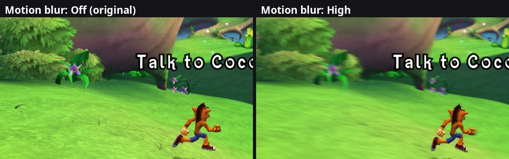

# 34. Motion blur (the port's own) and the effect settings

2026-10-11. The Options screen got a **Graphics** tab with two rows:

* **Motion Blur**: Off (the original), Low, Medium, High. A new effect: the
  Xbox 360 game has none (findings/21). Drawn by the native renderer only.
* **Depth of Field**: Off, Original, Strong. The game's own effect
  (findings/15) at three strengths, in **both** renderers.

Both are port settings (`motion_blur` 0-3, `depth_of_field` 0-2) in
`user/settings.toml`, the launcher's Settings tab and the Options screen,
and both change live.

*Wumpa Island, Crash running to the right at 60 fps, the same scripted run
twice (a 1:1 crop of each photo): motion blur off (left) and High (right).
The scenery smears along the camera's movement; Crash and the objective
text stay sharp.*

## 1. Does the game ask for motion blur?

findings/21 found an engine class `CMotionBlurRenderer` with on / off /
update / draw methods (vtable `0x82041AEC`: slot 8 `0x822BBA18` on, slot 9
`0x822BBA88` off, slot 10 `0x822BBAF8` per-frame update, slot 11
`0x822BBBF8` draw) and empty backend functions. The plan was to follow the
game's own requests. A temporary log on all four methods during play
logged **nothing**, and the reason is one level up: the class's factory
(`0x822BB8F8`, which allocates 32 bytes and runs the constructor
`0x822BB960`) has **no caller at all**. No direct call, and its address
appears nowhere in the image except the exception tables (`.pdata`, which
list every function). So the 360 build never even creates the object.
There are no designer requests to follow: the strength and the moments are
ours to choose.

## 2. How the port draws it

### Where

The game's depth of field pass (findings/15) is the anchor: it runs **every
frame** (all 66 traced frames have it, menus included, where its radius is a
hundredth of a pixel), right after the 3D scene and before the HUD, and it
already reads the two things motion blur needs: a copy of the picture and
the scene's depth. So motion blur is a second step in our `shaders/dof.frag`.
The HUD, menus and texts are drawn after it and stay sharp by themselves.

### Which way did each pixel move?

A pixel's movement on screen since the last frame comes from the camera
(the scenery stands still; the camera moves past it). For that we need the
camera's **view-projection** matrix, this frame's and last frame's. The
game never hands it over on its own, but every 3D draw passes its vertex
shader two matrices: the model-view-projection (VS c4-c7) and the model's
world matrix (VS c12-c15, "matWorld" in the shaders' debug files). Undoing
the world matrix gives the camera:

    view-projection = MVP x inverse(world)

A temporary log (2026-10-11, Wumpa Island and Crash's house) showed every
3D draw of a frame giving the **same** matrix this way: the ground, props
with their own position and scale, lit objects. One exception: the water's
planar reflection is drawn earlier with a mirrored camera of its own. So
`native/camera_motion.cpp` collects the distinct matrices per frame (two:
about 336 draws use the main camera) and takes the one most draws share.
Pixel-shader constant c128 holds the camera's position, which agreed.

In the shader, for each pixel:

1. Its depth turns it back into a world position, which last frame's camera
   puts somewhere else on the screen: `reproject = last VP x inverse(this
   VP)` applied to the pixel's clip position. (The game's depth is stored
   flipped by its viewport: clip z = 1 - stored depth, findings/10.)
2. The smear = that movement x the **shutter**, at most 48 pixels.
3. Up to 16 samples along the smear, centred on the pixel, each one the
   depth of field result at that spot, averaged.

### The shutter: the same smear at any frame rate

At 60 fps the camera moves half as far per frame as at 30. The shutter is
a share of 1/30 s (one frame of the original): Low 0.35, Medium 0.7, High
1.0, divided by the real length of the frame (measured between depth of
field passes, smoothed). Measured on Wumpa Island, running right: at 60 fps
the scenery moved 0.022 screen widths (in clip units) per frame and the
shutter scale was 2.0; at 30 fps 0.048 per frame and 1.0. The same smear.

### The players stay sharp

The camera's movement says nothing about things that move themselves, and
the camera follows the player: Crash barely moves on screen, while the
maths treats him like the scenery and smeared him. Each player's body (the
titan they ride, else their Crash; position from the actor's world matrix,
as the co-op camera reads it) gets a **capsule** (a vertical line with a
radius): Crash 0.5 to 1.3 units above the feet, radius 0.75; a titan 1.4 to
3.6, radius 2.2. A pixel whose world position is inside (fully within 3/4
of the radius, fading out to the radius) keeps the plain result, and samples
landing on a player are left out of the smear around them (else Crash would
ghost into the background). A first try with a ball of radius 1 around
Crash's middle still smeared his ears; the capsule doesn't. Other moving
characters (enemies) get only the camera's part of the blur.

### Camera cuts

A cutscene's change of shot, a respawn or a teleport moves the camera in
one frame by more than any real pan. If five test points (centre and
corners, at about 10 units and at the far plane) move more than 0.3 screen
widths in one frame, that frame gets no blur. Tested with the debug
console's `goto` (a 30-unit teleport): caught, one frame skipped. Loading
hitches (a frame over 0.2 s) and pauses (the camera stands still) give no
blur either.

### What it costs

Native Only, 60 fps, Crash running back and forth on Wumpa Island: GPU busy
17-18 % without, 23 % with High (same clock). The pass draws exactly the
game's depth of field when motion blur is off or nothing moves.

## 3. Depth of field strength

`FramebufferFxExt::v30` (`0x82440A50`) receives the depth of field settings
from the game every frame, MaxRadius (the farthest blur, in pixels) as a
pair of floats packed into the **64-bit register r7** (the function stores
it with a single `std` at `xnDOFShader +108`, the first float in the high
half). `effects/post_effects.cpp` scales that pair on the way in (pddi
handler): Off = 0 (the pass still runs, every sample lands on its own pixel,
the picture stays sharp), Original = as is, Strong = twice. Because the game
itself hands its renderer the new radius, the emulated picture follows too.
Measured on Wumpa Island (sharpness of the distance, the mean Laplacian of
the top of the screen; higher = sharper):

| Depth of Field | Emulated | Native |
|---|---|---|
| Off | 9.86 | 9.77 |
| Original | 7.30 | 7.27 |
| Strong | 6.50 | 6.48 |

## 4. Files

* `src/native/camera_motion.*`: the camera vote, last frame's camera, the
  shutter, the cut test, the players' capsules.
* `src/native/recorder.cpp`: each 3D draw's world matrix, the vote, the
  motion blur fields of the depth of field block (`DofParams`, `frame.h`).
* `src/native/shaders/dof.frag`, `dof_params.glsl`: the blur.
* `src/effects/post_effects.*`: the two settings, the depth of field
  handler.
* `src/options/options_settings.cpp`: the Graphics tab.

## 5. Ideas for later

* Per-object motion: moving characters' own movement (the lit simple
  material's vertex shader already computes a velocity from last frame's
  matrices, findings/11 s.3, but CPU-skinned characters would need last
  frame's vertices).
* The capsule sizes are guesses checked on Crash and a Ratcicle; other
  titans may want their own.
