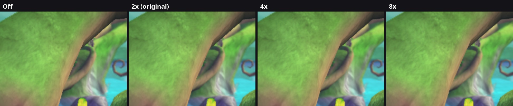

# 35. Anti-aliasing as a setting, and greyed-out options

2026-10-11. The Options screen's Graphics tab got an **Anti-aliasing** row:
Off, 2x (original), 4x, 8x. Rows that only the native renderer can draw
(Anti-aliasing, Motion Blur) are now **greyed out** while the emulated
picture is shown.

*Wumpa Island, the edge of the big tree's trunk, the same spot in four
runs, enlarged 2x without smoothing. Off shows the stair steps of the
pixels; 2x is the Xbox 360's own; 4x and 8x smooth the edge further.*

## 1. What the game does

The Xbox 360 draws the 3D scene into **2x MSAA** surfaces (findings/16):
every pixel keeps two samples of coverage and depth along polygon edges,
and the resolve averages them. The post-processing surface and the menus
are 1x (their pictures are already smooth). The native renderer gives each
surface the sample count the game made it with (`RenderTargets::SamplesFor`,
from the surface's `RB_SURFACE_INFO` bits).

## 2. The setting

`anti_aliasing` (0 off, 1 original, 2 = 4x, 3 = 8x) changes the count of the
surfaces the game multisamples, and only those:

* **Live.** `EnsureSurface` already re-creates a surface's image when its
  wanted sample count changes, so the next frame draws at the new count
  (that one frame starts from a cleared surface; the game redraws it all
  anyway). Render passes exist per count (1, 2, 4, 8); pipelines are keyed
  by count (`PipelineKey::samples`).
* **Resolves stay right at any count.** Colour resolves average all samples
  (`vkCmdResolveImage`), as D3D does; depth resolves take one sample with
  the depth copy shader: at 2x and 4x the Vulkan sample matching the Xbox's
  sample 0, at 8x (which the Xbox doesn't have) Vulkan's sample 0.
* **Only what the GPU can do.** The renderer logs the largest count its
  surfaces support ("MSAA up to 8x on this GPU": colour, depth and stencil
  drawn, and depth and stencil sampled); the row offers values up to that,
  and a count the GPU can't do steps down.
* **Native renderer only.** The emulated GPU imitates the Xbox's EDRAM at
  the game's own 2x; changing that would mean changing the game's surfaces.

## 3. Off was heavier than 2x: the 1x depth copies

The first measurement (native, 60 fps, Crash running back and forth on
Wumpa Island, GPU busy at the same clock) was odd: Off 28-30 %, 2x 18-19 %.
A temporary switch that skipped the 1x depth copies brought Off to 19 %:
the cause was the **copy route** for 1x depth surfaces. A multisampled depth
surface is copied by a small shader (`depth_copy.frag`: Vulkan can't copy
a multisampled image into a buffer), while a 1x one went through the GPU's
copy engine: image -> staging buffer -> image, once for the depth and once
for the stencil, every step waiting for the one before (buffer barriers).
With anti-aliasing Off, the main depth surface's every resolve took that
slow route.

Now 1x depth surfaces use the shader too (`depth_copy_single.frag`: the same
copy with `sampler2D` instead of `sampler2DMS`; the depth surface images
carry the sampled usage, and get their per-aspect views and descriptor set
like the multisampled ones). The copy engine route stays as a fallback for
a GPU without the shader. Same values (texelFetch of the stored numbers):
an Off photo before and after differs by 0.03/255 on average, only where
things moved between the runs.

| Anti-aliasing | GPU busy (running, 60 fps, 1155 MHz) |
|---|---|
| Off | 18 % (was 28-30 %) |
| 2x (original) | 18 % |
| 4x | 20 % |
| 8x | 26 % |

Sharpness of the whole frame (mean Laplacian; lower = smoother edges):
Off 6.73, 2x 6.39, 4x 6.25, 8x 6.20.

## 4. Greyed-out rows

A row can now say it can't be used right now (`Row::unavailable`, a reason;
`options_settings.cpp NeedsNative` for the native-only effects: the main
window shows the emulated picture). Such a row:

* is drawn **see-through**: its name and value get alpha 0x60 through the
  menu library's alpha setter `sub_82370860` (element, alpha), which writes
  only the top byte of the element's colour at +80 (next to the colour
  setter `sub_82370840`). The menu recolours its items when the selection
  moves, so the alpha is applied again every frame; the selected row keeps
  its yellow, faded;
* **can't change**: left / right / A do nothing (no sound);
* shows the **reason** as the card's warning line: "Needs the port's
  renderer: set Renderer to Native on the Display tab." (The game's font
  has no ">": a first wording with arrows printed as dashes.)

Switching Renderer to Native on the Display tab and coming back makes them
solid again (the tab switch refreshes every row).

## 5. Files

* `src/native/render_targets.*`: `SamplesFor` (the setting), 8x passes and
  scratch depth, `MaxSurfaceSamples()`, the 1x depth copy by shader.
* `src/native/shaders/depth_copy_single.frag`.
* `src/effects/post_effects.cpp`: the `anti_aliasing` flag.
* `src/options/options_settings.*`, `options_menu.cpp`: the row,
  `Row::unavailable`, the greying. `src/ui/scrooby.*`: `SetAlpha`.

## 5b. Smooth leaves (alpha to coverage)

MSAA smooths polygon edges, not the edges an alpha test cuts inside a texture
(bushes, leaves, fences: `atest 1 4 0.5` in the photo draw lists = "keep if
alpha > 0.5", Xbox compare function 4). The Options row Smooth Leaves
(`smooth_cutouts`, off = the original, native only, greyed otherwise) makes
those draws, when they're opaque simple / lit-simple draws on a multisampled
surface, use alpha to coverage: the pipeline gets `alphaToCoverageEnable` and
the fragment shader a specialization constant (`kAlphaToCoverage`, simple.frag
and lit.frag) that replaces the discard by a one-pixel soft edge
`clamp((a - ref) / fwidth(a) + 0.5)` whose alpha the GPU turns into samples.
It's part of the pipeline key (`alpha_to_coverage`), so switching it live just
builds the other pipelines. At 2x there are only three coverage levels, so
the gain grows with 4x / 8x. `docs/images/smooth-leaves-off-on.jpg`: the same
frozen frame, off / on, 4x zoom.

## 6. Ideas for later

* (DONE 2026-10-22, below) Alpha-tested leaves and fences.
* A post-process smoothing (FXAA / SMAA) for the 1x passes or weaker GPUs.
