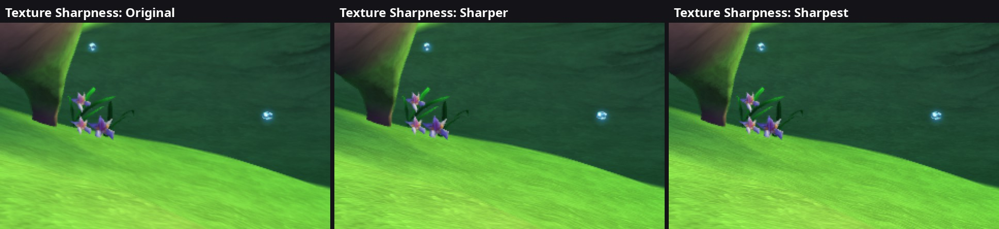

# 36. Texture sharpness: the game already uses 16x anisotropic filtering

2026-10-11. The planned setting was "anisotropic filtering" (textures that
stay sharp on ground seen at a shallow angle). A census of the game's own
samplers showed there's nothing to raise: the game already asks for the
maximum. The Options screen's Graphics tab got a **Texture Sharpness** row
instead (Original, Sharper, Sharpest), native renderer only.

*Wumpa Island, a grassy slope in the middle distance, the same spot in three
runs, enlarged 2x without smoothing. The grass grain gets crisper with each
step.*

## 1. What the game's samplers ask for

Each texture fetch constant carries its filtering (findings/17; word 3 bits
25-27 = the anisotropy, 1-5 = at most 1, 2, 4, 8, 16 samples). A temporary
counter in the recorder sorted every textured, depth-tested draw by its
diffuse texture's sampler, over 300 gameplay frames (the Ratcicle Kingdom
and Wumpa Island):

| Sampler | Draws per frame |
|---|---|
| 16x anisotropic, trilinear | ~118 |
| palettized (8-bit, filtered by hand in the shaders, no mip levels) | ~33 |
| "base map" (one level only) | ~17 |
| anything else (no anisotropy, or fewer samples) | 0 |

So every mipmapped world texture already gets 16x anisotropic filtering, the
most Vulkan GPUs offer, and the native renderer already passes it on
(`NativeRenderer::GetSampler`). The rest have no mip levels at all, so
anisotropy wouldn't change them.

## 2. The step that's left: the mip level

What still softens a distant texture is the **mip level** the GPU picks: a
smaller, pre-blurred copy of the texture, chosen so one screen pixel covers
about one texel (findings/17). A negative **level bias** picks a more
detailed level than that: crisper, at the price of some shimmer (more texels
per pixel than one sample can show, which flickers as the camera moves).

`texture_sharpness` (0 original, 1 sharper, 2 sharpest) adds a bias of 0,
-0.5 or -1 level to every filtered, mipmapped sampler (on top of the game's
own bias, in the fetch constant's units of 1/32 level), in
`NativeRenderer::GetSampler`; samplers are cached by their state, so a change
makes new ones at the next draw. Palettized textures, the depth copies
(read one texel at a time) and one-level textures are left alone. The
emulated picture keeps the Xbox's filtering, so the row is greyed out while
it's shown (findings/35 s.4).

Measured on the same Wumpa Island frame (mean Laplacian, higher = more fine
detail; the HUD is the same in all three):

| Texture Sharpness | Whole frame | Distance (top third) | Mean difference from Original |
|---|---|---|---|
| Original | 6.39 | 4.28 | 0 |
| Sharper | 6.99 | 4.69 | 0.38/255 |
| Sharpest | 7.34 | 5.12 | 0.55/255 |

The shimmer while moving hasn't been measured (a single photo can't show
it); "Sharpest" says so in its description.

## 3. Files

* `src/native/native_renderer.cpp`: the `texture_sharpness` flag and the
  bias in `GetSampler`.
* `src/options/options_settings.cpp`: the row; `launcher/settings_page.cpp`:
  the "native renderer only" note.
