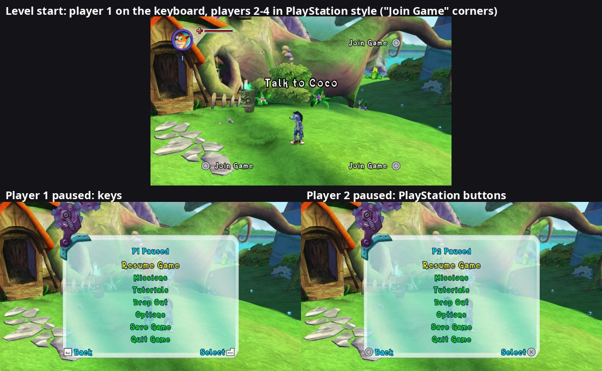
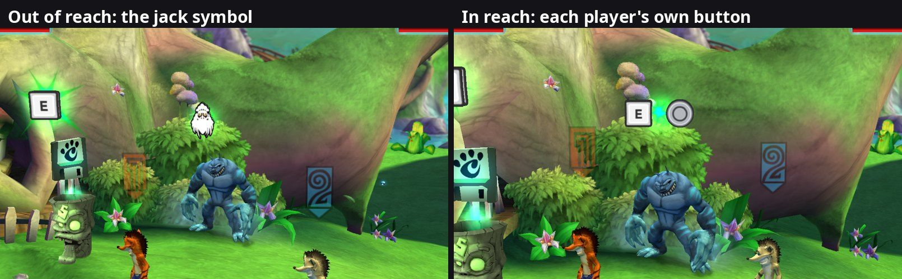

# 37. Keyboard and mouse pictures in the game's button prompts

2026-10-11. Roadmap phase 2: the prompts follow the device in use.

Short version: the game draws its button prompts ("Jump ±", "Press ² to
Jack") with font glyphs whose "page" is a whole picture of a 360 button
([findings/23](23-keyboard-and-mouse.md) s.1.2). Those pictures are ordinary
8-bit palettized textures in the game's memory, so the port redraws them in
place: while the keyboard or mouse was used last, every prompt shows the key
bound to that move (Xelu's free key pictures, public domain), and the 360
buttons come back as soon as a controller is used. Nothing in the game's
texts or layouts changes, so every screen, both renderers and F10 photos show
the keys. One clash needed a data patch: on a controller A both jumps and
confirms, on a keyboard those are two keys, and a menu's prompt bar and the
tutorial text above it use the same character. Two new glyphs for the menus'
own A and B solve it.

## 1. Where the prompt pictures live

The fonts are Pure3D `TextureFont`s (`Titans_Large`, `Titans_Small`) in
`package\b4c85fe7.p3d`. Each has 13 picture glyphs: U+00A5 (right stick),
U+00B1-U+00BE (A, B, X, Y, Back, Start, RT, RB, left stick, the menus' red
arrows, "rotate", LT, LB). Their pages are 64 x 64 (buttons), 128 x 128 (the
sticks: the glyph shows the top 3/4, v from 0.25) and 128 x 64 (rotate).

In memory (read with a temporary hook on the loader, then checked page by
page):

* Pure3D's `TextureFontLoader::LoadObject` = `sub_823C5DA0` (vtable
  0x8200E420, slot 5). It builds the font and stores it through its **r4**
  argument (its return value is something else: the first probe read r3 and
  found no font).
* `TextureFont` (vtable 0x8200E394): +60 page count, +64 the array of
  `pure3d::Texture*`, +72 glyph count, +76 the glyphs (40 bytes each), +84 a
  sorted array of their characters (binary search, `0x823C6764`).
* `pure3d::Texture` +24 = its `pddiTexture` (`xnTexture`, the renderer's
  texture; native/guest.h): +20 the D3D texture, +24 a ring of 16 palette
  textures, +88 the one in use, +276 = 1 for 8-bit palettized.
* Every prompt page: fetch constant format `k_8`, **linear** (not tiled),
  rows of 256 bytes (pitch 8 x 32 texels), no byte swap; the palette is a
  256 x 1 `k_8_8_8_8` texture, linear, 8-in-32 byte order. The pixels are the
  disc's TGA indices unchanged, rows top to bottom.

## 2. Redrawing a page

`src/input/prompt_icons.cpp`:

1. **Check first.** For each loaded font, every prompt page is compared with
   the same page read from the player's disc data: format, size, every index
   byte (either row order) and the palette (where each of B, G, R, A sits in
   the guest's 4 bytes is worked out from the match, so the byte order isn't
   assumed). A page that doesn't match is left alone and logged. The original
   bytes are kept.
2. **Draw** the picture at the page's size: one key (Xelu's 100 px picture,
   6 px of empty border cut, scaled by area averaging), four keys in the WASD
   shape for a stick, the Spin key plus a circling arrow for "rotate". Keys
   the set has no picture of get the blank key with the key's name written in
   the game's own font.
3. **256 colours**: median cut (255 boxes split at the pixel-weighted median
   of the widest channel, entry 0 transparent).
4. **Write** indices and palette in place, after telling the SDK's memory
   watchers (`TriggerPhysicalMemoryCallbacks`), as the game's own writes do:
   the emulated GPU's texture cache and the native renderer's write watch
   both see the change.

Pictures are cached by content and size; a page is rewritten only when what
it should show changes. The check runs once per frame at the frame's end
(main thread): which device was used last, and the bindings' revision.

**Which device**: the keyboard driver remembers when a key, mouse button or
wheel notch last went down. The XInputGetState wrapper (the one place the
game reads pads) looks at every state the game gets: whatever the keyboard
didn't add to it (buttons it didn't press, triggers, sticks well past the
dead zone while the keyboard leaves them alone) is a controller. The later of
the two wins. `--button_prompts` = 1 / 2 forces keys / buttons.

| Glyph | Picture (first key of the action) |
|---|---|
| ± A | Jump |
| ² B | Jack / use (save totems too) |
| ³ X / ´ Y | Light / heavy attack |
| µ Back / ¶ Start | Map / Pause |
| · RT / ¸ RB | Block / Pocket |
| ½ LT / ¾ LB | Titan special / Left bumper |
| ¹ left stick | the four Move keys |
| ¥ right stick | the four Right stick keys |
| ¼ rotate | a circling arrow (spins are written "¹¼": WASD + arrow = "circle"); see s.5 |
| U+E0B1 / U+E0B2 (ours) | Menu: confirm / Menu: back |

An action without a key keeps the 360 picture.

## 3. Menus: two more glyphs

First version: ± showed Menu confirm's key (Enter) while a menu was up and
Jump's (Space) in play. Pause -> Tutorials showed the problem: the prompt
bar's "Back ²" and the tutorial's "Press ² to Jack" are on screen together,
and the tutorial then claimed Backspace jacks.

Fix: a data patch of `package\b4c85fe7.p3d` (data/data_patcher.h) adds two
glyphs to both fonts, U+E0B1 and U+E0B2 (Unicode's private use area: no game
text contains them), with pages of their own:

* the A and B pictures' texture chunks (0x19000) copied and renamed after the
  next page numbers, inserted after the last page (the loader numbers pages
  in file order);
* the font's page count (the last u32 of its own data) + 2;
* two glyph records (chunk 0x22001: u32 count, 40-byte records) copied from
  ± and ², page and character changed, **in character order**: the table ends
  with U+FFFF and is binary-searched; appended after U+FFFF, the new glyphs
  were never found and drew nothing;
* the same two characters in chunk 0x22006 (a list of the picture glyphs:
  u32 character + u32 value each), also in order.

The menus' prompt bar is the page `FE_Buttons` (loaded in the front end and
in levels), whose button texts (`LowerLeftButton`, `LowerRightButton`,
`UpperLeftButton`, `UpperRightButton`) hold only the glyph. Every front-end
update (`sub_82261C40`), their ± and ² become the new characters. So the bar
shows Enter and Backspace, the texts Space and E; on a controller all four
are the 360's A and B again.

> Later the same day ([findings/38](38-keyboard-mouse-real-keybinds.md)): the
> menus got keys of their own, and the patch adds six menu glyphs (A, B, X,
> Y, LB, RB: U+E0B1 E0B2 E0B3 E0B4 E0BE E0B8), also used by the port's own
> Options screen.

## 4. Styles, Automatic, and key pictures anywhere (2026-10-15)

**Styles.** Options -> Controls has **Keyboard Icons** (Light / Dark,
`--keyboard_icons`) and **Controller Icons** (Automatic / Xbox 360 / Xbox
Series / PlayStation 5 / PlayStation 4 / Switch, `--controller_icons`). The
controller sets are Xelu's too (assets/prompts/README.md). They go into the
same pages the keys do: while a controller is the device in use and a style
other than the game's own is chosen, every button page gets that set's
picture of the same 360 button, BY POSITION (the 360's A is the bottom
button: Cross on a PlayStation, B on a Switch; Back = View / Share / Minus,
Start = Menu / Options / Plus). The "rotate" arrow keeps the game's own
picture. A page's description says which set ("L key 32", "D key 32",
"P 1 0" = PlayStation 5's bottom button), so a change of set redraws it.

**Automatic** reads the controller's maker and model from its SDL GUID (the
players' device key `pad:<32 hex digits>`: bytes 4-5 = USB vendor, 8-9 =
product, little-endian): Sony 054C with a DualSense (0CE6, Edge 0DF2) =
PlayStation 5, other Sony pads = PlayStation 4; Nintendo 057E = Switch;
Microsoft 045E = Xbox Series, except the 360 pads (028E, 028F, 0719) = the
game's own; any other maker (generic and third-party pads) = the game's own
360 look. The controller is the first one answering on the socket a
controller was used on last (`PlayerAssignment::PadKeyFor`).

**Key slots.** The font patch (section 3) adds 16 more glyphs, U+E100 to
U+E10F, each with its own page (copies of the A picture). `KeyGlyph(key)`
lends one to any key (the least recently asked slot is reused) and the next
frame paints that key into its page, in the chosen key set, whatever the
device in use. The Options screen's key rows write their keys this way, so
they show as pictures in the game's own text (the card keeps the names).
A slot can also hold a CONTROLLER button (`ButtonGlyph("A")`, by its 360
name): drawn in the Controller Icons style whatever the device in use, so the
Options key rows' card says "Controller: [Cross]" with a PlayStation 5 set;
with Automatic before any controller was used, or Xbox 360, it is the game's
own picture of that button, copied from the disc's font page (a stick's
picture is the top three quarters of its page, fitted with its shape kept).
**Card slots (2026-10-15).** Inside the Options cards' small print (drawn at
0.72 x) an A-sized picture, and the game's own left stick most of all, were
too small to make out (a stick squeezed into the A's 49-pixel circle). Six
more slots, U+E114 to U+E119, are copies of the A picture's page (64 x 64,
on the text line like a letter), and their picture fills the page's whole
width and up to 54 rows, centred on the A's circle: a stick 64 wide, a
button 54 across, a little larger than the game's own. (A first version
copied the left stick's 128 x 96 page and filled 80 rows: twice too big in
a playtest, and it hung below the line.) `KeyGlyph(key, SlotSize::kCard)` /
`ButtonGlyph(name, SlotSize::kCard)` lend them; every card text that names a
key or a button now shows it this way ("Controller: [stick] up", "Hold [LB]
or [Q]...", "[Esc] or [B]: cancel", the Controller Icons card shows A B X Y
in the chosen style). The other two sizes: `kText` (the 16 A-sized slots of
the rows) and `kBig` (the 4 stick-sized spin-row slots, section 5).

**Measuring them.** The port measures text with the game's fonts as it reads
them from the disc (ui/game_font.h). The button pictures' glyphs used to be
skipped there entirely, so a picture counted as 0 wide and lines with
pictures ran out of the card. A photo showed the game draws a picture at
its record's size, like a letter (the left stick's record = 128 font pixels
wide, about four letters of Titans_Small): the reader now keeps every
picture's advance, and the port's added glyphs measure like the picture they
copy (the left stick's for the big slots, the A's for all the others).

**The B floating in the world** (over a save totem, a stunned titan, things
to use) isn't a font glyph: it's a texture of its own,
`FE_360_b_button_64.tga` in package `bca1bc0b.p3d` (64 x 64, 8-bit
palettized, no mipmaps), drawn as a billboard with a green glow behind it.
Pure3D's TextureLoader (vtable 0x8200D710, slot 5 = LoadObject
`sub_823AFB00`, the texture through r4 like the font loader's) is wrapped:
every texture it builds is looked at once at the frame end; a 64 x 64
palettized one whose pixels are the disc's B (read from the package) becomes
one more prompt page, standing for the B button / Jack. So it shows the Jack
key (E by default) on the keyboard, the chosen controller set's B position
(Circle, A on a Switch...) on a controller, and the game's own B otherwise.
A page that isn't part of a font counts as gone when the texture object's
vtable changes. **The game draws this texture upside down**: a B looks the
same either way up, so it never showed, but an "A" written the disc's way
came out as "∀"; the pictures go into it the other way up. Its palette has
identical blue and green columns (a red ball), so the byte order check can't
tell those two apart: the font pages' order is used.

**The button's material and shape.** The B is drawn on a mesh,
`evil_circle_geoShape`: a 12-sided coin (radius 0.36, 0.27 thick, the front a
shallow dome) whose texture coordinates are a flat projection (u = 0.5 +
1.261 x, v = 0.5 - 1.261 y), so on screen it is a 12-sided window onto the
64 x 64 picture. Its material, `HUD_button_circle_m` (chunk 0x11000 in the
same package), is opaque with alpha test off (`ATST 0`): every pixel inside
the window is solid, a "see-through" one is drawn as its colour, black. The
red ball's dark rim on screen is exactly that. (With the B's picture emptied
a black 12-gon remained; filled with magenta, a magenta 12-gon.) So any
picture there was masked to that 12-sided shape with dark corners.

A data patch of the package (a "joined_assets" package: type 9 in
`levels/GlobalPackages.p3d`, so path category 10, not the menus' 6) makes a
key a whole square key while the game's own B stays exactly as it was:

* the material's alpha test on (`ATST 1`; compare `ACMP 4` = greater,
  threshold `ACTH 0.5`), so see-through pixels are left out;
* the coin's faces SQUARE: each rim corner moved out to the square (those at
  0 / 90 / 180 / 270 degrees to the edge middles, the pairs at 30 / 60
  degrees etc. both to their quadrant's corner), texture coordinates by the
  same projection (read from the mesh itself);
* the 12-sided window BAKED into the game's B picture: every palette colour
  opaque (as the material drew them), and the pixels outside the window
  given an unused palette entry made fully transparent. On the square coin
  the game's B shows the same 12-sided disc with its dark rim as before.

A key is drawn over the whole square face (0.046 to 0.954 of the picture);
its own transparent corners are left out. Controller buttons are round with
transparent corners: they look as on the 12-sided coin. (Tried first, each
leaving a dark silhouette or a circle: a dark badge, cutting the glow's
middle out, a key covering the box, spreading the key's edge, a round button
in the key's colour, a key shrunk to fit inside the 12-gon.)

**The size of a picture.** The game's own pictures don't fill their pages:
the 360 face buttons cover 49 of 64 pixels (7-55), the sticks 93 x 72 of
their 128 x 128 page, the world's B nearly all of its 64. The first version
drew every replacement over the whole page, about 11% bigger than the
button it replaced (playtest). Now each page's original drawn part is
measured from the disc's page (the box of its opaque pixels), every
replacement is cut to its own drawn part and fitted into that box with its
shape kept: drawn part over drawn part, the same size as the original.

## 5. The rotate picture and the spin rows (2026-10-15)

The keyboard's Spin key spins only with Simple Spinning on
([findings/40](40-gameplay-options.md) s.4.1), so the "rotate" picture no
longer shows it: "¹¼" = WASD + Xelu's circling arrow, read as "circle".

* **No gap.** The rotate page is 128 x 64 (the game's own arrow is that
  wide). A round arrow centred in it left half a page of empty space next
  to it. While keys are shown, the font's record for "¼" is made a square
  (width and advance halved), and the keys' page holds the arrow stretched
  twice as wide, which that square squeezes back round. A picture glyph is
  drawn as its whole page into its width: the texture's u range in the
  record is ignored (halving it changed nothing). With a controller the
  record gets its numbers back. The loaded font keeps the file's records
  (40 bytes: +28 width, +32 advance, +36 the character as a u16 in the
  word's top half) 20 bytes after TextureFont +76's pointer, in the order of
  the sorted character list at +84 (+72 = how many).
* **A second row.** The Tutorials pages (`InGame_Tutorial.pag`, rows
  `Text0`-`Text3`), the hints in play (`InGame.pag` `HintMessage`) and the prompt
  beside the HUD (`InGame_Announcement.pag` `AnnouncementText`, placed under
  the mojo count at run time: dig spots and the like) get
  their strings straight from the text bank (they don't pass through the
  text element's SetString `sub_82373360`: a logging wrapper saw none). So
  every front-end frame those texts are read; one with "¹¼" in it, while
  Simple Spinning is on, gets a second line where "¹¼" becomes the Spin key
  (keys shown) or LB (a controller), after "OR": "WASD ⟳ , LMB, LMB, LMB . . ."
  over "OR Q , LMB, LMB, LMB . . .". With Keep Spinning on, the Old Skool line
  becomes "OR Hold Q"; a text with words gets "Or press Q". Off = the game's
  text.
* **Big key slots.** The 16 key slots of the font patch (s.4) are copies of
  the A picture: a Q or LB drawn there looked small under the stick
  picture. The patch adds 4 more, U+E110..E113, copied from the LEFT STICK's
  128 x 128 page: a key drawn there is fitted into 65 % of the stick's height
  (100 % was too big, the A-sized slot too small). The font patch narrows
  these records to 65 % of the stick's width and advance (no empty space
  after the key), and the key is drawn stretched across the page so that
  squeeze gives it its shape back (the rotate arrow's trick). The spin rows
  use those (`KeyGlyph` / `ButtonGlyph` with `big`); the sentence form keeps
  a text-sized one.

Tested on the Tutorials pages (Old Skool, Gyro Jackhammer, Spin Dismount):
keys and controller, Simple Spinning on / off, Keep Spinning on. A dig spot
on Wumpa Island (reached with the console's `goto`): which text held "¹¼" was
found by reading the candidates there (the co-op pages' `Button` and
`CounterButtonPlayerN` didn't; `AnnouncementText` did, shown); then WASD +
arrow over the Spin key with keys, stick + arrow over LB with a controller.

## 6. Each player's own pictures (2026-10-17)

With players on different devices, the prompt pictures used to follow
whoever pressed something last: one shared set of pages, repainted for
everyone. Player 2 pressing a button on a PlayStation pad turned player 1's
keyboard prompts into PlayStation buttons and back again, many times a
minute.

**Who owns a picture now.** Each player has a LOOK: keys (their keyboard,
when it plays as them and was used after their controller) or their
controller's buttons, in the Controller Icons style (Automatic = the maker
and model of THEIR controller). The game's own glyphs follow player 1's look
only, and every text that isn't anyone's in particular (hints, the message
bar, tutorials in play) keeps them. Outside play every
device answers as player 1 (input/players.h), so the title and main menus
follow whichever device was used last, as before.

**Texts that belong to one player** get that player's pictures:

| text | page / element | owner |
|---|---|---|
| "Join Game" corner + its button, the countdown | `InGame_CoOp_Player1`-`4`: `Message`, `Button` | that corner's player |
| counter prompt beside the HUD (the Y) | `InGame.pag`: `CounterButtonPlayer1`-`4` | that player |
| menu prompt bar ("Back", "Select"...) | `FE_Buttons`: the four `*Button` texts | the menu's owner (who paused, who used the totem: findings/26 s.21) |
| Tutorials pages opened from a pause menu | `InGame_Tutorial`: `Text0`-`3` | the menu's owner |

The corners' button is set again by the HUD every frame while the corners
show "Join Game" (the first ~10 s of a level): the HUD update `sub_8226A998`
-> `sub_82269480` writes the text bank's string after the front end's update
(found with the console's `who` on the text's string word +156). The texts
are therefore rewritten after the HUD update too (the port's wrapper of
`sub_8226A998`), not only in the front-end update.

**Player slots.** A text of player 2-4 gets PLAYER SLOTS instead of the
game's characters: ten more glyphs in the small font (U+E120-E129, copies of
the A page) whose pictures are lent out per look and glyph. Two players
with the same look share a slot (two PlayStation pads: one Circle), and a
player whose look is player 1's needs none (the game's own glyph already
shows the right picture). The least recently asked slot is lent out next;
the owned texts are rewritten every frame, so a slot that changes picture is
noticed at once.

**64 pages.** A first version gave players 2-4 a full copy of all 19 prompt
glyphs each (57 more pages per font). Player 2's B drew, but player 3's, 4's
and player 2's menu buttons drew nothing. The font's draw keeps per-page
tables in fixed globals of 64 entries (0x8257E6E0 glyph counts, 0x8257E7E0,
0x8257F0E0, 0x8257F1E0 vertex lists, 256 bytes apart; batching at
0x823C4324, draw `sub_823C4FA0`), and it clears and fills them for every
page of the font, so pages past 64 are lost AND overwrite the next table.
The large font was already 4 pages over with the key slots added in section
4 (36 disc pages + 32 ours). Now:

| font | disc | menu glyphs | key slots | player slots | total |
|---|---|---|---|---|---|
| Titans_Small | 22 | 6 | 26 (16 text, 4 big, 6 card) | 10 | 64 |
| Titans_Large | 36 | 6 | 20 (no card slots: the Options cards use the small font) | none | 62 |

The font patch refuses to go past 64.

A slot whose look has no picture of its own (a 360 pad, or Automatic with a
360 or unknown pad = the game's own 360 buttons) is drawn with the game's
360 picture of THAT button, from the disc's font page (the key slots' "O"
pictures). Playtest: a first version left such a slot as it was, a copy of
the A page, so a 360-style player 4 saw "A Back / A Select".

**The floating B.** The B over a save totem, a stunned titan or something
to use is one texture (`FE_360_b_button_64.tga`, section 4) shared by every
such icon. Each icon belongs to a player: the icons are `CIconBehaviour`
(vtable 0x8203248C: +28 its object, +32 its own world matrix, +116 its
drawable, +120 shown), switched on and off by `sub_82179130(icon, show)`;
when one turns on, the playing player nearest to its object (their Crash or
the titan they ride) owns it.

Each icon is DRAWN with its owner's copy of the B (2026-10-22). The data patch
of the package adds four copies of the texture (`..._p1` to `_p4`); each is
painted in its player's look like the original. The coin is drawn by Pure3D's
render loop, not the character draws (the first try hooked those and never
matched), so the swap sits where every `xnSimpleShader` is set up
(`HairSetupDraw`, 0x82441EA8): the draw's WORLD matrix (VS c12-c15) is already
in the device when the set-up runs and equals the icon's own matrix at +32
exactly, so the nearest shown icon is the one being drawn; for that set-up
alone the shader's texture (+92) is its owner's copy, put back right after
(the shader holds a reference). Player 2 on a controller at a totem sees
their button while player 1 on the keyboard stands elsewhere. Both pictures
get it (the set-up is the game's; the swap only needs the recorder's note of
the mesh draw's context, which runs in every mode).

TWO ICONS AT ONCE (2026-10-23). With two players at two different things in
Crash's house (the chest and the tiki face), both coins showed ONE player's
picture (E on both, or the controller button on both). The log had one
"floating button ... players near" line per frame for two icons up: the
second coin's set-up never ran. `xnContext::DrawPrimBuffer` (0x82430878)
applies each pass of a material through 0x8243C0D0 / 0x8243C198, which
compare the material's key (+12) with the last one applied (global
0x824EE830); the same material again skips the shader binding and, for a
one-pass material, the set-up (vtable slot 14) too. Every coin uses the one
B material and the game draws them back to back, so the second coin kept the
first coin's texture (and, in the native picture, its coin group). Now the
recorder's DrawPrimBuffer handler sets that global to -1 (as the game's own
reset at 0x8243C250 does) before any draw of the B material
(`prompt_icons::IsCoinMaterial`: an `xnSimpleShader` whose texture is the B
or one of its four copies), so each coin is set up for its own icon. Cost:
one shader bind per coin.

SIDE BY SIDE (2026-10-22). When players with different looks stand at the
same icon (a keyboard player and a controller player at a totem), the icon
shows one coin per DIFFERENT look next to each other: the B and the key.
Players sharing a look (two Xbox Series pads) share one coin, and each coin's
texture is the copy of the B painted for the first player of that look.

Who counts (2026-10-22): only players the GAME would let use it. A totem or
other thing to use carries a `CInteractableBehaviour` (vtable 0x8202EA6C,
its object at +28 like every behaviour) that keeps its own list of the
bodies close enough: up to 4 entries of 8 bytes at +32 (the body, then a
countdown), the list's end at +64. `sub_82149C60` adds or refreshes a body
each time its interactor reports in (message 18 / 2), and the Update
(`sub_82149808`, wrapped to remember the interactables) counts down and
drops the ones that left. A player counts while their Crash (or the titan
they ride) is in that list. The first version took everyone within 12 units:
a player across the lawn still got a coin; at the Wumpa Island totem the
game's list holds a player within about 1.5-2 units. An icon with no
interactable (a stunned titan's B: the jack check is Crash's own) takes
players within the distance its owner stood at when the game showed it
(+15%). Nobody counted (the owner just left): the owner's coin alone. Each
change is logged ("floating button ...: players near [1 3], 2 coin(s)").

THE ARC (2026-10-22): three or four coins sit on the top of a circle,
neighbours 0.5 rad apart with the chord between them = the coin spacing,
the outer coins at the icon's own height and the middle ones higher (clip
y gets `s x row 3` like x, scaled by the screen's aspect so the arc stays
round). Two coins stay level. `WorldButtonSwap`
builds the group (`CoinGroup`) when the coin's material is set up and gives the
first coin's texture to the shader, which keeps it until the frame ends
(`WorldButtonRestore`: the native renderer reads the material's texture at the
draw). The native recorder (`CommitCoins`, recorder.cpp) then commits the
coin once per group member: the matrix's row 0 gets `s x row 3` (a clip-space
x shift of `s` in NDC, so the spacing holds at any distance: 1.15 x the coin's
width, centred on the icon; row 1 likewise for the arc) and the other coins' textures. The emulated picture
(not the native one) shows a single coin, the first look's.

Known limits: a stick drawn in a player slot is A-sized (the slots copy the
A page); the rotate arrow after it stays player 1's.

**The countdown under a player's picture (2026-10-23).** A dead player's
corner read "Please Wait" + a button picture instead of "Please Wait 5 .. 1".
The corner (`sub_82269480`, once per HUD display per frame) shows the
countdown by formatting the seconds into the display's own buffer (+8) and
pointing its Button text (+20) at it, but only while that text points at
nothing (`sub_823721D8` = the text's +152; 0x822696B0). In "Join Game" it
points the text back to 0 and sets the button from the text bank. The
player texts above give the Button a copy of its player's picture after
every HUD update, so when a countdown began the text still held that copy:
the number was never shown. Found with the console's `who` on +152 (writes:
the corner's reset at 0x822696F4 and the port's copy via `sub_82373360`).
Now `sub_82269480` is wrapped: before it runs, a Button holding the port's
own copy is pointed back to 0 (the copy freed, findings/30 s.9), the corner
decides as the original does, and the player texts then convert what it
chose (a number has no prompt characters and is left alone).

## 7. A titan's jack symbol, and who can jack it (2026-10-24)

A stunned titan's floating B means "this titan can be jacked": it appears
the moment the titan goes down, wherever the players are (once 72.8 units
from the nearest one). Section 6 gave every nearby player a coin, but a
titan keeps no interactable list, so "nearby" was a guess: within the
owner's distance when the B appeared, plus 15%. That covered a whole area,
and a player far away saw their button over a titan they could not jack.

**The game's own rule.** Found with the debug console (`who`, Ghidra, and
Crash's fight-tree script):

* A stunned titan **opens an opportunity** (`COpportunityBehaviour`, vtable
  `0x8202F904`; message 24: subtype 0 open `sub_82156128`, 1 close
  `sub_82156260`, 2 check `sub_82157058`) named after its fight tree:
  `StrongJackable`, `BearJackable`, `CaptainJackable`, `ProjectileJackable`,
  `BossJackable`, `JackableTurretJackableByCrash`.
* The open ones live in one table at `0x825A5418`: a binary tree (root = the
  word at the table, sentinel = table + 4; node +0 left, +4 right, +0x10 the
  name's hash `h * 31 + c`, +0x14 a list: entry +0 next, +8 the opportunity:
  +0xC the actor offering it, +0x10 the only actor it is for, 0 = anyone).
* On the Jack button, Crash's script (`fighttrees/Crashlua.blua`, the
  function at line 7306) checks each name with its own range: Boss 8.5,
  Captain 8.5, Bear 6.5, Strong 6.0, Projectile 6.0, turret 8.0. The check
  accepts an offer within that range across the ground (x, z) and up or
  down (|y|).

Measured before the script was read (one B press per fresh titan): a
Ratcicle jacks at 6.0, not at 6.5; Scorporilla still at 8. Three other
leads were dead ends: a reference count on Crash that happened to change
near 6 units, the counter-move opportunities (`CounterThroughLegs` is
checked at 6.25 every frame), and the trigger-volume messages.

**What the port shows.** For a floating B with no interactable list, the
coins now follow that rule (`JackReach` in `prompt_icons.cpp`): player p
gets their button while their Crash is on foot (co-op state 2, no titan)
and within range of an opportunity the titan offers. Nobody in reach = the
**jack symbol**, a fifth copy of the B texture (`_p5` in the package patch)
painted with `assets/icons/jack.png`: a silhouette of Aku Aku's mask
(the outline traced from a render of *Crash of the Titans*' mask model, its
eye sockets and eyes kept so it reads as a mask at button size), solid
YELLOW (255, 204, 24; the community's pick over the first white version)
with a dark outline and dark eye sockets and face marks. The file is 322 x
492 and the jack symbol's copy of the texture is 256 x 256 (`EnlargePage`:
the B's 64 x 64 picture enlarged 4 times, each pixel repeated 4 x 4, so
MakePage still recognises it as the disc's B; `kJackPageScale`): at 64 x 64
the mask's face lost its detail at the 1.7x size. It is drawn
1.7 times the size of a button (`kJackSymbolScale` -> `CoinGroup::scale`:
the native renderer scales the coin's own axes, recorder.cpp `CommitCoins`),
since the tall mask fills less of the coin's square face.

**One symbol, not two.** The coin is a thin 3D disc with a front and a back
face carrying the same picture. The game's B is opaque edge to edge, so its
back face is always hidden; the jack symbol is see-through around the mask,
and the back face's copy showed through it, a little offset (the disc's
thickness, seen at an angle). The native renderer now draws the jack
symbol's coin FLAT (`CoinGroup::flat`: the MVP's third column, the coin's
thickness axis, set to zero), so both faces land on the coin's centre plane:
the back face draws the very same pixels at the same depth and disappears
under the front. The game's coin data and the B itself are untouched; the
emulated picture keeps the plain coin (like the 1.7x size, this is native
only). So
from afar every player sees the same "can be jacked" symbol, and up close
the symbol turns into the buttons of the players who can jack it, side by
side as in section 6.

Tested with the debug console on Wumpa Island, a knocked-out Ratcicle from
the F5 spawn cheat: one player at 12 and 7 units = the symbol, at 5 = their
button; two players (keyboard + a fake PlayStation 5 controller) = only the
player in reach, both side by side, then only player 2. The log line
"floating button ...: players near [...]" says "(titan: jack symbol)" or
"(titan: in jacking reach)".

## 8. Tests

On a copy of the saves, with the debug console: both fonts found and checked
(15 pictures each, menu glyphs included); a fake controller's Start switched
the prompts to buttons, a key tap back to keys, again and again; the tutorial
pages (mouse buttons for the attacks, WASD + Q + arrow for the spins, E to
jack, R to pocket) in both pictures; the pause menu's bar with the menu
glyphs: Enter / Backspace in both pictures, A / B with the controller in the
native one.

Each player's own pictures (section 6), keyboard on player 1, fake
controllers on players 2-3 (`--debug_fake_pads=2`), Controller Icons =
PlayStation 5: the corners of players 2-4 show the PlayStation Circle by
"Join Game" while player 1's prompts stay keys; player 2 pauses -> Circle
"Back" / Cross "Select"; player 1 pauses -> Esc / Enter; player 2's
Tutorials -> Triangle in the text; player 3's counter prompt -> Triangle;
player 1's own controller and keys still switch player 1's pictures, and
player 3's X doesn't. Player 2 with a 360-style fake pad (Automatic): their
pause bar shows the 360's B "Back" and A "Select". The save totem by Crash's
house: player 2 walks up first -> the 360 B (player 1 on keys); player 2
leaves, player 1 arrives -> E. Both fonts within 64 pages (Small 55 prompt pictures
checked, Large 39).

Floating buttons in Crash's house (2026-10-23), four players: keyboard on
player 1, fake controllers 2-4 with `--debug_fake_pad_styles=ps5,switch,xbox-series`
(a debug flag: each fake controller's picture style under Controller Icons =
Automatic) and `--controller_icons=0`. Positions of the interactables
(`goto`): tiki face (3.33, 0, 1.8), chest (7.36, 0, 2.0), TV (10.87, 0, -3.87),
one by the front table (3.75, 0, -6). Player 1 at the face + player 2 at the
chest: E and Circle (before: E on both). Players 1-4 at four different
things: E, Circle, the Switch's A (its button in the 360 B's place), the Xbox
Series B, in both pictures. All four at the face: four coins on the arc.
Players 2 and 3 killed (`cheat kill`): "Please Wait 5", 4, 3, 2 in each
corner, then "Join Game" with each one's own button.

Known limits: texts still name the controller ("Rotate the Left Stick and
Press Unjack"); the key pictures are as big as the 64 x 64 pages (the same
resolution as the game's buttons).
