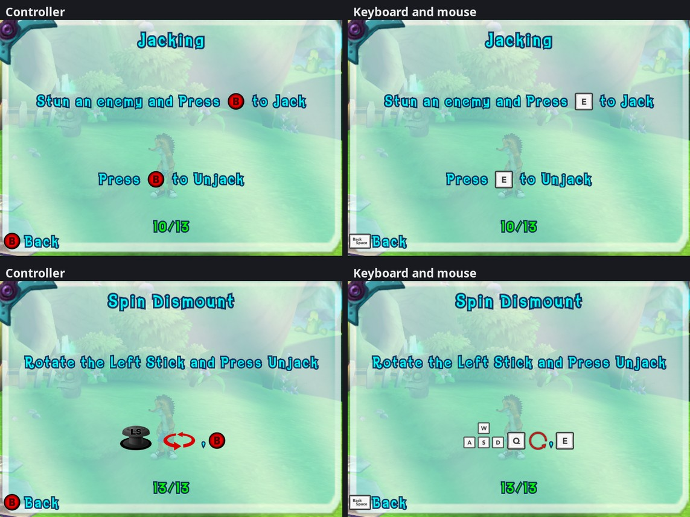

# 37. Keyboard and mouse pictures in the game's button prompts

2026-10-11. Roadmap phase 2: the prompts follow the device in use.

Short version: the game draws its button prompts ("Jump ±", "Press ² to
Jack") with font glyphs whose "page" is a whole picture of a 360 button
([findings/23](23-keyboard-and-mouse.md) s.1.2). Those pictures are ordinary
8-bit palettized textures in the game's memory, so the port redraws them in
place: while the keyboard or mouse was used last, every prompt shows the key
bound to that move (Xelu's free key pictures, public domain), and the 360
buttons come back as soon as a controller is used. Nothing in the game's
texts or layouts changes, so every screen, both renderers and F10 photos show
the keys. One clash needed a data patch: on a controller A both jumps and
confirms, on a keyboard those are two keys, and a menu's prompt bar and the
tutorial text above it use the same character. Two new glyphs for the menus'
own A and B solve it.

## 1. Where the prompt pictures live

The fonts are Pure3D `TextureFont`s (`Titans_Large`, `Titans_Small`) in
`package\b4c85fe7.p3d`. Each has 13 picture glyphs: U+00A5 (right stick),
U+00B1-U+00BE (A, B, X, Y, Back, Start, RT, RB, left stick, the menus' red
arrows, "rotate", LT, LB). Their pages are 64 x 64 (buttons), 128 x 128 (the
sticks: the glyph shows the top 3/4, v from 0.25) and 128 x 64 (rotate).

In memory (read with a temporary hook on the loader, then checked page by
page):

* Pure3D's `TextureFontLoader::LoadObject` = `sub_823C5DA0` (vtable
  0x8200E420, slot 5). It builds the font and stores it through its **r4**
  argument (its return value is something else: the first probe read r3 and
  found no font).
* `TextureFont` (vtable 0x8200E394): +60 page count, +64 the array of
  `pure3d::Texture*`, +72 glyph count, +76 the glyphs (40 bytes each), +84 a
  sorted array of their characters (binary search, `0x823C6764`).
* `pure3d::Texture` +24 = its `pddiTexture` (`xnTexture`, the renderer's
  texture; native/guest.h): +20 the D3D texture, +24 a ring of 16 palette
  textures, +88 the one in use, +276 = 1 for 8-bit palettized.
* Every prompt page: fetch constant format `k_8`, **linear** (not tiled),
  rows of 256 bytes (pitch 8 x 32 texels), no byte swap; the palette is a
  256 x 1 `k_8_8_8_8` texture, linear, 8-in-32 byte order. The pixels are the
  disc's TGA indices unchanged, rows top to bottom.

## 2. Redrawing a page

`src/input/prompt_icons.cpp`:

1. **Check first.** For each loaded font, every prompt page is compared with
   the same page read from the player's disc data: format, size, every index
   byte (either row order) and the palette (where each of B, G, R, A sits in
   the guest's 4 bytes is worked out from the match, so the byte order isn't
   assumed). A page that doesn't match is left alone and logged. The original
   bytes are kept.
2. **Draw** the picture at the page's size: one key (Xelu's 100 px picture,
   6 px of empty border cut, scaled by area averaging), four keys in the WASD
   shape for a stick, the Spin key plus a circling arrow for "rotate". Keys
   the set has no picture of get the blank key with the key's name written in
   the game's own font.
3. **256 colours**: median cut (255 boxes split at the pixel-weighted median
   of the widest channel, entry 0 transparent).
4. **Write** indices and palette in place, after telling the SDK's memory
   watchers (`TriggerPhysicalMemoryCallbacks`), as the game's own writes do:
   the emulated GPU's texture cache and the native renderer's write watch
   both see the change.

Pictures are cached by content and size; a page is rewritten only when what
it should show changes. The check runs once per frame at the frame's end
(main thread): which device was used last, and the bindings' revision.

**Which device**: the keyboard driver remembers when a key, mouse button or
wheel notch last went down. The XInputGetState wrapper (the one place the
game reads pads) looks at every state the game gets: whatever the keyboard
didn't add to it (buttons it didn't press, triggers, sticks well past the
dead zone while the keyboard leaves them alone) is a controller. The later of
the two wins. `--button_prompts` = 1 / 2 forces keys / buttons.

| Glyph | Picture (first key of the action) |
|---|---|
| ± A | Jump |
| ² B | Jack / unjack |
| ³ X / ´ Y | Light / heavy attack |
| µ Back / ¶ Start | Map / Pause |
| · RT / ¸ RB | Block / Pocket |
| ½ LT / ¾ LB | Titan special / Left bumper |
| ¹ left stick | the four Move keys |
| ¥ right stick | the four Right stick keys |
| ¼ rotate | the Spin key + a circling arrow (spins are written "¹¼") |
| U+E0B1 / U+E0B2 (ours) | Menu: confirm / Menu: back |

An action without a key keeps the 360 picture.

## 3. Menus: two more glyphs

First version: ± showed Menu confirm's key (Enter) while a menu was up and
Jump's (Space) in play. Pause -> Tutorials showed the problem: the prompt
bar's "Back ²" and the tutorial's "Press ² to Jack" are on screen together,
and the tutorial then claimed Backspace jacks.

Fix: a data patch of `package\b4c85fe7.p3d` (data/data_patcher.h) adds two
glyphs to both fonts, U+E0B1 and U+E0B2 (Unicode's private use area: no game
text contains them), with pages of their own:

* the A and B pictures' texture chunks (0x19000) copied and renamed after the
  next page numbers, inserted after the last page (the loader numbers pages
  in file order);
* the font's page count (the last u32 of its own data) + 2;
* two glyph records (chunk 0x22001: u32 count, 40-byte records) copied from
  ± and ², page and character changed, **in character order**: the table ends
  with U+FFFF and is binary-searched; appended after U+FFFF, the new glyphs
  were never found and drew nothing;
* the same two characters in chunk 0x22006 (a list of the picture glyphs:
  u32 character + u32 value each), also in order.

The menus' prompt bar is the page `FE_Buttons` (loaded in the front end and
in levels), whose button texts (`LowerLeftButton`, `LowerRightButton`,
`UpperLeftButton`, `UpperRightButton`) hold only the glyph. Every front-end
update (`sub_82261C40`), their ± and ² become the new characters. So the bar
shows Enter and Backspace, the texts Space and E; on a controller all four
are the 360's A and B again.

> Later the same day ([findings/38](38-keyboard-mouse-real-keybinds.md)): the
> menus got keys of their own, and the patch adds six menu glyphs (A, B, X,
> Y, LB, RB: U+E0B1 E0B2 E0B3 E0B4 E0BE E0B8), also used by the port's own
> Options screen.

## 4. Styles, Automatic, and key pictures anywhere (2026-10-15)

**Styles.** Options -> Controls has **Keyboard Icons** (Light / Dark,
`--keyboard_icons`) and **Controller Icons** (Automatic / Xbox 360 / Xbox
Series / PlayStation 5 / PlayStation 4 / Switch, `--controller_icons`). The
controller sets are Xelu's too (assets/prompts/README.md). They go into the
same pages the keys do: while a controller is the device in use and a style
other than the game's own is chosen, every button page gets that set's
picture of the same 360 button, BY POSITION (the 360's A is the bottom
button: Cross on a PlayStation, B on a Switch; Back = View / Share / Minus,
Start = Menu / Options / Plus). The "rotate" arrow keeps the game's own
picture. A page's description says which set ("L key 32", "D key 32",
"P 1 0" = PlayStation 5's bottom button), so a change of set redraws it.

**Automatic** reads the controller's maker and model from its SDL GUID (the
players' device key `pad:<32 hex digits>`: bytes 4-5 = USB vendor, 8-9 =
product, little-endian): Sony 054C with a DualSense (0CE6, Edge 0DF2) =
PlayStation 5, other Sony pads = PlayStation 4; Nintendo 057E = Switch;
Microsoft 045E = Xbox Series, except the 360 pads (028E, 028F, 0719) = the
game's own; any other maker (generic and third-party pads) = the game's own
360 look. The controller is the first one answering on the socket a
controller was used on last (`PlayerAssignment::PadKeyFor`).

**Key slots.** The font patch (section 3) adds 16 more glyphs, U+E100 to
U+E10F, each with its own page (copies of the A picture). `KeyGlyph(key)`
lends one to any key (the least recently asked slot is reused) and the next
frame paints that key into its page, in the chosen key set, whatever the
device in use. The Options screen's key rows write their keys this way, so
they show as pictures in the game's own text (the card keeps the names).
A slot can also hold a CONTROLLER button (`ButtonGlyph("A")`, by its 360
name): drawn in the Controller Icons style whatever the device in use, so the
Options key rows' card says "Controller: [Cross]" with a PlayStation 5 set;
with Automatic before any controller was used, or Xbox 360, it is the game's
own picture of that button, copied from the disc's font page (a stick's
picture is the top three quarters of its page, fitted with its shape kept).
The game's fonts as the port reads them from the disc (ui/game_font.h, for
measuring) don't have the added glyphs: they measure like the A picture.

**The B floating in the world** (over a save totem, a stunned titan, things
to use) isn't a font glyph: it's a texture of its own,
`FE_360_b_button_64.tga` in package `bca1bc0b.p3d` (64 x 64, 8-bit
palettized, no mipmaps), drawn as a billboard with a green glow behind it.
Pure3D's TextureLoader (vtable 0x8200D710, slot 5 = LoadObject
`sub_823AFB00`, the texture through r4 like the font loader's) is wrapped:
every texture it builds is looked at once at the frame end; a 64 x 64
palettized one whose pixels are the disc's B (read from the package) becomes
one more prompt page, standing for the B button / Jack. So it shows the Jack
key (E by default) on the keyboard, the chosen controller set's B position
(Circle, A on a Switch...) on a controller, and the game's own B otherwise.
A page that isn't part of a font counts as gone when the texture object's
vtable changes. **The game draws this texture upside down**: a B looks the
same either way up, so it never showed, but an "A" written the disc's way
came out as "∀"; the pictures go into it the other way up. Its palette has
identical blue and green columns (a red ball), so the byte order check can't
tell those two apart: the font pages' order is used.

**The button's material and shape.** The B is drawn on a mesh,
`evil_circle_geoShape`: a 12-sided coin (radius 0.36, 0.27 thick, the front a
shallow dome) whose texture coordinates are a flat projection (u = 0.5 +
1.261 x, v = 0.5 - 1.261 y), so on screen it is a 12-sided window onto the
64 x 64 picture. Its material, `HUD_button_circle_m` (chunk 0x11000 in the
same package), is opaque with alpha test off (`ATST 0`): every pixel inside
the window is solid, a "see-through" one is drawn as its colour, black. The
red ball's dark rim on screen is exactly that. (With the B's picture emptied
a black 12-gon remained; filled with magenta, a magenta 12-gon.) So any
picture there was masked to that 12-sided shape with dark corners.

A data patch of the package (a "joined_assets" package: type 9 in
`levels/GlobalPackages.p3d`, so path category 10, not the menus' 6) makes a
key a whole square key while the game's own B stays exactly as it was:

* the material's alpha test on (`ATST 1`; compare `ACMP 4` = greater,
  threshold `ACTH 0.5`), so see-through pixels are left out;
* the coin's faces SQUARE: each rim corner moved out to the square (those at
  0 / 90 / 180 / 270 degrees to the edge middles, the pairs at 30 / 60
  degrees etc. both to their quadrant's corner), texture coordinates by the
  same projection (read from the mesh itself);
* the 12-sided window BAKED into the game's B picture: every palette colour
  opaque (as the material drew them), and the pixels outside the window
  given an unused palette entry made fully transparent. On the square coin
  the game's B shows the same 12-sided disc with its dark rim as before.

A key is drawn over the whole square face (0.046 to 0.954 of the picture);
its own transparent corners are left out. Controller buttons are round with
transparent corners: they look as on the 12-sided coin. (Tried first, each
leaving a dark silhouette or a circle: a dark badge, cutting the glow's
middle out, a key covering the box, spreading the key's edge, a round button
in the key's colour, a key shrunk to fit inside the 12-gon.)

**The size of a picture.** The game's own pictures don't fill their pages:
the 360 face buttons cover 49 of 64 pixels (7-55), the sticks 93 x 72 of
their 128 x 128 page, the world's B nearly all of its 64. The first version
drew every replacement over the whole page, about 11% bigger than the
button it replaced (playtest). Now each page's original drawn part is
measured from the disc's page (the box of its opaque pixels), every
replacement is cut to its own drawn part and fitted into that box with its
shape kept: drawn part over drawn part, the same size as the original.

## 5. Tests

On a copy of the saves, with the debug console: both fonts found and checked
(15 pictures each, menu glyphs included); a fake controller's Start switched
the prompts to buttons, a key tap back to keys, again and again; the tutorial
pages (mouse buttons for the attacks, WASD + Q + arrow for the spins, E to
jack, R to pocket) in both pictures; the pause menu's bar with the menu
glyphs: Enter / Backspace in both pictures, A / B with the controller in the
native one.

Known limits: texts still name the controller ("Rotate the Left Stick and
Press Unjack"); the key pictures are as big as the 64 x 64 pages (the same
resolution as the game's buttons).
