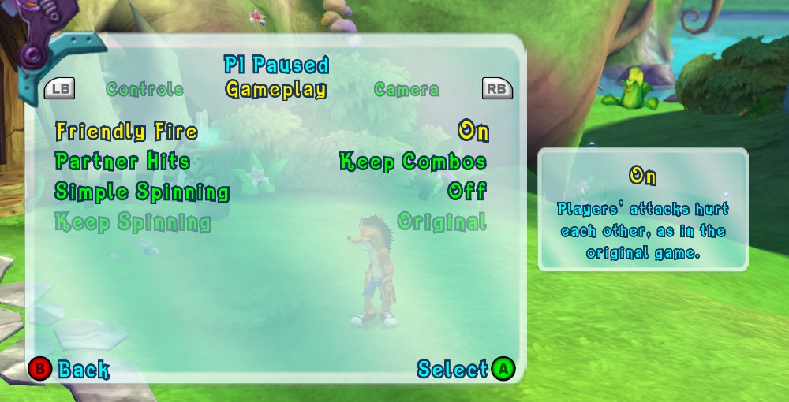

# 40. Gameplay options: friendly fire, combos on a partner's hit, simple and continuous spinning

2026-10-15. A new Options tab, **Gameplay**, for changes to the game's own
rules. Each row's first value is the original game's behaviour, and that is
the default except for Partner Hits: partners can still hit each other
(Friendly Fire On, as in the original), but by default a partner's hit no
longer costs your combo (Keep Combos).

| Row | Values | Setting (user/settings.toml) |
|---|---|---|
| Friendly Fire | On (original) / Off | `friendly_fire` |
| Partner Hits | End Combos (original) / Keep Combos (default) | `friendly_hits_break_combo` |
| Simple Spinning | Off (original) / On: LB spins | `simple_spinning` |
| Keep Spinning | Original / Hold to Spin (needs Simple Spinning) | `keep_spinning` |

Code: `src/gameplay/game_mods.*`; the rows are in
`src/options/options_settings.cpp` (`GameplayRows`).

## 1. How a hit reaches a character

Every character's `CDamageableBehaviour` (vtable `0x8202D2E4`, see
[findings/27](27-cheat-menu.md) s.3) gets hits as **messages** through its
vtable slot 5, `sub_82132FF8` (r3 = the behaviour, r4 = its actor, r5 = the
message). A jump table on the message type (+4) picks the case:

* **type 12 = damage**, subtype at +16:
  * 0 = a hit. The hit's record = `*(*(message + 20) + 4)`; the case builds
    the damage info at behaviour +196, sends the actor its hit reaction
    messages, lowers hitpoints through `sub_821349E0`, and sends the two
    combo messages (below);
  * 2 = a stun-related case, 3 = a direct hitpoint change (the record's
    +60 amount, again through `sub_821349E0`).
* type 8 / 57 / 17: other hitpoint and state changes, not hits.

The record's fields that matter here:

| Offset | Meaning |
|---|---|
| +20 | the actor that hit (also passed in r5 to `sub_821349E0`) |
| +36 / +40 | copied into the damage info's +0 / +4; +40 = the actor that gets the combo point |

A flag on the behaviour (+212 bit `0x04`) makes it accept hits from players
only (`sub_8226FDC0`, "is this a player's actor"); players' own damageables
don't have it.

**Which player an actor is**: the game's own `sub_8226FCD8` (r3 = the game
object `0x825B0008`, r4 = the actor) looks through the players' Crash list
(+16), jacked-titan list (+24) and the mask (+32); with the port's four-player
hooks ([findings/26](26-more-local-players.md)) it answers 0-3 for every
player's Crash and titan.

Measured with two players on Wumpa Island (player 2 a fake controller, three
light attacks and a heavy one into player 1): player 1 went from 90 to 89
hitpoints and was knocked aside. **The original game has friendly fire.**

## 2. Friendly Fire: Off

`sub_82132FF8` is wrapped. For a type 12 message, subtype 0 or 3, the wrapper
asks which player the hit actor (r4) and the hitter (record +20; a
projectile's owner through +40 when +20 is no player's) belong to. Two
different players = the message is dropped before the original sees it:
no hitpoint change, no hit reaction, no knock-back, no combo message.

Measured the same way: player 1 stayed at 90 / 90 and in place; the log
line `Gameplay: player 2 hit player 1: no friendly fire, the hit is dropped`
came about three times per punch (one attack sends several hit messages;
the line is now written at most once a second per pair).

## 3. Partner Hits: Keep Combos

The combo meter (`CComboCounter`, [findings/26](26-more-local-players.md)
s.25) is driven by **messages to the player's actor**, read by its
`CScoringBehaviour` (vtable slot 5 = `sub_82166198`):

| Message | What the scoring behaviour does |
|---|---|
| 31 / 0 ("you landed one") | `sub_82166240` -> the meter's one-more-hit `sub_8225D840` |
| 31 / 1 ("you were hit") | `sub_821661E8` -> the meter's break `sub_8225D948` |
| 12 / 1 | the same break |

The damageable's hit case sends 31 / 1 to the actor that was hit
(`0x82133414`) and 31 / 0 to the record's +40 actor (`0x8213346C`, only when
the hit did damage). The meter keeps its hit count at +3132 and its state at
+3112 (3 = counting, 5 = broken).

With Keep Combos and friendly fire on, the damage wrapper lets the partner's
hit through and notes "drop the next 'you were hit' for this actor" (kept
0.25 s). The `sub_82166198` wrapper drops that one message.

Measured: player 1 at 10 hits (state 3), punched by player 2. Original: 0
hits. Keep Combos: 10 hits, state 3, one `combo message 31/1 ... dropped`
line, and the hitpoint loss still happened. The hitter's meter stayed at 0
in both runs: **the original never gives a combo point for hitting a
partner**, so nothing is filtered on that side.

## 4. Simple Spinning and Keep Spinning

The original's spin is a stick gesture: one full circle of the left stick =
one spin ([findings/23](23-keyboard-and-mouse.md) s.2,
[findings/38](38-keyboard-mouse-real-keybinds.md) s.4). The continuous spin
is a separate move, **"Old Skool"**: the game's move list writes it
"Rotate Left Analog Stick and Repeatedly Press Light Attack" (stick + rotate
arrow, then X, X, X...).

Holding the Spin key in the original rules gives one spin after another:
3 s held = 3 circles handed to the game, each spin playing to its end before
the next starts.

### 4.1 Simple Spinning: LB spins

The keyboard has a Spin key ([findings/38](38-keyboard-mouse-real-keybinds.md)
s.4); since 2026-10-15 it works only with Simple Spinning on (off = the key
does nothing; its Options card says to turn Simple Spinning on), and the
spin prompts then get a second row with the button
([findings/37](37-keyboard-mouse-prompts.md) s.5). Simple Spinning gives
controllers the same: **LB** (in play a debug
button of the original, with no use) answers the fight trees'
`HasControlDone360` like a full stick circle. A press = one circle waiting
for the question, kept 0.4 s; held = one more every 1/3 s (the Spin key's
rhythm). In play the game doesn't hear LB any more; in menus it keeps its
LB (the Options tabs). It works on foot and riding a titan (titans have spin
moves too, such as the Spin Dismount). Rotating the stick still works.

Measured: a 150 ms LB tap = one spin (`KBM: Spin: a full circle for player 1
(simple spinning's button)` with `--debug_kbm_trace`).

Where it runs: the game's XInputGetState wrapper (`sub_824742F0`,
`save_library.cpp`) applies it LAST, after the input recording and after
the prompts' controller check. Before that order, LB (taken away here) never
counted as using the controller, and Keep Spinning's own Light attack
presses switched a keyboard player's prompts to controller buttons; a replay
would also have got the recorded presses twice.

### 4.2 Cutscenes lock the spin (the keyboard's too)

The game's own answer to `HasControlDone360` (`sub_8221E200` -> slot 23 of
the behaviour controller = the player's controller object -> `sub_82272FB8`)
first walks up to the root controller (`sub_82272D68`: +36 = parent) and
reads its **lock**: the top byte of +516 above zero = locked (cutscenes and
other scenes that take the player's control). Locked = "no circle", whatever
the stick did. The Spin key used to answer without that check, so it spun
Crash during cutscenes. Every circle the port makes (Spin key, LB) now asks
the same lock first and is dropped while it holds.

Measured in the N. Gin lab cutscene (Wumpa Island): the fight tree kept
asking during the scene; Q held 3 s there = ten `controller is locked (a
cutscene): no spin` lines, no spin. Before the walk, Q spun as usual.

### 4.3 Keep Spinning: hold to spin

Needs Simple Spinning (the row is greyed out until it's on). With Hold to
Spin on:

* when a spin starts for a player's Crash on foot (the
  `HasControlDone360` wrapper `sub_8221E200` answers yes, from a real stick
  circle or the Spin key), and the player **keeps spinning** within 0.5 s,
  the port presses **Light attack** for them: the first press 150 ms after
  the spin starts, then one every 150 ms, each held 60 ms (X reads released
  in between, so each is a new press). The presses go into the player's
  controller state in the game's XInputGetState wrapper (`sub_824742F0`,
  `save_library.cpp`), after the keyboard's keys are merged in;
* "keeps spinning" = the Spin key or LB held, or the left stick still
  circling: pushed at least 60 % of the way and turning at least once a
  second (speed smoothed over 0.15 s; a fast turn seen within the last 0.3 s
  still counts, so a thumb that cuts a corner doesn't stop it);
* while it feeds a spin, the Spin key hands out no new circles (a fresh
  spin would cut the Old Skool spin short);
* it stops at once when the player stops, a menu opens, or the player rides
  a titan (titans have their own moves for Light attack).

Measured on Wumpa Island: Spin held 3 s = one circle, then the Old Skool
spin (arms out, a different pose from the basic spin) for the whole hold;
the feeding stopped when the key was let go. The left stick circled for
5.5 s = the same, from one circle; LB held 3 s = the same. After about 2.5 s of non-stop spinning
Crash gets **dizzy** (stars over his head) and stops: the Old Skool move's
own rule, left as it is.

## 5. Not done / not tested

* Partner hits from titans and masks, and projectiles (the +40 owner path):
  not measured; same code path.
* Players 3-4: the same lookups, not measured.
* Spinning on a real controller (all stick tests used the debug input's
  eight-direction steps).
