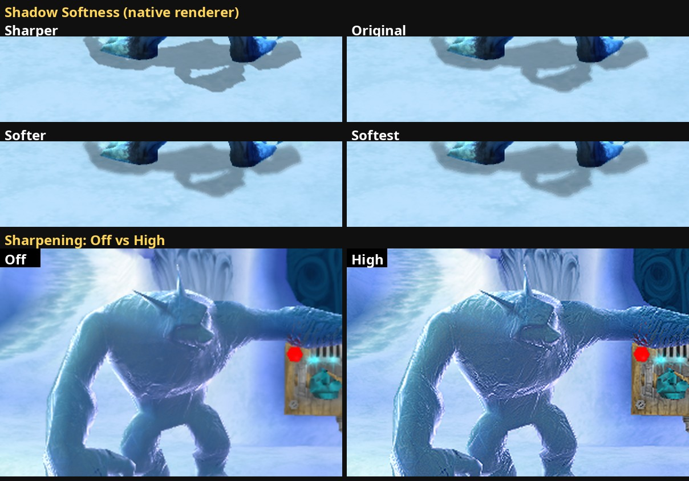

# 41. Shadow softness and a sharpening filter

2026-10-15. Two more rows on the Options screen's Graphics tab, both drawn
by the native renderer only (greyed out while the emulated picture shows,
like the other native-only rows, findings/35):

- **Shadow Softness** (`shadow_softness`): Sharper, Original, Softer,
  Softest. How wide the characters' soft shadows fade at their edge.
- **Sharpening** (`sharpening`): Off (original), Low, Medium, High. A
  contrast-adaptive sharpening filter over the finished picture.

*The Ratcicle Kingdom courtyard, game frozen (F5 cheat), the same frame in
every panel. Top: a titan's shadow at the four softness levels, enlarged
2x. Bottom: the ice statue with sharpening Off and High, enlarged 2x.*

## 1. Shadow softness

The game's soft character shadow (findings/12) is a hard stencil mask
(shadow volumes) turned soft by `xnShadowShader`: a full-screen quad whose
pixel shader looks at **9 points** of a copy of the stencil, about ±2
pixels around the pixel (offsets in PS c2-c10, weights in c30-c38), and
darkens by the weights of the points that fall inside the shadow. The
quad's stencil test is "always" (it is a back face, findings/12 s.4), so
the fade reaches both inwards and outwards from the mask's edge.

The setting scales those offsets on our side: the recorder passes a scale
in the shadow's parameter block (`ShadowParams::softness`, frame.h), and
`shaders/shadow.frag` multiplies the offsets by it.

| Value | Scale | Rings |
|---|---|---|
| Sharper | 0.5 | 1 |
| Original | 1 (the game's shader exactly) | 1 |
| Softer | 1.5 | 2 (0.75, 1.5) |
| Softest | 2 | 2 (1, 2) |

**Why rings.** Stretching the 9 taps alone leaves gaps between them: the
edge turns into steps (each tap entering the shadow at its own distance).
Above 1 the shader runs the kernel several times, the k-th of R rings at
scale x k / R, and averages them: the inner rings fill the gaps, the outer
one sets the width. Pixels deep inside a shadow see every tap inside and
stay exactly as dark as the original.

**Why not wider.** A blur spreads the same darkness over a wider edge. The
first try had 2x / 3x: on a shadow only a few pixels wide (Crash's shadow
on Wumpa Island with the sun high, a thin rim around his shoes) the 3x
setting faded it almost entirely. 1.5x / 2x soften big shadows (titans)
clearly and keep thin ones visible.

Cost: at most 18 stencil reads per pixel instead of 9, on one full-screen
quad per frame where a shadow is drawn. Not measured separately.

## 2. Sharpening

A post filter in the native renderer's **present pass** (the pass that
copies our 1280x720 frame into the presenter's image and applies the
game's gamma ramp, `shaders/present.frag`). It works before the ramp, on
the colours as the game drew them, and covers the whole picture, HUD and
menus included.

The method is the idea behind AMD's FidelityFX **Contrast Adaptive
Sharpening** (CAS, MIT licence), written from its published description:

1. Read the pixel and its 8 neighbours (whole texels: frame and output are
   the same size).
2. A soft minimum and maximum of the neighbourhood per channel: the cross
   (the pixel and its 4 direct neighbours), plus the corners added on top,
   so a single bright corner counts less than a real edge.
3. The **room to sharpen**: `sqrt(min(lo, 2 - hi) / hi)`, near 1 where the
   neighbourhood is soft or flat, near 0 where it already spans dark to
   bright. Hard edges (the HUD's outlined text, silhouettes against the sky)
   get little sharpening, so no halos or ringing.
4. An unsharp mask with the 4 direct neighbours weighted
   `room x -1 / mix(8, 5, strength)`, normalised.

| Value | Strength |
|---|---|
| Off | the plain copy (the filter is skipped) |
| Low | 0.3 |
| Medium | 0.6 |
| High | 1.0 |

The strength reaches the shader as a push constant (the present pipeline
layout got a 4-byte range), read every frame, so the row changes the
picture at once. Measured on the courtyard frame above: the mean change
over the picture is 1.3 / 1.7 / 3.1 (out of 255) for Low / Medium / High,
most of it in textured surfaces (grass, ice, fur).

This is **not** Texture Sharpness (findings/36): that one picks more
detailed mip levels for distant textures before they're drawn; this one
works on the finished picture, whatever made it soft (mipmaps, MSAA
resolves, the game's depth of field). They can be combined.

## 3. Testing

- The debug console got `flag <name> [value]` (findings/29): reads a
  setting or sets it live, the call the Options rows make, without saving
  it. Both settings were switched this way between F10 photos of one
  frozen frame (Wumpa Island, then the Ratcicle Kingdom with a titan).
- Options -> Graphics in game: the two rows, their cards, A cycles the
  values; 0 errors in every run.
- Not checked: the cost on a weaker GPU, and the look in motion at high
  sharpening (grain on fine textures while moving).
