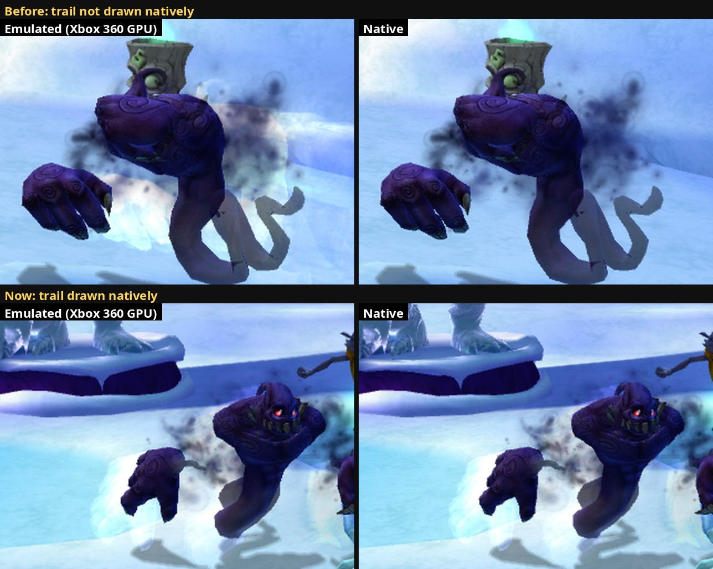

# 42. Motion trails: the last material missing from the native renderer

2026-10-16. The native renderer logged one gap in fights:
`NativeRenderer: not drawn natively yet: material class xnMotionTrailShader`.
It's the pale streak some titans sweep behind an attack. It is now drawn
natively, and no other material class shows up as missing in the play logs.

*The Ratcicle Kingdom courtyard, a spawned Phantom fighting the player's
Ratcicle, the same frame from both renderers (F10 photo pairs), enlarged 2x.
Top: a control run with the native trail skipped, the white streak behind the
fist is missing (crop 8.34/255 apart). Bottom: drawn natively (1.60/255,
the frame's usual edge noise).*

## 1. Who draws trails

The fight trees switch a trail on through the render behaviour:
`m_RenderBehaviour:TriggerCharacterMotionTrail`. In `default.rcf` the call
appears in two of them:

- **Strong** (the big titans' tree, the Ratcicle and the Phantom among them):
  light attack, heavy attack, the special attack, the time shift.
- **Bear** (the Roller): its rolling boost
  (`m_ControllerGroundRollBehaviour:Boost`).

The trail's look comes from the character's data (pictures such as
`motionTrail_01_64`, `motionTrail_roller_blur_64`). A Ratcicle's attacks
call the trigger too, but draw no trail. The Phantom's and the Roller's do.

A trail at rest is still drawn every frame, with all its vertices on one
point (36 vertices, zero area). Only during an attack does it spread out.

To reproduce: load a save in the Ratcicle Kingdom, `cheat god on`, then
`cheat spawn Phantom` and `cheat spawn Roller` at the debug console (findings/27
s.9; a bare name now means `Characters:<name>`). They attack within seconds.
The scripted input also got `lt` / `rt` (triggers, all the way) for titan
specials.

## 2. The material

Read with the Ghidra tools (`tools/ghidra_decompile.sh`, docs/01-building.md),
from the class's vtable (`0x820163CC`, `tools/rtti_vtables.py`):

- **Draw setup** (vtable slot 14, `0x8242EB70`): binds the D3D texture the
  renderer context holds at `+0x440` (getter `0x8242FEE0`; its neighbour
  `+0x43C` is the water's planar reflection) to **sampler 0**, sets the
  vertex shader `motiontrailvp` and the pixel shader `motiontrail` from
  globals `0x8258E348` / `0x8258E34C`, then the common state (blending from
  the material's state cache).
- **motiontrailvp** (its debug file): position x `matMVP` (c4-c7), colour and
  texture coordinate passed on unchanged.
- **motiontrail** (microcode, `--dump_shaders`; 48 bytes once matched to the
  `.out` file by its byte-swapped words): one texture fetch and one multiply,
  `colour = tex2D(MotionTrailTex, uv) x vertex colour`. No fog, no fade, no
  tint.

That is exactly what our simple material computes with a white tint, no fade
and no fog. So the recorder gives the draw its own kind
(`Material::kMotionTrail`, for the draw lists) and draws it with the simple
shaders, the texture read from D3D's copy of sampler 0 (the way the fx grid's
picture is read, findings/18). Blending and depth come from the state cache
as for every material.

## 3. Checking it

The trails are faint and short, so a single photo proves little. Instead:

1. **Control run:** a temporary switch skipped the trail draws in the native
   picture only. In a burst of 60 F10 pairs during the fight, several jumped
   to 1.5-1.8/255 overall, with 9,000-11,000 strongly different pixels
   (the streaks).
2. **Real run**, trails drawn: 61 pairs, median 0.94/255, at most 2,700-3,800
   strongly different pixels in every pair (the usual edge noise). The 4
   photos with a spread-out trail: 0.91-0.93/255. The largest pairs (up to
   3.67/255) hold no trail; they show the Phantom's time-shift glow, which
   differs a little between the renderers (not investigated).
3. 0 errors in the logs.
