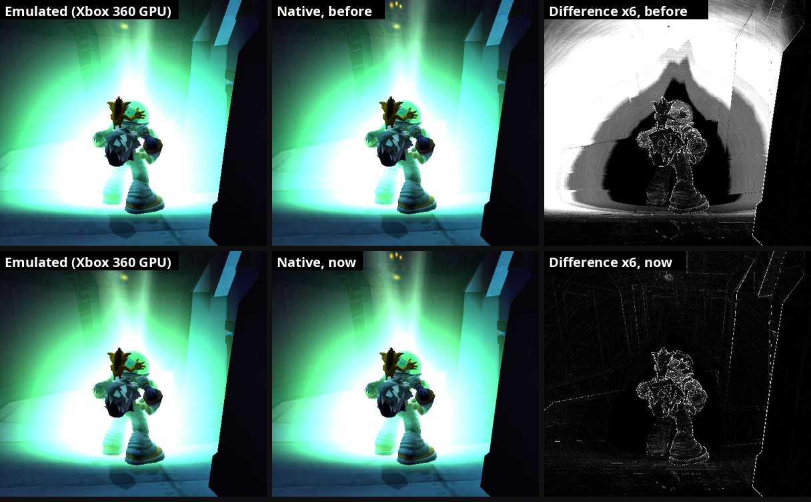

# 43. Palettized particles: the game filters them at texel corners

2026-10-16. Big glows in fights (a Stinky's light attack, the Phantom's time
shift) came out up to ~8% too dim towards their edge in the native renderer.
The cause was how we filter 8-bit palettized sprites; the fix is one line in
the particle shader.

*A save in a metal corridor, the player riding a Stinky, the game frozen
(F5) 800 ms into its light attack: the same frame from both renderers (F10
pairs), the differences amplified 6x. Before: the whole outer halo is off.
Now: only the usual edge noise.*

## 1. Narrowing it down

- **Measured**: around the titan the glow matched; from about 140 px out
  ours was 10-15 (of 90-200) too dark in green, a radial falloff.
- **Not the soft edge**: F12's "no soft edge" (our picture only) changed the
  inner part, not the outer shortfall.
- **One draw**: a temporary switch zeroed the vertex colours of one draw (by
  its vertex count) in the game's own data, so BOTH pictures lose it (the
  F12 erase experiments' method, findings/20 s.8). Erasing the 30-vertex
  draw removed the whole glow and the whole difference. That draw is an
  additive, palettized `xnParticleShader` sprite.

## 2. The game's filter

A palettized texture holds palette indices, which can't be filtered by the
GPU (blending two indices gives an unrelated colour). The game's pixel
shaders fetch 4 texels with point sampling, look each up, and blend the
colours themselves. The palettized particle shader (`palparticleshaderfp`,
dumped with `--dump_shaders`, matched to the `.out` file by its byte-swapped
words) computes the sample point as

    texel = uv x (BilinearScale + c254.x)      BilinearScale (c112) = size
    corner = floor(texel), weights = texel - corner

and its literal constants (just before the microcode in the `.out` file)
are c254 = (-1, 255/256, 0, 0), c255 = (0.5, 0, 1, 1/512). So:
`uv x (size - 1)`: texel CORNERS at uv 0 and 1, the same mapping as
`bumpmegafp` (findings/20, `SamplePalettizedBump`).

Our shared helper (`palette.glsl`, `SamplePalettized`) uses the usual GPU
convention instead: texel CENTRES at (i + 0.5) / size, i.e.
`uv x size - 0.5`. Towards the edge of a sprite the two pick slightly
different texels (ours a little further out), and on a soft round glow that
is a darker edge.

## 3. Fix and check

`palette.glsl` got `SamplePalettizedCorner` (the bump shader's mapping);
`particle.frag` uses it for palettized sprites.

- The frozen glow, two runs: outer halo within +0.2..0.4 (was +10..15).
- Regression: the Ratcicle Kingdom courtyard fight with a Phantom, 61 pairs:
  median 0.94/255 (unchanged), worst 1.12. 0 errors.

## 4. Other palettized shaders (not changed)

All five palettized pixel shaders of the game have a `BilinearScale`
constant. `palreflectfp` carries the same literal pair (-1, 255/256) as the
particle one, so the palettized reflect material probably wants the corner
mapping too. `palsimpleshaderunlitfp`, `palsimpleshaderlitfp` and
`palfurshaderlitfp` keep their constants differently and need their own
reading before anything changes (the menus, HUD and much of the world draw
with the palettized simple material, and their A/B numbers are already
good).
