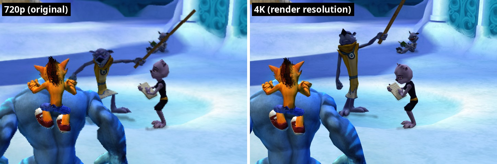

# 45. Render resolution: the native renderer above 720p

The Xbox 360 game draws at 1280 x 720. The native renderer (findings/08-17)
made every image the same size as the game's: its surfaces (render targets),
the textures it resolves into, the final picture. The **Resolution** setting
(Options -> Graphics, flag `render_resolution`: 0 720p, 1 1080p, 2 1440p,
3 4K) now draws all of them 1, 1.5, 2 or 3 times larger. The game itself
never notices: it keeps working in its own 1280 x 720 pixels.

*The same scene, cropped and enlarged: 720p (the game's own size, left) and
the native renderer at 4K (right). The dark patch on the character's head is
the game's own (the emulated picture shows it too).*

## 1. What had to change, and what didn't

Everything the game hands the renderer falls into one of three groups:

| What | In what units | At a higher resolution |
|---|---|---|
| Vertex positions after the vertex shader | clip space (-1..1) | nothing to do: the viewport maps them |
| Texture coordinates, including the resolved scene copies water, particles, depth of field and shadows sample | 0..1 | nothing to do |
| Shader constants in pixels (depth of field's 1 / screen size, shadow blur steps, water's PixelHeight, motion blur's longest smear) | the game's pixels | nothing to do: they keep the effect the same size on screen, now drawn with more pixels |
| Surface sizes, resolve rectangles and destinations, viewports, clear rectangles (the tiling strips) | the game's pixels | **scaled** |
| The movies' and 2D sprites' positions | the game's screen pixels, turned into clip space by our shaders with the game's 1280 x 720 | nothing to do |

So the whole change sits in two places:

- `src/native/render_targets.cpp`: every surface image and resolve
  destination is made at the scaled size (`Scaled()`), and resolve
  rectangles are scaled before they're clamped. The depth copy shader
  (findings/16) works in destination pixels with an offset, so it follows
  without changes.
- `src/native/native_renderer.cpp`: the game's viewport and clear
  rectangles are scaled; the frame image (our finished picture) and the
  presenter's output are the scaled size. Changing the setting re-makes the
  frame image once (after waiting for the GPU) and the surfaces re-create
  themselves at the next frame, like any surface whose size changes (one
  frame starts from a cleared picture).

Each edge is scaled on its own and rounded. That keeps the three tiling
strips (x 0-448, 416-864, 832-1280, findings/10) meeting exactly at 1.5x,
where 416 becomes 624.

## 2. Checked

- Live switching 720p -> 1080p -> 1440p -> 4K -> 720p in a level: photo sizes
  1280 x 720, 1920 x 1080, 2560 x 1440, 3840 x 2160, 1280 x 720; no errors.
- 4K together with 8x anti-aliasing: no errors.
- Menus, HUD text and the prompt pictures are drawn at the new size too
  (they're 2D draws through the same surfaces). The game's UI pictures are
  still their original size, so menus get smoother edges but not new detail.

## 3. Cost

GPU load in a busy ice-level scene at 60 fps, native picture only, on a
mid-range graphics card (4K has 9x the pixels of 720p):

| Resolution | GPU load |
|---|---|
| 720p | 27% |
| 1080p | 37% |
| 1440p | 50% |
| 4K | 89% |

## 4. Not done

- The emulated picture stays 720p (its own GPU emulation draws at the
  Xbox's size).
- A "match the window" choice, and resolutions between the steps.
- Widescreen / ultrawide aspect ratios: a different question (the game's
  projection and HUD placement).
