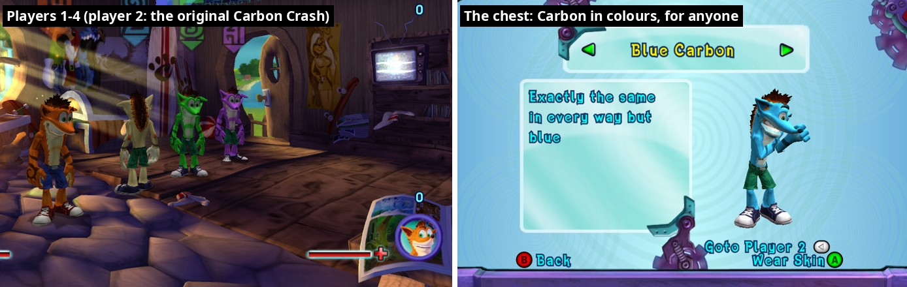
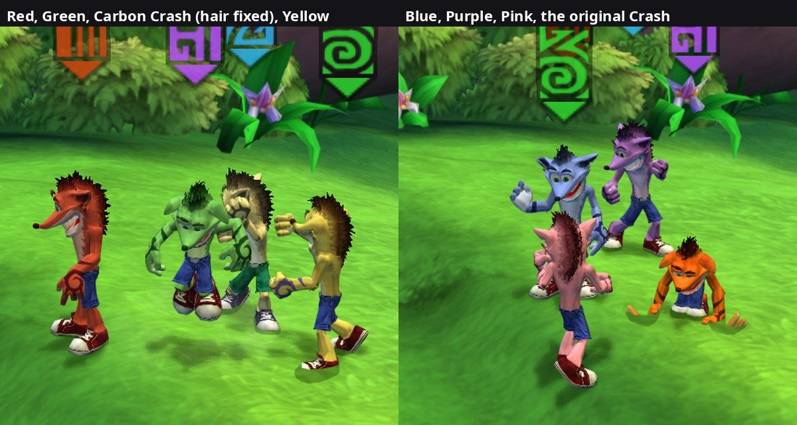
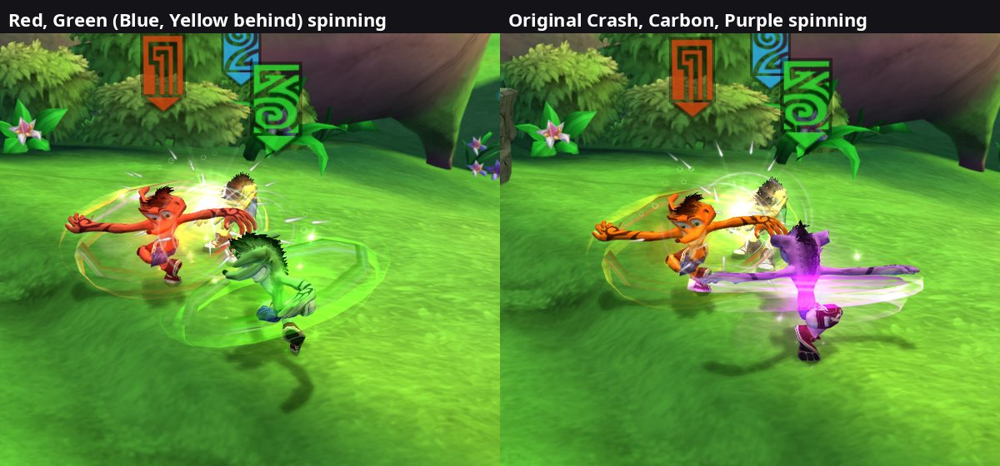
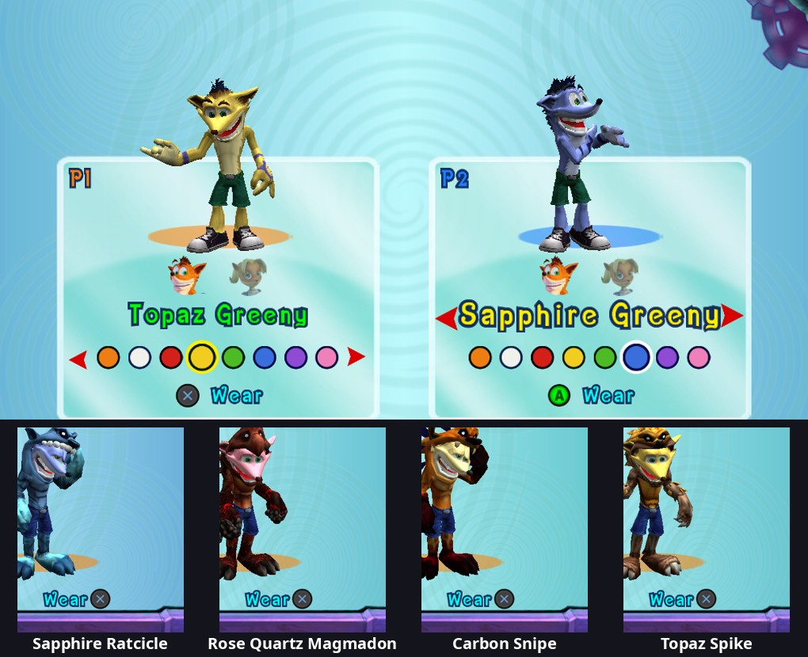
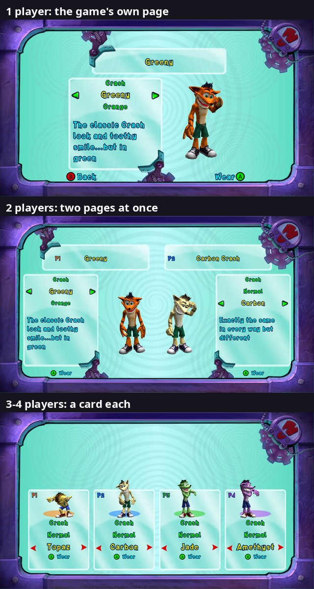

# 46. Outfits for players 1-4: the chest, Coco for anyone, Carbon Crash in colours

The chest in Crash's house opens the game's outfit screen. On the Xbox 360,
player 1 picks one of Crash's outfits there, player 2 picks between Carbon
Crash and Coco's two looks, and players 3-4 (this port's addition) get
nothing. The port turns it into one wardrobe for all four players: every
outfit for everyone, Coco for player 1 too, and Carbon Crash in each
player's colour.

## 1. What the game has

An outfit is a **skin number**, and each one is its own character template
("Characters:" + name, table 0x824F3A30) with its own package:

| # | Name in the game | Template |
|---|---|---|
| 0 | Crash | Crash |
| 1-3 | Crash Greeny / Bluey / Reddy (coloured shorts, shoes and hair tips) | Crash_Var01-03 |
| 4 | Snipe | Crash_Parafox |
| 5 | Ratcicle | Crash_Ratcicle |
| 6 | Magmadon | Crash_Shurtle |
| 7 | Skeleton | Crash_Skeleton |
| 8 | Spike | Crash_Spike |
| 9 | Coco | Coco |
| 10 | Old School (Coco) | Coco_Alternate |

- **Who wears what**: one number per player in a 2-entry table (0x8259B1C0),
  read and written only through `sub_8229F8B8` / `sub_8229F8A0`. A player's
  spawn event (`sub_8229C550`) builds them from it; a save stores players
  1-2's numbers next to the list of unlocked skins (0x825A72A8, 11 entries,
  -1 = end; unlocking Coco also makes player 2 Coco).
- **Carbon Crash is not a skin.** Crash's model carries two texture sets,
  `Crash_Player1.bmp` (orange fur, blue jeans) and `Crash_Player2.bmp` (white
  fur, green shorts). Its render behaviour (`CCharacterRenderBehaviour`)
  blends between them by +0xE4 (the script's `SetCharacterSkin`): set 1 for
  player 1, set 2 for anyone else. So player 2 in skin 0 is Carbon Crash.
  The other outfits' packages only have set 1.
- **The outfit screen** (`CSkinScreenAction`) is a carousel: the outfit's
  name, description and a 3D preview; A = "Wear Skin" (then a Yes / No
  question). Its page belongs to one player (this +0x84, 0 or 1), which also
  picks the page's layout (player 2's is mirrored), its list (player 1: skins
  0-8; player 2: 0 "Carbon Crash", 9, 10) and the preview's animations.
  With two players on foot, Back ("Goto Player 2" / "Goto Player 1") turns
  the page. "Wear Skin" (`sub_82123880`) does nothing for anyone above
  player 2, and only lets player 2 change character (Crash <-> Coco: every
  player is respawned from their skin).

## 2. One wardrobe for four players

`src/players/outfits.cpp`:

- **Four outfits.** The get / set functions are overridden: players 1-2 keep
  the game's table (saves are written as before), players 3-4 get the port's.
  An outfit picked at the chest is kept per player and per save (section 3d;
  it was a global setting at first, `outfit_player1`-`4`, now retired). It only counts while the loaded save has that outfit
  UNLOCKED (the game's unlock list 0x825A72A8, 11 skin numbers ending at -1,
  filled from the save; its own test is `sub_8229F858`; Crash's model is
  always unlocked). Otherwise the player wears what the save says, and the
  pick comes back in saves that have it. Without this check, Coco picked in
  a late save was played in early saves and before the story unlocks her.
  Checked: an early save's list holds 0-3 (Crash, Greeny, Bluey, Reddy) and
  player 1 stays Crash with Coco picked; a desert save's list adds 9 and 10
  (Coco, Old School) and player 1 is Coco.
- **Carbon as an outfit of its own** (number 11 inside the port): toward the
  game it is skin 0, so its name, base character and "unlocked" lookups
  answer like Crash. Which texture set a character shows is decided every
  frame from its player's outfit (the render behaviour's Update, slot 4,
  `sub_821858C0`, which turns +0xE4 into the blend). The first attempt set
  it in slot 7 alone: that runs once, when the character appears, so a pick
  only showed after the character was made again.
- **One list on every page**: Crash, Carbon Crash, Greeny, Bluey, Reddy,
  Snipe, Ratcicle, Magmadon, Skeleton, Spike, Coco, Old School, copied from
  the game's two lists at the first opening. The page keeps its layout
  (player & 1) and the port keeps the real player: midasm hooks where the
  page's player is stored on opening (0x820E0088) and on Back (0x820E18FC),
  where Back now goes to the next player on foot (1 -> 2 -> 3 -> 4 -> 1). The
  "Goto Player N" text gets the real number.
- **Wear Skin for anyone** (`sub_82123880` rewritten with the game's own
  steps): Crash <-> Coco = the game's respawn of the players; another model of
  the same character = the game's in-place swap on the actor (its outfit
  package looked up by name, `sub_822E4000` with the name in r4); then the
  game's store (`sub_822665B0`: loads the new package, releases the old).
- **The preview follows the outfit, not the page.** The screen gave the
  preview Crash's animations on page 1 and Coco's on page 2. Coco on page 1
  then had no animations (null read in `sub_82351340`, a crash). The
  animation set (midasm hook at the controller's creation, 0x820E0AA8) and
  the random idle list (`sub_820E0C98`) now follow the shown outfit.

**The respawn and players 3-4's HUD.** With 3-4 players, the first
Crash <-> Coco pick crashed the game (read of address 0 in `sub_82268770`).
Each HUD display (`sub_82268660`, state at +148) notices that its player's
character changed, fades out, then binds the new one in state 5
(`sub_82268D60`: +128 = the character, +132 = a pointer to its health
variable), and state 1 reads through +132. Players 1-2's characters exist
the moment the respawn makes them; players 3-4's arrive a few frames later
through the port's spawn events, so their displays bound nothing and state 1
read address 0. Now a display of player 3-4 waits in state 5 while its
player has neither a character nor a titan (`more_players_hud.cpp`), and one
bound to nothing goes back to state 5. Reproduced and checked with the debug
console's `cheat respawn` (the same game call as the chest's) with four
players: crash before, none after, all four HUDs back.

**Coco for player 1** needs nothing else: player 1 respawns as Coco, moves,
jumps, attacks, gets her HUD portrait, and keeps her look through a level
change and a restart. The story's cutscenes and set pieces with player 1 as
Coco are still to be played through.

## 3. Crash in colours, and every outfit's hair

### 3.1 Crash's textures

Crash's package holds four textures: his two texture sets for the BODY
material (`crash_body_shader`): `Crash_Player1.bmp` (orange) and
`Crash_Player2.bmp` (Carbon), 512 x 512 DXT1, no mip levels; a normal map;
and `crash_fur_color.tga` for his HAIR, a material of its own
(`crash_hair_color_shader`, the spikes on his head and down his back): 256 x
256, 8-bit with a 256-entry 32-bit palette, dark red-brown spikes with
orange roots. The game swaps only the body's texture set, so its own Carbon
Crash has orange-rooted spikes on white fur.

### 3.2 The colours

Six coloured Crashes, for anyone at the chest: **Red, Yellow, Green, Blue,
Purple, Pink** (named after gems beside the game's own Carbon Crash: Ruby,
Topaz, Jade, Sapphire, Amethyst and Rose Quartz Crash; section 3h) (port numbers 12-17, in that order on the chest's pages from
red: 12 red, 13 blue, 14 green, 15 purple, 16 yellow, 17 pink; the white
Carbon Crash stays 11). They follow the many-coloured Crashes of the Crash
of the Titans short "Have Another". By default player 2 is still the game's
own white Carbon Crash, and players 3-4, who have no original look, are
Green and Purple (their markers' colours). `carbon_colours = false` hides
the colours and gives players 3-4 the white Carbon.

A data patch (`data/data_patcher.h`, category 10, Crash's package
`b06ecd92`) adds, made from the player's own disc data, per colour a body
texture `Crash_Player2_<colour>.bmp` and a hair texture
`crash_fur_<colour>.tga` (plus `crash_fur_carbon.tga` for the white Carbon).

The bodies are recoloured from the ORANGE texture: the first version tinted
the white Carbon texture, where fur and chest are nearly the same cream, so
the colour ran into the chest. In the orange texture the parts are apart:

| Part | Hue | Saturation | Value |
|---|---|---|---|
| fur | 22-27 | 0.88-0.92 | 0.94 |
| chest, muzzle, fingers | 36-37 | 0.54-0.58 | 1.0 |
| eyebrows, tattoos, the head's dark fur | 14-27 | 0.9 | 0.33-0.62 |
| paw pads | 44-45 | 0.29-0.38 | 0.21-0.59 |
| shoes, mouth | 355-359 | 0.7-0.85 | 0.34-0.55 |

One function of the colour alone maps every pixel (in DXT1, the two end
colours of each 4 x 4 block; when the new pair's order flips, the pair
swaps and the 2-bit choices are renumbered, as the order picks the block's
mode): only Crash's range takes part (hue 6-56, saturation above ~0.2, not
the paw pads), then DARK (value 0.62 -> 0.40) takes the colour's eyebrow
shade, or its tattoo shade inside the tattoo patch (the swirls of the
shoulder and back, pixels 275-410 x 15-135), CREAM (saturation 0.80 ->
0.58) its chest shade, and the rest its fur shade, each keeping the
texture's own shading. Jeans, shoes, eyes and teeth stay. The hair's
palette goes through the same function without the cream part.

The colours (hue, saturation, value of fur / chest / eyebrows / tattoos /
hair) were read from stills of the short, scaled for its washed-out video
(the original Crash there measures s 0.68 v 0.81 where his texture is s 0.88
v 0.95), then checked on the characters in the game. The yellow Crash's
tattoo stripes are blue-violet as in the short; the others' a deeper shade
of their fur.

A Crash names its body texture: the render behaviour keeps set 2's texture
name at +0x9C and binds it in its one-time set-up (slot 7, `sub_82185E60`);
before that runs, the name is replaced with the outfit's copy (the chest's
preview: the page's player), and the coloured outfits draw with set 2 like
Carbon. Because the texture is bound once, a change between two outfits of
that slot swaps the model in place onto Crash's own, the same step as for
Greeny, so the character is set up again with the new texture (the new
outfit already counts as the player's during that step). A respawn of the
players did the job too, but with partners on foot it brought player 1 back
as a mask.

### 3.3 The hair

The hair material is ONE object shared by every Crash of the package, so
its texture can't be set once per character, and the game draws it from
inside each character's model draw: `sub_822B6FB8` (from CCharacterObject's
vtable 0x82041734 slots 6 and 8) and `sub_822B6DB0` (slot 11), r3 = the
CCharacterObject (= the render behaviour's +0x98), found from the call stack
at the hair's draw set-up. For the length of those two calls the hair
material's texture (`xnSimpleShader` +92, read by its draw set-up
`0x82441EA8` for every draw that uses it: a pddi handler) is the outfit's
copy, and it's given back after (+92 holds a reference: the material must
end up with its own texture). The textures are found the way the set-up
finds its body textures: `sub_820D8908(section, 64-bit name key)` -> a
tTexture, its pddiTexture at +0x18; the section is slot 7's r5, recorded per
CCharacterObject, and the outfit is recorded by the render behaviour's
Update. The first try hooked slots 7 and 8 themselves: the scene draws
through slot 6, and the hair kept its old texture. The orange Crash keeps the
original hair; the white Carbon gets cream roots and dusty-brown spikes.

### 3.4 The spin in each colour

Crash's spin attack and spin jump are EFFECTS in the always-loaded package
`bca1bc0b`, started by his fight tree: a `CharacterEffect` track (its type
in `Crash.bfig` = the name's h*31+c hash, 0x2B4155FA) names the effect and
the joint it rides. Crash's are warm (yellow `FFD525` and orange `FF7D1B`
sparks, an orange `842A02` glow); Coco's are her own (`cha_fx_coco_*`,
purple and pink). An effect is a set of top-level chunks tied by NAME: the
effect (0x123000, lists its parts), a skeleton of attachment points
(0x23000), animations (0x121000), particle systems (0x1580c with emitters
0x15900), billboards (0x17006), meshes (0x10000), and the glow's material
and texture (`Crash_Spin_m`, `Crash_Spin.tga`: three PNG pictures). 34
chunks hold a spin name.

A data patch (`players/spin_colours.cpp`) copies each of them once per
colour, right after itself, with the names changed IN PLACE to the same
length (`crash_spin` -> `crshN_spin`, `Crash_Spin` -> `CrshN_Spin`,
`crash_coopswitch1` -> `crshN_coopswitch1`, N = 1-6), so the copies point
at each other and no name field changes size, and turns their warm colours
(hue 0-70) toward the Crash's: new hue = the Crash's fur hue + (hue - 25) /
2, saturation kept, then the colour is made as bright to the eye
(luminance) as the original x 1.15, turning toward white past full
brightness (a first version kept the HSV value: blue and purple spins looked
dim next to the original's yellow, which is far brighter at the same value). Colours
live in three places: mesh vertex colours (0x10008: u32 count + u32 colours),
colour channels (0x121109, "COOL" colour over life and "CLR" start colour:
version, fourcc, count n, n u16 frames, n u32 colours), and the PNG
pictures; all colours are B G R A bytes. The blue parts stay blue (Coco's
effect has the same blue).

When a coloured Crash's `CCharacterEffectAction` starts (vtable
0x820221D4 slot 4, `sub_820C47B8`; track = action +8, its name key at
track +0xC; the character = *(action +0xC) +0x10), a track that names one
of the six spin effects names that colour's copy for the length of the
call. The orange Crash, the white Carbon and Coco keep the game's own.

## 3c. Cutscenes with player 1 as Coco

Some in-engine cutscenes (the Ice Prison ones, for example) show "the
player's Crash". The cutscene builds that actor from its own CRASH template
but takes the MODEL from player 1's skin package: sub_8223E8A0 asks
sub_8229F8B8(0) at 0x8223E93C, turns the skin into a package name
(sub_8229F810) and finds that inventory section. In the original game
player 1 is always a Crash model, so the package always fits. With player 1
in Coco's outfit, the Crash template got Coco's package, its character object
stayed null, and the model set-up read it (sub_820B0DF8 -> sub_8210AE80 ->
sub_822B7BE0: a read of guest 0x194). Crash models (Carbon, the colours,
the costumes) were never affected.

Found from the crash report's game stack, then xexdis of sub_8223E8A0
(the `li r3,0` / `bl sub_8229F8B8` pair).

Fix (outfits.cpp, section 1b): at that one call site (return address
0x8223E940) the answer is the skin of the first player, 1 to 4, whose outfit
is a Crash model and whose package is loaded (the same section lookup the
cutscene makes); otherwise plain Crash (0). If no Crash package is loaded at
all (every player in Coco's outfit) a warning is logged: that case is not
handled yet.

## 3d. Picks per save file

The picks used to be global (settings.toml), so a pick made in one save showed
in every other. They now live in the save file itself: a 10-byte trailer after
the game's 20,205 bytes ("MORE", version 1, count 4, then one signed byte per
player, -1 = no pick). The size word at the start still says 0x4EED (it counts
the game's part), the PC save drive hides the trailer from the game and
writes it after every save it writes, so the game's bytes stay exactly as the
game made them and a file without the trailer is a normal save. Load = the
trailer becomes the current picks (a save without one has no picks: the
game decides); New Game = no picks; a pick at the chest is kept in memory and
reaches the file with the next save, like the rest of the progress; backups,
deleted saves and copies carry it along because it is the file. Code:
outfits.cpp (`OnSaveLoaded`, `OnNewGame`, `CurrentPickBytes`),
save_files.cpp (`ReadOutfitTrailer`, `MakeTrailer`), pc_save_drive.cpp
(Open splits the trailer off, Flush appends it).

## 3e. The front end's outfit packages, and the last of the global picks

**A crash at Quit Game -> Load Game.** Every outfit's model lives in its own
package (Crash's, Coco's, ...), counted by the inventory: a package is
unloaded when its last reference goes. The front end holds one reference per
player, for what that player wears: taken once at boot (`sub_8225FED8`, step 3
part 0, asks the getter `sub_8229F8B8` for players 1-2), then moved by the
store `sub_822665B0(front end, player, skin)`, which asks the getter for the
OLD outfit, sets the new one (`sub_8229F8A0`), asks again for the NEW one,
takes the new package and gives back the old (`sub_822E44B8` /
`sub_822E4650`). In the game the getter's answer only changes through the
setter, so asking again always named the package held. The port's getter
also answers a player's pick, which changes when a save is loaded (the picks
and the unlock list arrive before the loader's stores, `sub_8229F9A8`). A
trace of every store showed it: at boot the front end took Crash for player
1; loading a save whose pick is Coco, the store gave back Coco (the getter
already said Coco) and took Coco; the reset before the next Load Game
(`sub_8229F960`, skin 0 for both players) gave Coco back again = one release
too many. Coco's package was unloaded while player 1 still wore it, and the
next "take Coco" read the half-freed section's dependency list (a read of
address 4 in `sub_822E28E0`).

**The change** (`outfits.cpp`, section 6). The port remembers, per player,
which outfit's package the front end holds (recorded after the boot step and
after every store) and the store, rewritten with the game's steps, gives
back exactly that one; players 3-4 start holding nothing. Tested: three Quit
Game -> Load Game cycles in one run between two saves with a Coco pick, no
crash, 0 errors, every give-back the package held.

**Picks no longer leak into the game's table.** The store also wrote every
chest pick into the game's own two-entry table (0x8259B1C0), which is saved
in the game's part of the file. A player 1 pick of Coco (something the game
can't do: player 1 is always a Crash, 0-8; player 2 Carbon 0 or Coco 9 / 10)
ended up in every save made after it, so an older save without picks still
showed player 1 as Coco. Now a pick the original couldn't make stays in the
picks only, and a table value the original can't have (player 1 = 9 or 10)
reads as the game's default (0). The files keep their bytes.

**The global settings are retired.** `outfit_player1`-`4` are no longer read
(a save without picks of its own = the game decides; before any save is
loaded nobody has a pick). They stay defined so settings files that hold them
load without a warning; `--list_settings` (the launcher's Settings tab) leaves
them out.

## 3f. A Coco pick with the chest screen still open

**The crash.** With the outfit picker, every Crash <-> Coco pick crashed a
second or more later, in the chest screen's per-frame code: the preview's
animation (`sub_82350F88` / `sub_8237AB58` from `0x820E1E40`) read addresses
0, 0x20 or 0x24. Crash models were fine.

**Why.** A Crash <-> Coco pick respawns the players (`sub_8227C5A0`:
`sub_8229CB78` + game +0xA8 bit 0x80), a small level reload that lets go of
every actor in the zones. The chest's 3D preview is such an actor: its build
(`sub_820E0A30`) puts it in the zone manager's own zone (`sub_822E6B60`). In
the game that never mattered, because Wear Skin is the screen's exit (front-end
exit 850 in the same frame as the respawn): the screen and its preview were
gone. The outfit picker keeps the screen open while the others choose, so the
screen went on animating a preview the respawn had freed, and crashed when its
next idle animation started. Found from the crash reports' stacks, a trace of
the preview's builds and animation changes, and a log of the same pick before
the picker existed (exit 850 right at the pick).

**The change** (`outfits.cpp` section 5b, `outfit_previews.cpp`). Right before
the respawn the preview is destroyed the screen's own way (`sub_820E1180`, the
step the picker already uses to change the shown outfit), and so are the
picker's per-player previews. No preview is built again (`sub_820E0A30`
skipped; the screen asks again every frame) until the level has made its
players again (spawn events for players 1-2, `sub_82283670`) and the player's
new character exists; then the screen builds a fresh one.

When that pick is the last one (everyone ready), the picker now closes the
screen at once, as Wear Skin does in the game, instead of first sliding its
panels out: the slide ran through the reload's loading screen and left the
empty chest frame showing for a moment before the game came back.

## 3g. The chest's music, and where a respawn puts the players

**The menu music stayed on.** The chest screen's Enter (`sub_820E0188`,
`0x820E07B8`) puts the music manager (`*(0x8259B240)`) in mode 3, the
menu's music; both of the screen's own ways out set mode 1 again, the level's
music: B (`sub_820E15F8`, `0x820E1700`) and Wear's "done" (`sub_820E0858`,
`0x820E0924`), through `sub_822D9998(manager, mode)`. The outfit picker takes
the input itself and closes the screen through its own decision, so neither
ran: the menu music played on in the level until a level change, a respawn or
the next menu. The picker's close now sets mode 1 the same way. (Found from
the logs: the level's music was loaded again only after a respawn pick or
another object's screen.)

**Respawned at another object.** After using the save tiki, the TV or the
books in Crash's house, a Crash <-> Coco pick at the chest put the players back
at that object. The respawn makes the players' spawn events again
(`sub_8229C550`), and each event's position comes from, in order: a fixed
position in the global options block `0x825A7374` (`sub_822C8358()`; +0xC4
byte = on, +0xC8..+0xD0 = x, y, z; the zone manager's start `sub_822E69E0`
reads it too), a named spawn point (+0xD4), else the level's current spawn
point (`sub_8227BC40`), one spot per player (`sub_82279260`). Those objects
make themselves the current spawn point; the chest doesn't, since in the game a
pick never reloaded for player 1. Now the respawn of a chest pick sets the
fixed position to where the picking player stands, and puts the block back
once the level has made its players again and a second has passed. Checked
with the console: the fixed position set by hand, the game's respawn (`cheat
respawn`) put player 1 exactly there.

## 3h. Every look in a colour

The fur colours (the white Carbon and the six gems) also go on Crash's other
looks: the chest's colour row is there for every look that shows his fur,
and a look keeps the picked colour while stepping through the looks. The
names follow: "Ruby Crash", "Carbon Snipe", "Sapphire Greeny" (a long name is
drawn smaller to fit its row, measured with the element's own font).

**What each look's package holds** (read from the disc's packages, named by
hash in `levels/GlobalPackages.p3d`):

| Look | Package | Crash's fur | Hair |
|---|---|---|---|
| Greeny / Bluey / Reddy (`Crash_Var01`-`03`) | `55b4ea5b` / `5c` / `5d` | `Crash_Player1.bmp`, the whole Crash (512 x 512, 8-bit, shorts in the look's colour) | `crash_fur_blue/purple/green.tga` (tips in a colour) |
| Snipe, Ratcicle, Magmadon, Spike (`Crash_Parafox`, `_Ratcicle`, `_Shurtle`, `_Spike`) | `7ed57722`, `2f22d61e`, `29ac4a2e`, `55915af9` | `Crash_Player1_face.bmp` (256 x 256, 8-bit), drawn by `..._crash_body_shader1` | none |
| Skeleton (`Crash_Skeleton`) | `8ee6e47a` | none drawn: only `crash_skeleton.bmp` | none |

In the four suit packages the SUIT is the package's `Crash_Player1.bmp`,
with its own material (`<Suit>_Suit_shader`); Crash's own fur where the suit
leaves it (face, arms, legs) is the separate face texture. So only that
texture is recoloured, and every suit keeps its own colours (the Ratcicle
suit stays icy blue; parts that belong to a suit, such as Magmadon's chest or
Snipe's fox fur, stay as they are). The Skeleton shows no fur: no colour row.

**The textures.** A data patch per look's package adds a copy of its fur
texture (and hair) per colour, "<name>_<colour>" (`Crash_Player1_face_red.bmp`),
through the same colour function as Crash's own (section 3.2), applied to the
256-colour palette. The palettes hold one catch: every colour is in use, and
the tattoos' dark colours are the same entries as the eyebrows' (16 of them in
a 256 x 256 texture, 24 at 512), while a coloured Crash gives the two
different shades (the Topaz Crash's tattoos are blue-violet). The closest
pairs of palette entries (same alpha, 1-6 levels apart per channel) are
merged until there is room, then each dark entry used inside the tattoo patch
(pixels x 140-205, y 188-246 of the 256 layout, twice that at 512) gets a copy
used only there.

The white Carbon's fur for these looks was measured on the game's own Carbon
texture where the orange one has each part (medians: fur h 45 s 0.36 v 0.91,
chest h 60 s 0.13, eyebrows h 38 s 0.29 v 0.36, tattoos h 48 s 0.31 v 0.43).

**The numbers.** A coloured look is one outfit number,
`32 + 8 x look + (colour - 11)`, so it fits the save file's one byte per
player like the others; Crash's own look in a colour stays 11-17. The game's
lookups that take a skin number (name, base character, unlocked) answer it as
its look.

**The draw.** The look's fur material is shared by every character made from
that package, so its texture is changed per character for the length of
that character's draw, as for the hair (section 3.3), on two material
set-ups: the character material's (`xnCharacterRimShader`, setup
`0x8242CD10`) and the simple one's; +92 is the texture in both. Matching by
the texture itself keeps the suit's material (which uses another texture of
the same name) untouched. Two more things were needed:

- **The game skips a material's set-up** when it is the material it applied
  last (its key +12 against the global `0x824EE830`, in `0x8243C0D0` /
  `0x8243C198`, used by mesh draws and the skinned draws `0x824372E0` alike).
  Forgetting the last material (writing -1, the game's own reset) before and
  after a recoloured character's draw makes its set-up run with the copy, and
  the next character's with its own texture.
- **Most pieces are drawn later.** Greeny's body and hair stayed orange: the
  character's draw only queues them in a display list that draws them after
  every model: `OpaqueTraversal` (vtable `0x8200D684`, groups draws by
  material) or `TranslucentTraversal` (`0x8200D658`). Each list's add is its
  slot 6 (`sub_823AE290` / `sub_823AD538`, r4 = the drawable, r5 = which of
  its prim groups); the entry keeps the prim group's record
  (`*(drawable +128) +80`, 20 bytes each), and the list's draw
  (`sub_823ADC58`) hands that record to `sub_82391400`, where the set-up runs.
  Found from the game's call stack at the set-up: `82391400 <- 823ADC58 <-
  82378C40 <- ... <- the frame function`. Records queued during a recoloured
  character's draw are remembered with its swap until the frame ends, and
  drawn with it. (The suits' fur pieces were drawn inside the character's own
  draw.)

Checked at the chest and in the house: every look in Topaz and Carbon, two
players in the same look in two colours at once (each their own), the four
suits unchanged, Crash's own colours unchanged.

**The old model at the close.** With 2-4 players each card has its own model
(`players/outfit_previews.*`), and the screen's own single model is parked
out of sight only while those are up. When the last player got ready they
went at the start of the closing slide, and the screen's own model (the
focus player's look, where the one-player screen stands it) appeared for the
rest of the slide: player 1's Crash or Skeleton popped up before the game
came back. The picker now parks it itself whenever the card models aren't up
(the opening and closing slides). Checked with photos 50-80 ms apart through
ten closes (colours, looks, Skeleton for both players, Coco).

## 3i. The chest's layouts: the game's own page for 1-2 players, names instead of pictures

The co-op picker (`players/outfit_picker.*`) now lays the chest out three ways:

- **1 player: the game's own page.** The original's title glass with the
  outfit's name, its square panel, the 3D model on the right, its hinges and
  gears, at the original's places (the page's boxes, findings/30). The panel
  holds the three choices as NAMES ("Crash" / "Coco", the look, the fur
  colour), the selected one yellow and pulsing between the page's own green
  arrows, and under them the game's DESCRIPTION of the outfit.
- **2 players: two such pages at once**, 0.8 of the size: player 1's on the
  left, player 2's mirrored on the right (model inside, panel outside, as the
  original's player-2 page), each with its own model, "P1" / "P2" on its title
  and its own "A Wear" / "Ready!".
- **3-4 players: the cards**, with names where they had face pictures and
  colour circles.

**The descriptions.** The game's screen shows one entry at a time
(`sub_820E1228`), which also swaps outfit packages, so it can't serve two
pages. Its text step is a single call: `sub_82371C58(text, key)` sets a menu
text from the text bank, and each list entry (20 bytes) holds the name key at
+4 and the description key at +8. The pages call it on their own description
texts with the shown pick's key; a locked pick gets the game's "Locked" (key
in `0x825A58F0`, as the screen does); the coloured Crashes have their own
lines ("Exactly the same in every way but red"), and a coloured look shows its
look's text.

**The pieces** are copies of the original page's own elements, one set per
page side (data patch of `GameStart_SkinSelection.pag`): MenuPanel (title
glass), CrashMenuText (title), CrashDescription (wrapped description box),
LeftArrow / RightArrow (`Menu_Down_Arrow.tga`, turned a quarter turn each
way), MenuHinge / CrashHinge and the two gears, pulsing as the game's own.
Everything is laid out in the page's 640 x 480 units and mapped to the screen
with a size + shift (+ a left-right flip for the second page). Two players'
pages are narrower (0.8) but keep the original's heights, so the gears stay
half behind the frame at the top and bottom; the glass panels stretch to it,
everything else keeps its shape. The lower hinge is the same picture as the
upper one turned half a turn (on the mirrored page: flipped up-down, a
negative height in its stretch = its mirror image). The second page has no
top gear or hinge (its corner is the frame's own emblem), and its
description keeps the same place inside its panel as the first page's (the
text is left-aligned: a mirrored box would sit 30 units further in).

**Long descriptions scroll.** The panel shows four lines of description; a
longer one scrolls up through them, holds at its end, fades out and starts
again from the top (`ui/marquee.h` FitLines; dev flag
`debug_outfit_description` = a test text for every outfit). A Scrooby text's
glyphs come in the text's own units, each line at y 0..30, and each line
(drawn in one batch per font page) gets its own MVP: one line lower = VS
`c7.y` down by 30 units' worth (`c5.y` = the y scale). The marquee turns every
glyph's y into one "text space" with those two, finds the lines there, moves
the glyphs and cuts them at the window's top and bottom (their texture v
moved alike), in the game's vertices before EndPrims, so both renderers show
it. The title glasses come first in the
layer, so the cards' "P1" text draws on them.

**The screen after a Crash <-> Coco pick.** Such a pick respawns the players
(section 3f), and the respawn clears the front end's shown screen (front end
+24, set by `sub_82262730(front end, screen)`; `sub_82260D68` sets none). The
original closed the chest at that pick; the picker keeps it open for the
others, and the frame stayed up with nothing on it until everyone was ready
(cards and pages alike). The picker now shows the chest's screen again (the
skin screen's +16, as its Enter shows it) whenever it isn't the shown one.

## 4. Not done yet

- HUD portraits: the game has four (Crash, Crash as a mask, Coco, Coco as a
  mask) and picks them by character, so Carbon and the colours show Crash's
  face, as player 2's Carbon always did.
