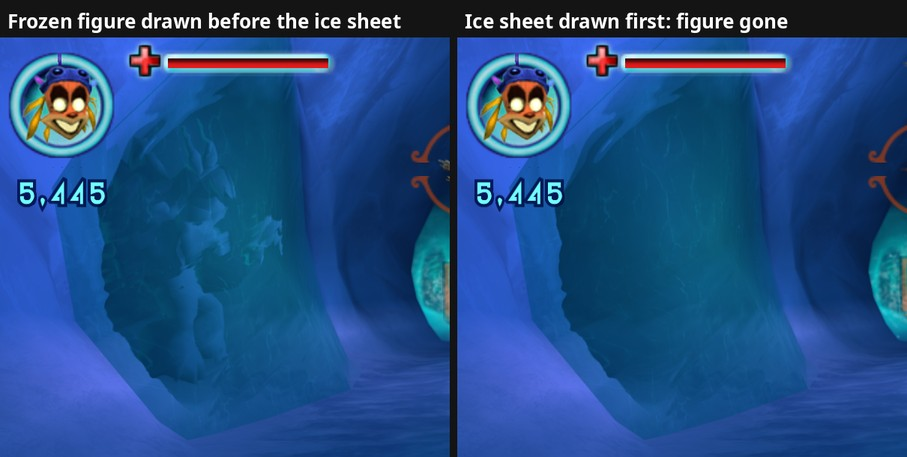

# 48. A frozen figure that flickers: the game's sort of see-through objects

In an ice cave of the Ratcicle Kingdom a frozen figure stands behind a sheet
of clear ice. While explosions are on screen (a masked co-op player firing
down the tunnel works well) the figure vanishes for a frame or several and
comes back. The emulated picture does exactly the same, so this is the
original game's behaviour, not a native-renderer gap. The port now sorts
these objects itself (`src/native/translucent_sort.cpp`,
`--translucent_sort_fix`, on by default).

## 1. What the photos showed

A burst of F10 photos (about 5 per second) with their draw lists:

- Every opaque mesh, and the figure's own draw, is in every frame. Nothing is
  skipped and no limit is near (about 130 draws per frame).
- The camera is the same in "visible" and "gone" frames (a pixel-shift search
  of the background finds no movement).
- The only difference is the ORDER of two see-through draws. The figure is a
  simple-material mesh (6678 indices, alpha blended, writes depth). The ice
  sheet in front of it is a bump-material mesh (45 indices, refraction, also
  writes depth). Figure first = visible; sheet first = gone, 18 of 18 frames.
  When the sheet comes first it fills the depth buffer, and the figure
  behind it fails the depth test.

## 2. How Pure3D orders see-through objects

`TranslucentTraversal` (RTTI, vtable `0x8200D658`) collects one 100-byte
entry per see-through primitive group (slot 6, `sub_823AD538`). Slot 3
(`sub_823ADA00`) sorts an array of pointers to the entries with the C
library's `qsort` (`sub_8245D000`) and the compare function `sub_823AD928`.
The objects are then drawn in that order, far ones first.

| Entry offset | What |
|---|---|
| `+0x00` | bounding sphere centre x, y, z in view space (z = depth, bigger = farther) |
| `+0x0C` | sphere radius |
| `+0x10` / `+0x1C` | bounding box min x y z / max x y z (view space) |
| `+0x28` | the drawable |
| `+0x30` | its prim-group record (`+4` = the PrimGroup) |
| `+0x58` | byte: sort layer (a float x 64; higher layers draw first) |

The compare, for two entries in the same layer:

1. spheres apart in depth: the farther one first;
2. boxes apart in depth: the farther one first;
3. otherwise (they overlap): the smaller sphere first; equal radius: the
   farther centre first.

Each rule makes sense alone, but together they can go round in a circle
(a before b, b before c, c before a): rule 3 decides one pair, rules 1 and 2
the others. A compare like that has no single correct order. The result
`qsort` returns then depends on every entry in the list, not just on the two
objects. A dump of the sorted list in the cave (the file's debug output,
below) showed the two objects:

| Entry | Radius | Box depth |
|---|---|---|
| frozen figure | 2.48 | 36.05 .. 46.13 |
| ice sheet | 16.13 | 27.05 .. 56.09 |

The figure sits inside the sheet's bounds, so rule 3 puts it first, and it
shows through the ice. An explosion adds particle-system entries (some with
large bounds). These close a circle through rules 1 and 2, and in those
frames `qsort` happened to put the sheet first.

## 3. The fix

`sub_823ADA00` is replaced. Every pair of entries is decided by an exact
copy of the game's compare (checked against the disassembly). The order is
then built from those decisions: each step draws an entry that no remaining
entry must come before.

- Without a circle there is exactly one such entry at every step, so the
  result is the order the game's rules ask for. It is the same order `qsort`
  gives in calm frames (checked entry for entry).
- In a circle every remaining entry has something "before" it. The next one
  is then picked within the highest remaining layer (layers never form
  circles), taking the entry whose box near edge (min z) is farthest. An entry
  entirely behind another always has the farther near edge, so this follows
  rules 1 and 2. Near edges within about a centimetre count as equal, and the
  game's own decision for that pair wins.

In the cave the frozen figure must precede the sheet (rule 3) and its near
edge (36) is farther than the sheet's (27), so the figure is always drawn
first, whatever the explosions add.

A first version ranked every entry by its near edge alone. It fixed the
explosion case but made a new flicker while a player walked: the sheet and a
second ice layer around the figure (mesh 51, radius 16.9) share their front
plane (both near edges 27.05, or 29.04 from another camera position), so
rounding picked their order frame by frame. The figure behind them looked
sharp in one order and faint in the other. Walking adds large particle
entries (radius around 210, the footstep dust's bounds), so circles form
often there. Keeping the game's own pair decisions, plus the tie rule above,
gives the same order in every frame: 41 photos and 25 list dumps of a walk,
layers always in order, the sheet always before the second layer.

The fix changes the game's own draw order, so it applies to both pictures.
`--translucent_sort_fix=false` (or the console's
`flag translucent_sort_fix false`) brings back the game's `qsort` for
comparisons.

## 4. Debug output

While a PDDI trace records a frame (`--debug_pddi_trace_dir` plus F10 or the
trigger file), the sorted list goes into the log, one line per entry in
drawing order: layer, sphere, box depth, drawable and PrimGroup addresses.
The PrimGroup matches the `xnContext::DrawPrimBuffer` calls in the trace of
the same frame.
