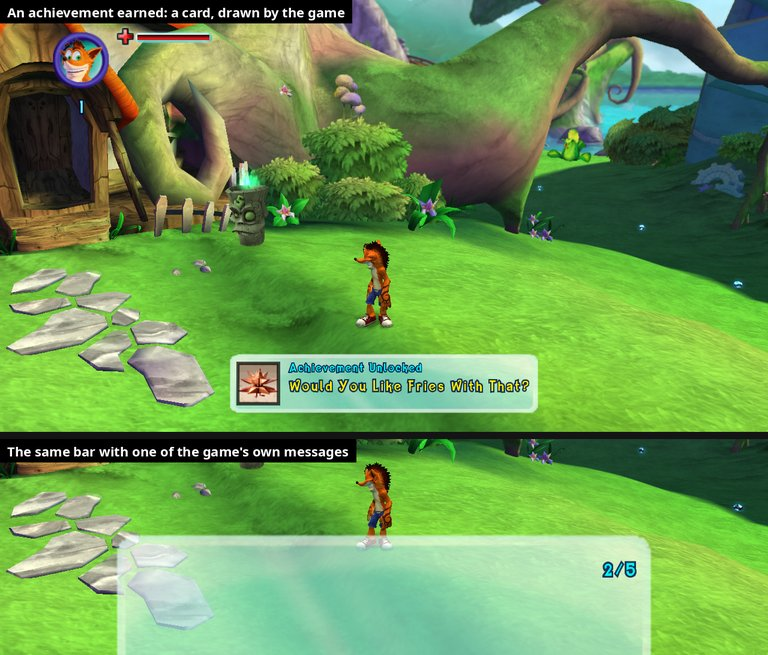
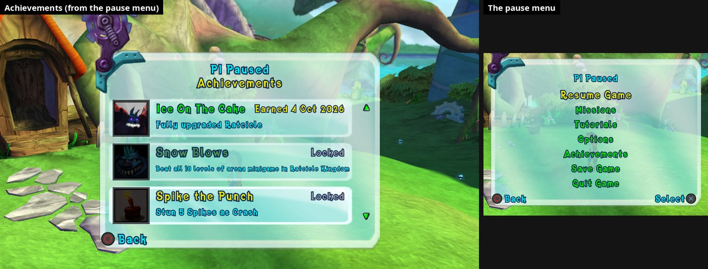

# 51. Achievements: one record for the whole game, a notification in the game's look



The Xbox 360 kept achievements for the player's profile and showed its own
pop-up (the console's "Achievement unlocked" toast). Neither exists on a PC.
The port keeps them itself (`src/achievements/achievements.*`):

* the game's own 48 achievements, earned exactly when the
  original earns them;
* **one record for the whole game**, whatever save is played, as on the
  Xbox: `<saves folder>/achievements.toml`;
* a **notification** in the game's own look at the **bottom centre** of the
  picture, with one of the game's own jingles (stinger_reward).

## 1. Where the achievements come from

`default.xex` carries the title's data: an XDBF block (the "SPA") with every
achievement's id, name, description, locked description, picture id and
gamerscore, in every language the game shipped, plus the pictures as PNGs.
The SDK reads it at start-up (`KernelState::LoadAchievementsData`, in the
language of `--user_language`). The port takes the list from there
(`rex::system::AchievementInfo`) and the pictures through the SDK's
`AchievementIconCache`. All of it is read from the player's own disc at run
time; none of it is in the port.

The ids are not 0-47: they run from 17 to 78 with gaps (17 "Stone Cold
Crash", 70 "Neo Is Getting Angry", ...). The console command
`achievement list` prints the whole list with each one's state.

Their texts follow the player's text language since 2026-10-31: the title
data's own words in English, German, French, Spanish and Italian, the game's
in-game list (the one the other consoles show in their pause menus) in the
disc's other languages. Details: findings/49 s.7.2.

## 2. How the game earns one

Radical's achievement manager queues 28-byte entries (end pointer at
manager `+168`). Its writer `sub_82292938` takes the LAST entry, copies it to
`+180` and calls the XAPI wrapper `0x82300670`:

```
XUserWriteAchievements(count = [manager +204], entries = manager +180,
                       overlapped = manager +136)
```

which sends the Xbox system message `0xB0008` to app `0xFB` (`lis r4,11` /
`ori r4,r4,8`, `li r3,251`, through the import thunk `0x824BB98C`). Each entry starts with an `XUSER_ACHIEVEMENT`:
`+0` user index, `+4` **achievement id**. The manager polls the overlapped
(`sub_82291BB8`) before writing the next one; when nothing was started it
simply moves on (the cheat menu's "blocked" path already relied on that,
findings/27 s.7).

The writer is replaced: the entry leaves the queue, the id goes into the
port's record, and nothing reaches the emulated Xbox. Checked with the cheat
menu: "Max level" on the Ratcicle made the game queue id 18 ("Ice On The
Cake"), which the cheat rule then blocked as before.

The game has no achievement pop-up of its own. Its in-game messages about
unlocks ("Wumpa dolls complete - concept art unlocked", "Minigame victory -
Crash skin unlocked!") are its own rewards, not Xbox achievements; the text
banks have no other "achievement" string. The main menu's stats page counts
them (`frontendCrashStats_Achievements`).

## 3. The record

```toml
# Mind over Recomp: the achievements earned in Crash: Mind over Mutant.
# ...
[unlocked]
29 = 2026-09-26T06:36:42Z  # Can U Dig It?
```

One line per achievement: its id and the date it was earned (UTC), with its
name as a comment. Written whole (temporary file + rename); a file that
can't be read is never overwritten (that session's unlocks stay in memory).
It sits beside the saves because it is progress like them, and because test
runs on a copy of the saves (`--user_data_root`) then keep their own.

Before this the SDK kept unlocks in
`<saves folder>/achievements/565507FA.toml` (`[unlocked.<id>] filetime =`,
Windows FILETIME). When the port's record doesn't exist yet, those are
copied in (FILETIME -> Unix time); the old file is left as it is.

Progress cheats (cheat menu) still stop unlocks for the rest of the session.

## 4. The notification: a card on the game's own message bar

The game has a pop-up of its own at the bottom of the screen:
**`InGame_MessageBar`**, a glass bar 600 x 180 game units at (20, -45) (at
720p: x 190-1090, from y 517 to the bottom edge) with a title, a message
and a counter ("2/5"). The level scripts fill it: voodoo doll pick-ups,
objectives, "concept art unlocked". Its pieces:

| | |
|---|---|
| Object | inside the front end at `+1428`, vtable `0x8203B128` |
| Set-up | `sub_8226C108`: `+128` page, `+132` title, `+136` message, `+140` counter, all hidden; `+4` bit 0x80 = set up (in play) |
| Queue | `+8`: up to 5 entries of 20 bytes, end pointer `+108`: `+0` f32 seconds, `+4` title key, `+8` message key, `+12` counter value, `+16` counter max |
| Add | `sub_8226C5E8` (r5 flag, r6 message key, r7 title key (0 = none), r8 / r9 counter, f1 seconds): queues, shows the page, starts the slide (interpolator `+144`) and plays FE_SFX `back`, at once. Only caller: the script action `sub_82294F30` |
| Update | `sub_8226C2F8`: every frame while a message is up, its title and message from their KEYS (`sub_82371C58`, a text's string from the bank by key) and the counter (shown when value >= 0 and max > 0); counts the time down; then the next message, or slides away and hides the page; waits while `sub_8223D340` / `sub_820C9F48` say so |
| On screen | page `+110` bit 0x80, from the add until it has slid away |

An earned achievement **joins that queue** as one more message, so the game
itself slides it in and out, it waits its turn behind the game's own
messages (and theirs behind it), and it waits through cutscenes like them.
It looks like the port's achievement card, not like the bar:

* the bar's page gets five more elements (data patch, `options_page.cpp`):
  `AchPopGlass` (the save list's glass, `FE_Common_GlassPanel_Rectangle_Small`,
  white at 78 %, 346 x 67 units at (147, 20): at 720p 520 x 100 pixels, 30
  above the bottom, centred), `AchBarIcon` (one FRAME per achievement:
  `scrooby::SetFrame`), `AchBarRing`, `AchPopTitle` (cyan) and `AchPopName`
  (yellow);
* our entry: title key 1, message key 0, counter value -1 (hidden) and max =
  `0xAC4E0000 | id`, which is how an entry is known to be ours;
* while ours is up (or sliding away) the bar's own glass, title, message and
  counter are hidden every frame (its Update shows them again each frame)
  and the card shows; its by-key text calls on the bar's title and message
  are skipped (`sub_82371C58` wrapped); the add's own `back` sound is muted
  (`scrooby::SetSoundsMuted`, honoured by the front end's sound player
  wrapper) and the jingle plays when the card comes up;
* the card's texts are placed at run time: "Achievement Unlocked" at 0.6 x,
  the name at 0.9 x (smaller when it doesn't fit), each box moved so its
  left edge stays where it should after the scale around its centre.

The bar is only set up in play, and achievements are only earned in play:
an earned one waits until the bar can take it (set up, room in its queue).

| Piece | From |
|---|---|
| Glass | `FE_Common_GlassPanel_Rectangle_Small.tga`, the save list's panels |
| Picture | the achievement's own, from the XDBF, as a menu sprite (s.6) |
| "Achievement Unlocked" | `Titans_Small`, the titles' cyan |
| Name | same font, the selected item's yellow |
| Sound | FE_SFX cue `objective1` = `fe_and_pickups\stinger_reward.wav` (picked by ear from `objective1`, `objective3` free_life, `objective4` upgrade reveal, `multiplier` and the first choice `objective5` stinger_unlock; console `achievement cue <name>` tries any cue) |

The FE_SFX bank's cues are listed in `default.rcf` next to their clips
(`SeqEventClip`): `objective1` / `objective2` = `stinger_reward`, `objective3`
= `free_life`, `objective4` = `upgrade_reveal` + `voodoo_doll_reveal_02`,
`objective5` = `stinger_unlock`, `select`, `back`, `confirm_YES`,
`confirm_NO`, `countdown`, `timeout`, `multiplier` (mojo_collect_timer_01),
`starter_pistol` (go_03), `arm_wipe` (glass_slide_09)... The game's `ta-da`
lives only in level sound banks. `scrooby::PlayCue` plays any of them.

How it got here: the first version drew the same card over the finished
picture (ImGui), and had to take turns with the bar by holding and
replaying the bar's add calls. Drawn that way it wasn't in photos and sat
over the port's own ImGui windows. Riding the bar's queue gives turn-taking
for free and makes the card part of the game's picture.

A spawned voodoo doll (`Collectables:c_voodooWhumpa`) doesn't trigger the
bar: the level script that counts the dolls only knows its own. The test
command `achievement bar <seconds>` adds a message of the game's kind
(empty text, counter 2/5) through the same add.

**No gamerscore.** The title data gives each achievement points (1000 in
all), but gamerscore was the Xbox profile's number, summed across a
player's games: on a PC it means nothing, so it isn't shown anywhere (the
log lines still print it).

## 5. Options

Display tab, heading **Achievements**: **Notifications** On / Off
(`achievement_popups`; off = still earned and recorded, no card) and
**Jingle** On / Off (`achievement_sound`; greyed while notifications are off).

## 6. The Achievements screen



**Achievements** is in the pause menu (after Options). (It was in the main
menu too for a few days; the achievements are earned in play, so it was
taken out there. The screen's main menu code paths below still work but
aren't reached.) It opens a LIST OF CARDS in the game's usual
glass panel at its full size (the pause menu's: the Options screen draws
its page and panel at 0.85 x, the list doesn't), three at a time, one
achievement each: its picture on the left in a dark frame, its name, its
text in small print under it (the game's own "how to earn it" text while
locked), and "Locked" on the right of a locked one (an earned card shows
no date: it said nothing useful, and the name gets the whole line). The selected
card is solid glass with a yellow name, the others see-through; locked ones
are darkened. Up / down move one achievement (the list scrolls), left /
right four, the mouse selects by hovering and its wheel scrolls, the arrows
beside the cards show there is more (and scroll when clicked). Back closes
it. The heading "Achievements" sits under "P1 Paused".

**It is the Options screen in a second mode** (`options/options_menu.cpp`):
the same front-end states (main menu 96 via exit 77; in game 956 via the
pause menu's Options exit), so the slide-in, the glass panel, the prompts
and Back are the Options screen's. A request
(`achievements_screen::OpenNext`) made by the menu's pick is taken by the
screen's Enter. In that mode the rows, tabs and side card are hidden, and
the lower right "Select" prompt is cleared every frame (A does nothing
here). The Options screen moves its glass panel left by 110 units for its
side card; the list keeps it centred: in game the shared glass page isn't
moved (the in-game screen's Enter may run before the menu's, so it looks at
the request without taking it), and the elements the Options page itself
moves (the in-game title, the main menu page's panel, cogs, hinge and
title) are moved back to the middle and put back at Exit.

**The cards are the page's own elements**, drawn by the game:

* the pictures come from the player's XEX (the title data's PNGs), made
  into the menus' own sprite format by `ui/menu_pictures.*`: a 0x19005
  sprite (name, 640, 480, 0, 0, an empty name = one byte, 1 image, 0) > a
  0x19001 image (0x36B0, width, height, 8, 1, 1, 2) > a 0x19002 data
  (size + a palette TGA: 256 colours by median cut, 32-bit entries). 48
  pictures of 64 x 64 = 251 KB per package, added to the main menu's
  package and every in-game menus package. A first version wrote a u32
  where the game has the one-byte empty name: everything after it slid 3
  bytes and the loader read the image count as 64 MB (the allocator
  `sub_82280200` crashed on a null arena: the crash report named it);
* plus `AchRing.tga`, a square outline drawn by the port (5 of 64 pixels),
  tinted by the elements that use it;
* per card (`options_page.cpp`, `options_page.h` THE ACHIEVEMENTS LIST):
  `AchCard<k>` (the save list's glass, 438 x 70 units from x 85, the first
  card's top at y 304, 78 apart: the last ends at y 78, above the prompts'
  line), `AchCardIcon<k>` (one FRAME per
  achievement), `AchCardRing<k>`, `AchCardName<k>`, `AchCardState<k>`,
  `AchCardDesc<k>`; `AchHeading` in the tabs' line; `AchUp` / `AchDown`
  (the map's arrow, as the Options list's markers) beside the first and
  last card. The small texts are scaled around their box's centre, so their
  boxes are moved to keep the edge they're read from; long names and texts
  shrink to fit.

The menu's own up / down still runs (CMenuAction asks MovePrevious /
MoveNext and plays `up_right` / `down_left` only when they say "moved",
0x820D2B08 / 0x820D2B4C): for this screen they say "no move"
(`options_menu::TurnPage` returns -1), and the screen plays one sound
itself when the selection really moves.

Earlier versions: a grid of the pictures drawn over the glass by ImGui (not
in photos, over the port's ImGui windows, couldn't put the selected picture
over its neighbours); then a grid of real page pictures; then cards without
the glass panel. The cards inside the panel match the game's other menus.

**The menu items** are copies made by the data patches
(`options_page.cpp`): the pause pages' `OptionsItem` copied
right after itself as `AchievementsItem`, the items spread over the same
span (`InGame_Pause`: 7 items 35 apart; `InGame_Pause2Player`: 8 items 30
apart). The words are written at run time (no text bank has
"Achievements"). Only `InGame_Pause` and `InGame_Pause2Player` are shown by
the pause state; the `_NoSave` pages are left alone.

**The pause decision** (`sub_82121B48`, node 868) maps the selected item to
an exit by index, twice:

| Item | 1 player (`InGame_Pause`) | 2 players (`InGame_Pause2Player`) |
|---|---|---|
| Resume / Missions / Tutorials | 891 / 892 / 893 | 879 / 880 / 881 |
| Drop Out | | 882 |
| Options | 894 | 883 |
| Save Game | 897 | 886 |
| Quit Game | 898 | 887 |

It is wrapped; while it runs, the game's GetMenuIndex answers for these
two pages go through a filter (`mouse_menus::SetMenuIndexFilter`): the
Achievements item answers Options' index (and, once the Options exit comes
back, the screen is told to open as Achievements); the items after it
answer one less. Checked: Achievements -> 894 + the grid, Options -> 894 +
the Options tabs, Save Game -> 897 (the save list), Quit Game -> 898 (its
question). The Options screen opened after an Achievements visit has its
title, tabs and rows back and no grid.

## 7. Not done yet

* The SDK's own F7 achievements window still shows the SDK's old record.
* "Going native": achievements were one of several users of Xbox system
  messages (`XMsgStartIORequest` / `XMsgInProcessCall`, ~44,000 calls a
  session from the others), so that counter doesn't move yet.

Tested with the debug console on a copy of the saves: the list (48), the
copy of 22 earlier unlocks, `achievement show` (the card on the bar, a long
name, the bar's own look back for a game message after it), the game's own
unlock call (id 18 through the cheat rule), the Options rows (Jingle
greyed), settings saved; the Achievements list from the pause menu (scroll
to the end, Back, the Options screen opened afterwards intact; at full size
and, before the item was taken out there, from the main menu too), the pause menu's other items after the new one; 0 errors. Not
checked: the 2-player pause menu, a real controller, Windows, a doll picked
up in a level.

Console / FIFO: `achievement list`, `achievement show <id>` (card only),
`achievement unlock <id>` (recorded + card), `achievement bar <seconds>` (a
test message in the game's bar), `achievement cue <name>` (another jingle
for the session).
