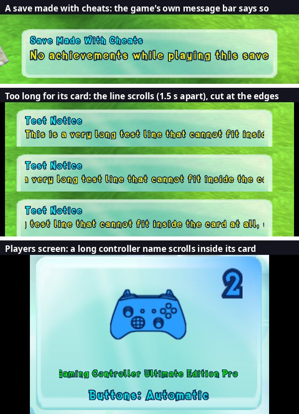

# 52. One Tools menu, cheats that mark the save, and scrolling text

Three changes that belong together: the port's tools leave the function
keys, using cheats is now said out loud and remembered in the save, and a
menu text too long for its box scrolls through it instead of running out.

## 1. The Tools menu (F1)

Over time nearly every function key had picked up a tool: the SDK's F3
(debug overlay), F4 (all settings), F7 (its achievements list) and backtick
(log console), and the port's F2 (save rename box), F5 (Cheats), F6
(Controls), F8 (second window), F9 (renderer switch), F10 (photo), F11
(material highlight) and F12 (particle experiments). One stray press
switched the renderer or opened a window in the middle of play.

Now (`src/ui/tools_menu.*`):

| Key | Does |
|---|---|
| F1 | opens / closes the **Tools** menu |
| F2 | hides / shows the whole HUD (s.5; not a cheat) |
| F11 | fullscreen on / off (borderless; remembered in `settings.toml` like the Options row) |
| Delete | still deletes the save under the cursor on the Load / Save Game screen |

Every other tool is a button in the Tools menu, in four groups: Game
(Cheats, Controls, Fullscreen, Take a photo), Picture (Switch renderer,
Second window), Saves (Rename, Delete) and Developer (Debug overlay, Log
console, All settings, SDK achievements list, Highlight a material, Particle
experiment). Each button's tooltip names the key it used to have.

**How.** The tools stay ordinary key binds of the SDK's registry
(`rex::ui::RegisterBind`), registered with NO key. The menu runs a bind by
name: `rex::ui::InvokeBind(name)`, added by SDK patch **0017**, which also
registers the SDK's own four binds without a key (their callbacks touch
`ReXApp`'s private overlay members, so only the registry can reach them).
Each bind is still a setting (`bind_photo`, `bind_renderer`,
`bind_settings`...): `bind_photo = "F10"` in `settings.toml` puts a tool back
on a key. The keyboard driver still keeps F1-F12 and backtick out of the
game's own keys (no clash if a key is given back).

The debug console's `fkey` now only reaches F1 and F11; `tool <bind name>`
runs any button (`tool bind_cheat_menu`, `tool bind_photo`).

## 2. Cheats: said once, remembered in the save

Before, only "progress" cheats (level ups, mojo, god mode...) switched
achievements off, and only until the game restarted; some cheats slipped
through, and nothing told the player. A save made with cheats looked like
any other, which also hides a likely cause when a strange state in a save
gets reported. The rule now (`src/cheats/cheats.*`):

1. **Opening the Cheats menu** (or any console cheat, or a spawn) = cheats
   enabled. The game's own message bar shows a card: **"Cheats Enabled / No
   achievements until a save is loaded"**. No achievement is earned from
   then on (the replaced writer `sub_82292938` drops the unlock, findings/51).
2. **Loading a save** (or starting a New Game) ends it, unless a cheat
   switch is still on (god mode, no AI, game speed, freeze, hidden HUD, free
   camera) or the Cheats menu is still open: those carry their cheat into
   the loaded game. A "Cheats Enabled" card not shown yet is dropped then.
3. **A save written while cheats are on is MARKED** "made with cheats". Loading
   it later keeps achievements off for as long as that game is played
   (card: **"Save Made With Cheats / No achievements while playing this
   save"**), and every save of that game carries the mark on. The mark
   follows the game, not the slot: overwriting a marked file with a clean
   game gives a clean file.

The log says each step ("Cheats: ENABLED", "session cleared by loading save
10", "save 51 was MADE WITH CHEATS", "PC save drive: ... marked as made
with cheats"), so a bug report's log shows whether cheats were involved.

**The mark in the file.** The save file's port trailer (findings/46 s.6,
`saves/save_files.h`) was `"MORE"`, version 1, count 4, four outfit picks
(10 bytes). An 11th byte of FLAGS may now follow; bit 0 = made with cheats.
It is written only when a flag is set, so a plain save keeps the 10-byte
trailer, and older builds of the port (which read the first 10 bytes and
check the version) read a marked save as before. The game never sees the
trailer (the PC save drive keeps it apart, findings/32).

**The card.** It is the achievement card on the game's message bar
(findings/51 s.4) with words of the port's: `achievements::ShowNotice`
queues it like an earned achievement under a reserved id (0xFFFE; the real
ids run 17-78), one in the bar's queue at a time (its words wait in the
port until it shows). A notice has no picture, so its text starts where the
picture would be. Notices show even with `achievement_popups` off. The bar
only works in a level: a Cheats menu opened in the main menu shows its card
once a level is played.

Tested by console on a copy of the saves: menu opened in play -> card,
pause -> Save Game over the current save -> file 20,216 bytes ending
`MORE 01 04 FF FF FF FF 01`; a file with the byte -> card at load, writer
blocked; a cheat before a clean load -> cleared; god mode on before the load
-> still enabled.

## 3. Scrolling text (marquee)

Several of the port's screens shrink a text that doesn't fit its box, down
to a minimum size (achievement names 0.6x, the Players screen's device
names). Below that the text ran out of its box. Now such a text scrolls
(`src/ui/marquee.*`): it shows its start for 1.6 s, scrolls left at 45
canvas units a second until its END reaches the box's right edge, holds 1.2 s,
fades out (0.35 s), comes back at the start fading in, and goes round again.
One way only, no back and forth. Letters are cut cleanly at the box's edges.
Only texts the port asks for scroll, and only when they still overflow after
the screen's usual shrinking:

* the achievement / notice card's second line (the card stays up long enough
  for one whole pass);
* the Achievements screen's names and descriptions (one description, about
  Ratcicle Kingdom's arena, ran 9 units past its room: it now nudges);
* the Players screen's device names.

Every other text of the game draws exactly as before.

**How the game draws a text.** A Scrooby `Text` (RTTI `Text@frontend@pure3d`,
vtable `0x8200BE2C`) draws itself in slot 6, `sub_82371D68`. It writes every
glyph as immediate geometry: `xnContext::BeginPrims` -> the glyphs' vertices
into D3D's command buffer -> `EndPrims`. Measured on the card and the
screens: one batch per text, a **triangle list, 6 vertices per glyph**,
stride 24: position x y z at +0, colour (ARGB) at +12, uv at +16.

**How it scrolls.** `sub_82371D68` is wrapped: while one of the port's texts
draws, the renderer hooks that sit in front of `BeginPrims` / `EndPrims`
whatever renderer shows the picture (`native/recorder.cpp`) hand each batch
over before `EndPrims` closes it, and its vertices are changed IN PLACE, in
the game's own data:

1. the text's left and right x as the game laid it out are measured (in
   whatever units the vertices use: only proportions matter, so the page's
   scale, slide or position need no knowing);
2. the window = the text's box: its width is the text's width x room / width
   (the caller's measurements with the game font), placed by the text's
   justification byte (+108: 0 left, 1 right, else centred) as the game
   places a text in its box;
3. every vertex moves left by the scroll position, then is CLAMPED to the
   window, with its texture u moved by the same fraction (each glyph's own
   du/dx from its triangle), so a glyph at an edge is cut, not squeezed;
4. every vertex colour's alpha is multiplied by the fade.

The emulated GPU reads the command buffer after `EndPrims`, and the native
recorder copies the vertices after the change too, so both pictures scroll
the same way. Nothing of ImGui is involved.

**Care taken.** A text that fits is never touched (0.5 % slack). A text that
stops being drawn (its screen closed) and isn't asked for again is forgotten:
its page may be unloaded and the address be another text later. A batch that
isn't a triangle list or 4-vertex quads is left alone.

## 4. Test cards

Three Developer buttons in the Tools menu (console: `achievement test card`,
`test long`, `test message`), for checking the message bar without earning
anything:

* **fake achievement**: the achievement card with a real achievement's
  picture and the made-up name "Fake Achievement";
* **long fake achievement**: the same with a name too long for the card (it
  scrolls, s.3);
* **game-style message**: a message in the bar's OWN wide look (glass,
  title, message, counter "2/5"), as the game shows a voodoo doll or an
  objective. The game adds those from a level-script action,
  `CActionDisplayMessageBar` (`sub_82294F30`: message key +8, title key +12,
  counter +16 / +20, seconds +24, flag +28 -> the bar's add `sub_8226C5E8`),
  with text-bank keys that can't be named yet; so the port queues its own
  entry (as for the card) but leaves the bar's glass and texts showing and
  writes its words into the bar's title and message texts (their by-key
  setter is skipped while the port's entry is up) and its counter text.

## 5. Hiding the whole HUD (F2)

The Cheats menu's "Hide the HUD" (findings/27) only skipped the HUD
controller's draw (`sub_8226A998`: portraits, health and special bars). The
mojo count and multiplier, the combo meters and the texts stayed. Now every
piece is skipped at its own draw, so the game's state (which page it shows,
a meter counting hits) carries on and comes back as it was
(`src/ui/hud_hide.*`):

| Piece | Draw skipped |
|---|---|
| portraits, bars | CHUDController slot 4 `sub_8226A998` |
| mojo count + multiplier, hints, mission title, counter-button texts | the page `InGame` |
| announcements, "Join Game" corners, collectable counter | the pages `InGame_Announcement`, `InGame_CoOp_Player1-4`, `InGame_CollectableCounter` |
| combo meters | CComboCounter slot 4 `sub_8225CF30` |
| "counter now" prompts | CCounterOpportunityDisplay slot 4 `sub_8225E658` |
| player markers over heads | CPlayerIdentifierArrow slot 4 `sub_8226D358` |
| the POCKETED mutant's portrait and bars (top centre, apart from the players' HUD) | CStoredActorDisplay slot 4 `sub_8226E688` |
| a timed challenge's clock | CTimerDisplay slot 4 `sub_8226EBF8` (a tail call into `sub_8226ECE0`) |
| any health display drawn outside the HUD controller | CHealthDisplay slot 4 `sub_822685F0` |

Pages: Scrooby's Page draw is `Parent@frontend` slot 6 `sub_82371270`, shared
with groups and layers, so only `this` in the list of HUD pages (found by name
once a second) is skipped. The message bar's page (`InGame_MessageBar`) is
NOT hidden: it says "HUD Hidden / Press F2 to show it again", and the game's
voodoo dolls and objectives keep showing there.

**F2 is not a cheat**: it sets the same switch without enabling cheats, and
a hidden HUD doesn't keep cheats on across a load (it changes nothing in the
game). From the Cheats menu it's part of using cheats (opening that menu
enabled them). A "HUD Hidden" card still waiting when F2 shows the HUD again
is dropped; the same card twice in the queue is kept once.

Tested by console in Ratcicle Kingdom (P1 in a titan, a combo of 12): with
F2 every piece above is gone, F2 again brings them back. The pocketed
mutant's portrait stayed in the first version (found in play); the front
end's element classes (RTTI: every `CFrontendElement` subclass) were then
checked one by one: the others draw through the pages above or not at all
(slot 4 = `blr`: announcement, hint, mission, collectable counter).

## 6. Not done / to watch

* The Tools menu is an ImGui window (a developer and power-user panel, like
  the Cheats menu); photos don't show it.
* The Players screen's names still shrink to its old minimum before they
  scroll; with scrolling there, a larger minimum would read better.
* Other places where long texts could scroll (Options values such as long
  monitor names) still use their own fitting.
