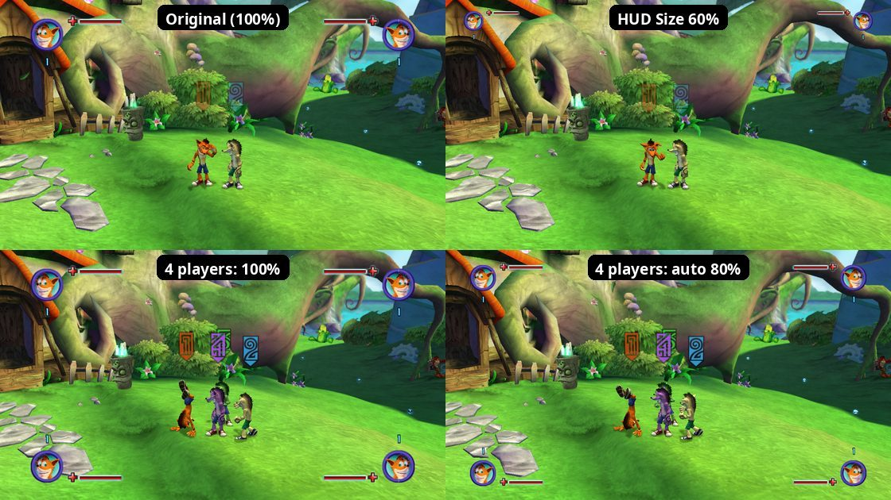

# 53. HUD size: the whole HUD smaller, each part toward its own corner

Options → Display → **HUD** has two rows (`src/ui/hud_scale.*`):

| Row | Flag | Values | Does |
|---|---|---|---|
| HUD Size | `hud_size` | 30-100 % (default 80; 100 = the original) | every HUD part drawn smaller, shrunk toward the screen corner it belongs to |
| Smaller for 3-4 Players | `hud_smaller_four_players` | On (default) / Off | while player 3 or 4 is in the game, the HUD is at most 80 %, so four corners fit; a HUD Size already at or under 80 % stays as it is (a ceiling, not a further shrink: no 50 % x 0.8 = 40 % surprise) |

The default is 80 %: a little smaller than the original, the size four
players need anyway (the original-size corners, findings/26 s.18, take a lot
of the screen with four). At 100 % nothing changes with one or two players.
Both are global settings (`settings.toml`, like every Options row), not
stored in saves.

## 1. What shrinks, and toward where

| Part | Drawn by | Shrinks toward |
|---|---|---|
| a player's corner: portrait, health and special bars with their icons, level-up ring | `CHealthDisplay` slot 4 `sub_822685F0` (player at `+144`) | that player's screen corner |
| its mojo count, multiplier and the multiplier's effect | Scrooby texts on the page `InGame` (the display keeps them at `+84`, `+36`, `+48`) | the same corner |
| "Join Game" + button | the pages `InGame_CoOp_Player1-4` | that player's corner |
| combo meter | `CComboCounter` slot 4 `sub_8225CF30` (player at `+3148`) | its player's corner |
| "counter now" star and its Y | `CCounterOpportunityDisplay` slot 4 `sub_8225E658` (player at `+8`, the Y text at `+16`) | its player's corner |
| the pocketed mutant's display | `CStoredActorDisplay` slot 4 `sub_8226E688` | the top centre |
| the collectable counter ("0/6" + its icon) | the page `InGame_CollectableCounter` | the top right corner (s.3) |
| a timed challenge's countdown clock | `CTimerDisplay` slot 4 `sub_8226EBF8` | the top right corner (s.3) |
| the announcement ("Attack" + its button, a dig spot's prompt) | the page `InGame_Announcement` | the left edge, at its own height (s.3) |

Corners: player 1 top left, player 2 top right, player 3 bottom left,
player 4 bottom right (where findings/26 s.18 puts their HUDs). The margins
to the screen edges shrink with the parts, so the whole HUD looks like the
original seen smaller.

Not touched: the markers over the players' heads (in the world), the message
bar, hints, the mission title and every menu.

## 2. How: one matrix around each part's draw

Every 2D thing the game draws goes through PDDI's matrix stack. The
context's virtual methods (vtable `0x82016744`, stack type in `r4`, 0 = the
one all 2D drawing uses):

| Slot | Address | Does |
|---|---|---|
| 13 | `0x8243E1E0` | load identity |
| 14 | `0x8243E260` | load 16 floats from `r5` (copies, marks the transforms dirty) |
| 15 | `0x8243F0C0` | push: the top copied one deeper |
| 16 | `0x8243F0F0` | pop (marks the transforms dirty) |
| 17 | `0x8243E2D8` | multiply the top by the matrix at `r5` |
| 18 | `0x8243F118` | the top's address |

Matrices are 16 big-endian floats, row vectors (a translation sits in row
3, bytes 48-56), and a multiply applies BEFORE what is already on the
stack: the game's helpers on the object at `*(0x82571B80)` (its `+0` = the
context), `sub_823812E8` translate and `sub_82381308` scale, are called
local-last, OpenGL style. `xnContext::UpdateTransforms` (at each
`BeginPrims`) turns the stack into the vertex shader's matrices.

Each 2D frame starts from identity: the front end's 2D set-up
(`0x822630F4` onward: identity, scale by 1.5 / 1280, move by (-320, -240))
and every Scrooby page (`0x8237BD10` onward: push, identity, the same scale
and move, then x 640: page elements are in canvas / 640 units). So the
stack's OUTPUT is the same for all parts: the screen runs from x -0.5 to
0.5 and y -0.28125 to 0.28125 (720 / 1280 / 2), whatever a part's own units
are. A first version moved the corner in canvas units (640 x 480): the
displays and meters shrank right, but every Scrooby text vanished (their
units are canvas / 640, so the "corner" was hundreds of screens away).

Around a part's draw the port pushes, reads the top `M`, loads `M x C` where
`C` = move the corner to 0, scale by `s`, move back (in that output space: for
the affine `M` only columns 0-1 change, x `s`, and row 3 gains corner x
(1 - `s`)), runs the original draw and pops. Everything the part draws,
including Scrooby texts that multiply their own element matrices on top,
shrinks toward the corner. None of the game's positions change, so the
layouts, the texts' pulses and the players 3-4 mirroring keep working, and
both renderers show the same picture.

A player's texts sit on the shared page `InGame` and are drawn by the page,
not by their owner. The display and the counter prompt note their texts'
addresses when they draw; the Scrooby text draw (Text slot 6
`sub_82371D68`) looks the text up there. A note not renewed within a second
is forgotten (a page unloaded with its level: the address may be another
text by then).

## 3. The right-hand column and the announcement

The collectable counter and a timed challenge's clock are placed by code (their
page elements sit at (0, 0)), from the screen's width in canvas units `W`
(`sub_820C4D60`: 853 on a wide screen, else 640):

| Part | Set-up | Position (canvas units) |
|---|---|---|
| counter | `sub_8225C0B0` | count right-aligned at x = (W - 640) / 2 + 640 - 160, the "/max" 5 units right of it, the icon at +70; y 305 (icon 300) |
| clock | `CTimerDisplay` draw `sub_8226ECE0` | under the counter, right-aligned with the icon |
| announcement | `sub_8225B5E8` | x = (W - 640) x -0.5 + 50 (50 in from the left edge), y 300, left-aligned |

So the original lays the counter and clock out as a column under player 2's
corner, as far from the right edge as player 1's portrait is from the left.
Both pages also slide in from the side (`sub_82370E98`, the page's x).

A first version shrank both toward the TOP CENTRE: at 80 % the column moved
into the middle of the screen's right half, at 50 % the clock reached the
screen's middle. Now they shrink toward the top right corner and stay in the
column at every size, with or without player 2. The announcement shrinks toward
the left edge at its own middle (canvas y 318), so it keeps its height and a
smaller margin.

To see them without finding an arena, the console has `cheat hudtest
counter|timer|announce|all` (`hud_scale::ShowTestParts`): a "0/6" counter
through the game's own add / show (`sub_8225C520` / `sub_8225C7E8` on the
counter at front end `+1628`), a 30 s clock (`*(front end +260)`: seconds at
`+12`, start `sub_8226EC40`, shown = `+4` bit 0x40, CFrontendElement slot 5
`sub_8225F0F0`; the objectives' `CActionStartTimer` / `CActionSetTimer` reach it
through the HUD controller at front end `+252`), and an "Attack TEST"
announcement (front end `+72`: seconds at `+16`, text at `+12`).

## 4. Open

* A collected mojo still flies to the point in front of the camera where the
  original-size portrait is (findings/26 s.40): at small sizes it ends a
  little short of the corner.
