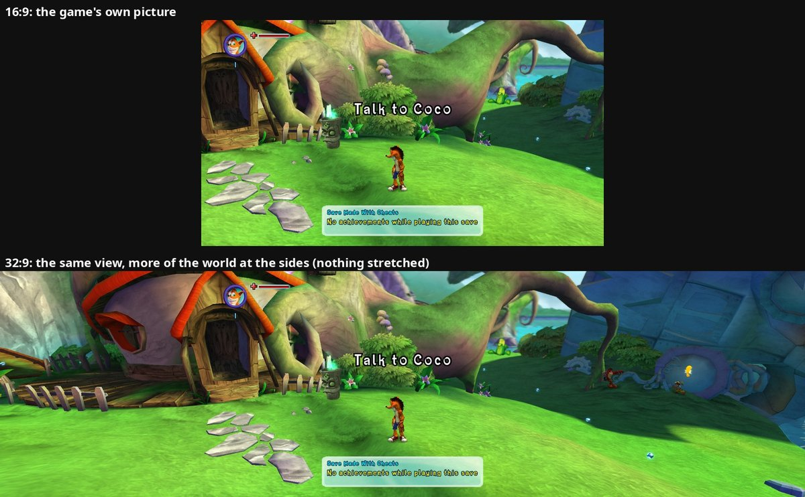
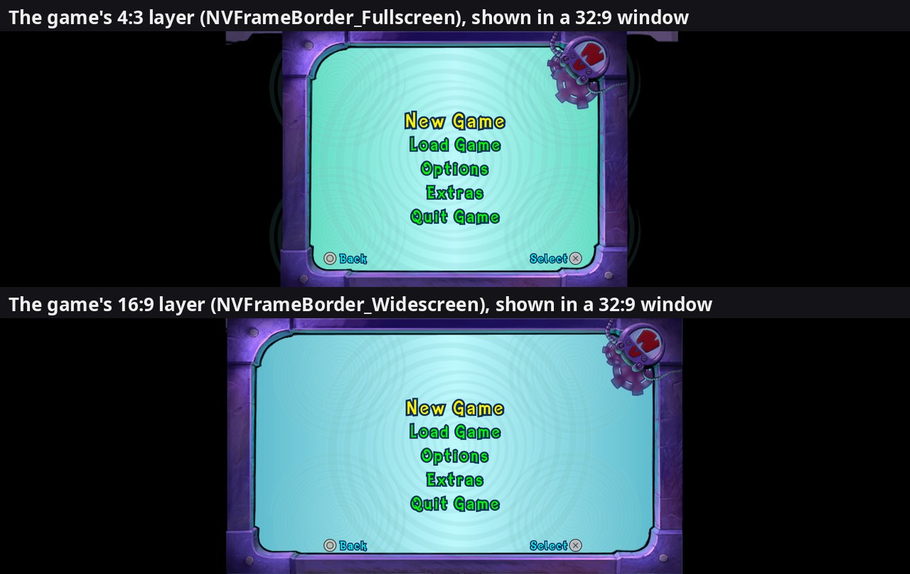
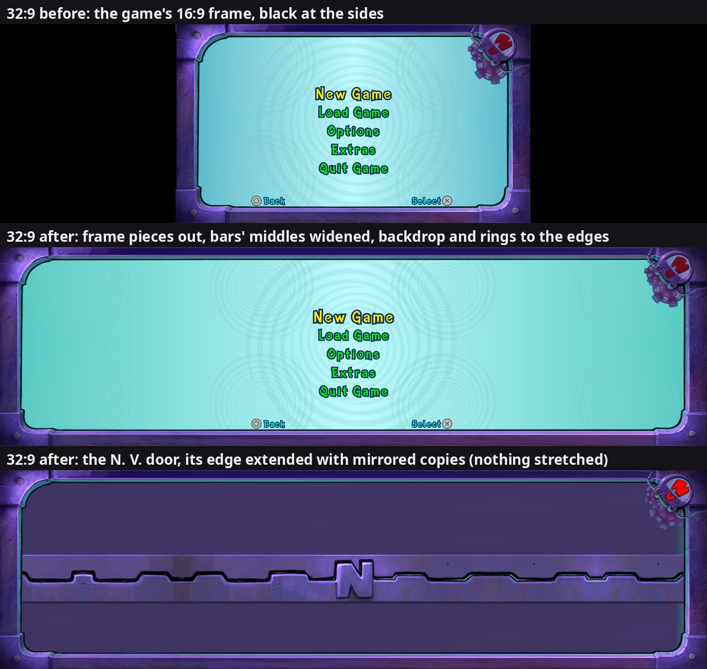

# 56. Widescreen (any aspect ratio) and resolutions in pixels

The Xbox 360 game draws a 16:9 picture. With the native renderer drawing
alone (Renderer: Native Only), the port now draws a picture of any shape from
16:9 up to just over 32:9, "Hor+": a wider picture shows **more of the world
at the sides**, the top and bottom stay exactly the game's, and nothing is
stretched. Options -> Display -> **Aspect Ratio**: Match Window (the
window's shape), 16:9 (original), 21:9, 32:9. A window of another shape gets
black bars. Options -> Graphics -> **Resolution** is now a list of real sizes
at the shape in use ("2560 x 1080" at 21:9), plus Match Window (the window's
own size).

*The same moment at 16:9 and 32:9: the middle is the same picture, the sides
are new.*

Code: `src/native/widescreen.*` (the shape, the display, the camera, the
projection), `src/native/render_targets.*` + `native_renderer.cpp` (wider
images), `src/ui/hud_scale.cpp` (HUD placement), `shaders/bink.vert`
(movies). Flags: `aspect_ratio` (0 window, 1 16:9, 2 21:9, 3 32:9),
`widescreen_max_aspect` (3.6), `widescreen_hud` (0 in place, 1 screen edges),
`render_resolution` (a height in pixels, -1 = the window's), and for tests
`debug_widescreen_aspect` (pretend the window has that shape).

## 1. Where the game gets its screen shape

The game asks its display object (`xnDisplay`, pointer at `0x82571B78`):

| Field | 16:9 value | Read by |
|---|---|---|
| +1640 / +1644 (ints) | 1280 / 720 | surfaces, viewports, tiling strips (left alone) |
| +1680 / +1684 | 1 / 0.5625 | slot 0x54 (their ratio): the views (`sub_82379B20`, `sub_82379D40`) |
| +1688 / +1692 | 1 / 0.5625 | slot 0x50 (their ratio): the default projection, the menus' projection, the camera's aspect |
| struct at +1672 | | slot 0x48: the menus' canvas scale `min(+1680 / 640, +1684 / 480) / +1688` (`sub_8237BBE8`), the canvas <-> screen conversions (s.4) |

Found by logging every caller of the getters for a few seconds of play, then
by answering them with a 21:9 aspect on a 16:9 picture (the menus and the
world both changed shape).

For a picture of aspect A the port writes +1680 = (16/9) / A, +1684 = 1 / A,
+1688 = 1, +1692 = 1 / A. The menus' projection (aspect A) and their canvas
scale (1 / (480 A)) then cancel out: every menu page keeps its size and stays
centred, and the extra room is at the sides. (A first try kept +1684 at
0.5625 and widened +1680: the menus came out 1.33 times too big at 21:9.)

## 2. The camera: wider, but the game keeps thinking in 16:9

The projection is set through **pddiBaseContext::v29** (`sub_8243E4B8`: near,
far, HORIZONTAL field of view, aspect; rebuilt by xnContext slot 122
`sub_824319A8`, perspective case: x extent = near x tan(fov / 2), y extent =
x extent / aspect). A handler on it widens only the call from the camera's
view set-up (return address `0x82381BAC`): the field of view becomes
2 atan(tan(fov / 2) x A / (16/9)), the aspect A. The vertical view stays the
game's. The menus' calls and the context's restores (which re-send what was
stored) are left alone.

Writing the camera's own fields (+16 field of view, +28 aspect) before its
matrix rebuild did nothing: the camera's set-up writes them again. That set-up
is **Camera slot 0x14, `sub_82381E78`** (read with xexdis; +28 found with the
debug console's `who`):

* +16 / +20 field of view, +24 the viewport's shape;
* +28 aspect = +212 x +24 x display slot 0x50 (the wide one);
* +40 = 1 / tan(fov / 2), +44 = +28 x +40 (projection scale factors);
* +48..+76 the **view frustum's side planes**, what the game culls with.

The port's wrapper hands it the wide field of view, so the frustum covers the
whole wide picture (with the 16:9 one, scenery at the sides was only drawn
once the 16:9 view reached it: Wumpa Island at 32:9 went from 281 to 497
draws). Then it writes the game's 16:9 view back into +16, +20, +28, +40 and
+44 (forgetting +20 put the camera far back). So everything the game itself
computes with its camera (aiming, positions on screen, markers, the co-op
camera's fit) sees the middle 16:9 of the picture, exactly what the original
shows there.

## 3. The native renderer: one more scale, sideways

The render scale (findings/45) is split: widths and x positions are scaled by
scale x A / (16/9), heights and y by scale. Surfaces, resolve rectangles and
destinations, viewports and clear rectangles follow, and the presenter gets
the picture's real shape (it letterboxes it into the window). The game still
works in its 1280 x 720 pixels.

**Resolution** is now the picture's height in pixels (360-4320, -1 = the
window's; the old values 0-3 still mean 720p, 1080p, 1440p, 4K):
scale = height / 720.

## 4. What else had to follow

* **Canvas <-> screen.** `sub_82265D40` (a 640 x 480 canvas point -> a 0..1
  screen point) and `sub_82265DE8` (back; used by the players' markers,
  `sub_8226B2C8`) read display slot 0x48. They feed the game's 16:9 camera, so
  a handler on that getter (`sub_82433960`) answers them a copy with the
  16:9 numbers. Without it, the markers sat at the screen's edge although the
  players were on screen, and the mojo cursor aimed off.
* **Movies.** The movie player fits its quad to the display's shape: at
  32:9 it already sits in the middle 16:9 sideways (x 320..960 of 1280) but is
  shrunk in height by the same factor (y 180..540). `bink.vert` scales the
  height back up around the centre: full height, bars at the sides.
* **Cutscene bars.** Page `InGame_LetterBox` (two black quads, x -110..750 =
  exactly the 16:9 screen) is drawn with one more matrix that stretches x by
  A / (16/9) (`hud_scale` kStretchWide).
* **Fades and dimmers.** A flat, untextured 2D quad of up to 6 vertices that
  covers the whole 16:9 screen (a fade to black: 6 vertices, x 318..962 of
  1280 at 32:9) gets its x stretched the same way in the renderer
  (`CoversGameScreen`).
* **HUD.** "In Place" (default) keeps it where the 16:9 game has it; "Screen
  Edges" moves the corner pieces sideways to the wide corners (hud_scale,
  output-space shift). HUD Size's anchors follow the picture's height
  (0.5 / A) and the 16:9 corners.
* **A collected mojo's flight.** The game aims 4 units in front of the camera
  at the ORIGINAL portrait's place (findings/26 s.40). Midasm hooks at
  `0x82198ED8` / `0x82198F6C` scale the aim's side and up parts by the
  portrait's move (HUD Size, Screen Edges).
* **Sliding menus** (`ui/slide_fade.*`). The pause menu (and other screens)
  slide a whole page or layer sideways through its TRANSFORM every frame
  (`CPauseScreenAction`'s step `sub_820DA120` -> `sub_82370E98(element, x,
  0)` on the glass layer +32 and the menu page +20, x from the interpolator
  at +52; out to about 850 canvas units). On a 16:9 screen the panel leaves
  the screen before the slide ends; at 32:9 it stayed in view at the side
  and vanished at once. Now a Parent element (page, group, layer: slot 7 =
  `sub_823711A8`) whose canvas centre has moved more than 120 units fades
  out (smoothstep) and is fully see-through at 426.7 units, the 16:9
  screen's half width: the panel's centre at the original screen's edge.
  How: element +16 = its 4 x 4 matrix (row vectors; translation at +64, in
  canvas widths, written by `sub_824239E0` / `sub_82370E98`), +110 bit 0x40
  = the matrix is in use. The colour an element draws with is CACHED at
  +84: its own +80 times its parent's, worked out by the parent's draw
  (`sub_82371270`) only while +84 holds the sentinel `[0x824EA190]`. Slot 7
  stores +84 and resets every child to the sentinel. So the fade = slot 7
  with the faded colour before the element's draw, the old +84 after.
  (Lowering +80 at draw time came one step late: a slid-out panel stayed
  faintly visible.) Only on a picture wider than 16:9; flag
  `menu_slide_fade`.
* **Pointer maths.** The mouse in menus, the Wii-style cursor and the FPS
  counter use `widescreen::Game()` (the middle 16:9 of the picture) or
  `Picture()`.

**The Players screen's prompt row** (2026-11-14). The row under the
Players cards ("Buttons", "Back", ...) is the port's own, not the game's
FE_Buttons bar, so it didn't hide while the panel slid in or out: on a wide
picture it stayed solid in the side room until the slide ended, while the
panel faded. It now shows only while the screen takes input (front end
+8592 bit 0x40, read by the screen's Update each frame), like the game's bar
and the Options tab keys. The screen redraws its cards only when something
on them changes, so "takes input" is part of that check (without it the row
kept the state it had when the screen opened: hidden).

## 4b. How the original handles 4:3 and 16:9 (research for the main menu frame)

The 360 game supports both TV shapes. Everything hangs on ONE flag, and
on art that was laid out twice.

**The flag.** At start-up `sub_82433B00` (xnDisplay) asks the console's
video mode (`XGetVideoMode`): `fIsWideScreen` sets byte +1656 bit 0x40,
"HD" sets bit 0x80 and 1280 x 720 (else 640 x 480). `xnDisplay` slot 0x60
(`sub_824337A8`) = "is the TV widescreen?" = that bit. `sub_824337E0`
then fills the display shape: +1680 = 1, +1684 = 0.75 (4:3), or 0.5625
when the flag is on. So for a 4:3 TV the menus' canvas (640 x 480) fills
the screen exactly; for 16:9 it is fitted to the height and centred, and
the canvas is 853.3 units wide (x -106.7 .. 746.7).

**Who asks the flag.** Only four functions:

| Function | What it does with it |
|----------|----------------------|
| `sub_820D7B88` | main menu frame (below) |
| `sub_820C4D60` | "visible canvas width": 853 (16:9) or 640 (4:3); used by the frame's backdrop, the players' markers (`sub_8226D358`, `sub_8226B2C8`), the canvas <-> screen helpers (`sub_82265AE8`..`sub_82265BD0`), `sub_8226ECE0` |
| `sub_822B3ED8` | camera code (callers `sub_8210A3B8`, `sub_8223FA08`, `sub_822B4020`, ...) |
| `sub_8226B2C8` | players' markers |

**Art laid out twice.** Most pages need nothing: their decorations
(backgrounds, the title's black polygon, the N. V. door, cutscene bars)
already reach x -110 .. 750, which a 4:3 TV simply never shows. The main
menu frame is the one exception: page `FE_NV_Frame.pag` (package
`cdd70a8c`) holds TWO complete frames:

* layer `NVFrameBorder_Fullscreen` (4:3): pieces inside x -7 .. 647
  (top bar `NVFrameTop2` 416 wide, cogs at x 493-602);
* layer `NVFrameBorder_Widescreen` (16:9): the same pictures moved out to
  x -109 .. 750 (left / top-left / bottom-left at x -107..-109, right /
  corners / cogs / light at x 596-750) and the top and bottom bars
  (`NVFrameTop` / `NVFrameBottom`, 256 x 64 pictures) stretched to 616 / 618
  units wide.

The frame belongs to `CNVBackgroundAction` (vtable `0x82024374`, global
`0x8259AD84`): its set-up `sub_820D7960` finds both layers (+24 4:3, +28
16:9), the cogs (+40/+44 4:3, +48/+52 16:9) and lights (+56 4:3, +60
16:9). Its EVERY-FRAME update `sub_820D7B88` asks slot 0x60 and shows one
layer, hides the other (+110 bit 0x80 = visible), turns that layer's cogs
by the shared angle `0x8259AD8C` and pulses its light. Flipping bit 0x40
in a running game swaps the frames at once (photo below).

**The cyan backdrop** is not on any page: the same class draws it in code.
`sub_820D8208` = two gradient quads whose width comes from `sub_820C4D60`
(so 640 or 853: the gradient follows the TV shape by itself);
`sub_820D8408` = five rotating `NV_Background_Circle.tga` rings (scale 128
at canvas x 100 / 540, y 100 / 380, and scale 256 at the centre 320, 240)
through the helper `sub_820D8048`.

**What a wider screen needs** (canvas width 480 x A, so each side moves by
d = 240 x (A - 16/9) units: 142 at 21:9, 427 at 32:9):

1. Frame: the 16:9 layer's left pieces x - d, right pieces + cogs + light
   x + d, top and bottom bars widened by 2d around their centre (the game
   already stretches these 256-pixel bars 2.4 times; at 32:9 they would
   be about 5.7 times). Positions written from the stored originals each
   frame, after `sub_820D7B88`, so a window resize just works.
2. Backdrop: `sub_820C4D60` answered with 480 x A only for the two calls
   in `sub_820D8208` (lr `0x820D823C` / `0x820D8260`); the markers and the
   canvas helpers keep 853 (game logic stays 16:9, section 2).
3. Rings: repeat the 4 outer rings every 440 units sideways (their own
   spacing) so the sides are not plain gradient.
4. Later screens of the same family: the N. V. door transition
   (`GameStart_NV_Door.pag`, x -110 .. 750) would leave the sides open.

**Built** (`ui/menu_frame_wide.*`, flag `menu_frame_wide`, on): all of 1-4.

* The frame: CNVBackgroundAction's update `sub_820D7B88` is wrapped. The 11
  pieces are found by name INSIDE the 16:9 layer (+28; the 4:3 layer uses
  the same names) through the Parent lookup `sub_82371A90`, their original x
  (+92) kept. Every frame, BEFORE the original: x = original -/+ d (the
  original then turns the cogs around their moved centres; moving them after
  would turn them around the old ones). At 16:9 d = 0: the stored positions
  go back.
* The bars. A Scrooby picture wider than its texture is drawn as TILES, one
  immediate draw each: the top and bottom bars three (left end, plain
  middle, right end), the door's edge strips five (x -110, 144, 398, 652,
  714, 744). A first version stretched each whole bar (a sideways scale on
  its transform): that widened the END tiles about 2.4 times at 32:9, so
  their see-through end columns showed the cyan backdrop beside the corner
  pieces and the bottom bar's bevel no longer met the corner's (thin stripes
  and small steps at all four joints). Now the vertices are edited in the
  game's own data while the picture draws, like the scrolling texts
  (`ui/marquee.h`): the Sprite draw `sub_82374098` is wrapped (in
  `ui/voodoo_card.cpp`, its one wrapper) to say which picture draws, the
  renderer's immediate-geometry hooks (`native/recorder.cpp`, any renderer)
  hand each tile over right before EndPrims. Canvas x of a vertex = 320 +
  240 A x (x c4.x + y c5.x + c7.x) (the MVP's first column: the menus'
  projection puts the picture's 480 A units into clip -1..1). The end tiles
  move RIGIDLY by -d / +d with their corners, the middle tile's left edge -d
  and right edge +d. Which tile is which: against the bar's ends measured in
  the previous frame, on the very first frame against the picture's box (+92,
  +88). The joints now match the original 16:9 frame's within about 2/255
  (frame pixels only; the rest = the cogs' turn and the light's pulse).
* The N. V. door (`GameStart_NV_Door.pag`: two plain bodies + two edge
  strips with interlocking teeth and the "N" handle) opens from the middle
  when the title gives way to the main menu. The BODIES (NV_door.tga, which
  the game itself stretches 13 times over 860 units) are mapped wider: the
  part outside x 144..398 so the 16:9 screen's edges (x -106.7 / 746.7)
  land on the wide picture's. The STRIPS are not stretched at all (a first
  version mapped them like the bodies: the outer teeth came out wider). They
  are cut and extended with copies of their own slices: the Sprite draw is
  called several times (passes, same registers), and in each pass every
  tile is CROPPED (its texture u cut at the same place), moved or MIRRORED,
  or hidden (zero wide). Left: cut at x -94 (just inside the rounded left
  end), copies of the slice -94..144 going left, then the left end piece.
  Right: cut at x 652, copies of the slice 398..652 going right, then the
  end tiles (652..744, the angled end). Plain repeats would leave steps of
  2-4 pixels (720p) at every join: the hand-drawn teeth are not all at one
  height (both outlines measured per column on a 16:9 photo of the opening
  door: the left plateaus at rows 333 / 409 and 330 / 406, the right ones at
  335 / 414). So the copies ALTERNATE mirrored / normal, like reflections
  between two facing mirrors: every join meets its own reflection and the
  outline runs on without a step; an even number of copies puts the end
  piece back against the slice's own edge. Both strips get the same cuts and
  copies, so the teeth still interlock; everything inside the 16:9 screen is
  drawn as the game draws it. 2 copies a side at 21:9 and 32:9 (7 passes).
* A RENDERER BUG found on the way: the title's black background (6 vertices,
  untextured, x -110..750) is drawn ON TOP of the arriving menu frame and
  door for a frame or two. The renderer stretches such full-screen quads
  (`CoversGameScreen`, s.4), but the test read the vertices of `frame_`,
  which since the record thread (findings/57 s.10) is the NEXT frame the game
  is filling; `RecordPasses` draws `pass_frame_`. The test then looked at
  other vertices and failed now and then: one frame with the door bright at
  the sides and black in the middle. Now it reads the frame being drawn.
  Photo bursts of the hand-over (every 30 ms) show the sides fading in with
  the middle.

## 5. Not done

* Players' markers for a partner standing in the wide sides (the game's
  "off screen" test is its 16:9 view).
* The emulated picture stays 16:9 (the rows are greyed out without Native
  Only).
* Windows: untested.

## 6. Tested

Console-driven runs on an installed-style test copy at 16:9, 21:9 and 32:9
(`debug_widescreen_aspect` and the fixed choices): Crash's house, Wumpa
Island, N. Gin's lab cutscene, boot and story movies, a level's fade-in,
the pause menu and Options (rows, sizes updating live), two players' markers,
spawned mojo, all resolutions (2560 x 1080, 5120 x 1440, Match Window).
Sliding menus at 32:9: the pause menu opening and closing photographed
frame by frame (gone at the sides, solid at rest), pause -> Options
unchanged, 0 errors.
Main menu frame: main menu at 21:9 and 32:9, Options and the quit question
inside the frame at 32:9, a live change 21:9 -> 16:9 (the original layout
back) and the flag turned off at 32:9 (the original 16:9 frame back), 11 of
11 pieces found, 0 errors.
