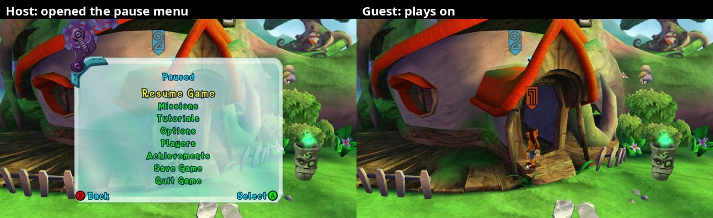
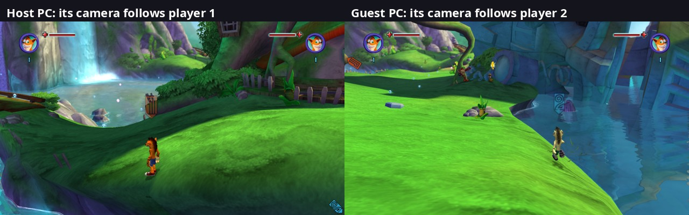

# 68. LAN co-op, first step: two copies of the game in lockstep

Status: **experimental test tool** (online plan milestone M1). Two copies of the
game, one player each, on one PC or a LAN. Source: `src/net/`.

## 1. The idea

Each PC runs the whole game. Only the players' controller states travel over
the network: every game frame, each PC waits until it holds every player's
controller state for that frame, then runs the frame with them. Nothing about
the world (positions, enemies, objects) is ever sent.

This only works because the game is **deterministic** once the fixed step is on
(every frame exactly 1/60 s, helper threads and sound on game frames, the
random generators and the clock reset at the session's start; earlier work in
`fixed_step.h` and `system/helper_threads.h`): the same inputs on the same
frames give the same world, frame for frame, on every PC.

```
PC 1 (host)  = player 1            PC 2 (guest) = player 2
reads its keyboard / pad           reads its keyboard / pad
for frame N + delay                for frame N + delay
         \______ UDP: "my input for frames A..B" ______/
frame N runs when both inputs for N are in (the FRAME GATE)
```

**Input delay**: a press read on frame N plays on frame N + 3 (50 ms at 60 fps,
`--net_delay`). The other PC's packet has that long to arrive before anybody
waits.

## 2. Where it hooks in

| Place | What happens there |
|---|---|
| Main loop's pass hook (`fixed_step.cpp`, the frame's time delta) | Before the helper threads may run: this PC's input goes out for frame s + delay, and the frame that just ended is fingerprinted. After they may run: **the frame gate** (a wait here is "between frames": the helpers finish their work, their clock stands still, so a wait changes nothing in the world). |
| The game's controller read (`sub_824742F0`, wrapped in `save_library.cpp`) | Socket 0 = this PC's own player (keyboard + pads), noted; then every socket is answered from the session's table for this frame: sockets 0-1 = players 1-2, sockets 2-3 "not connected". |
| The game's controller capabilities call (`sub_824742E8`) | Sockets 0-1 answer "standard pad" on both PCs. Without it the other PC's player never joined: the game creates a controller object only for a socket whose capabilities answer, so player 2's START was never read on the host. |
| Who has a controller (`players.cpp` PresentMask) | Players 1 and 2, on both PCs, whatever devices each PC has. |
| Session start (`fixed_step::StartSession`) | The front end's "Load successful" exit (state 282 -> 283) or quick load: clock + random generators reset from the host's seed; session frame 0 = the next main-loop pass. At most once per frame (two callers in the same frame would otherwise restart the clock twice on one PC only). |

Also changed for a session, because they read this PC's devices or write into
the world directly:

* the keyboard reaches the game as controller state (its native input events
  would reach only one PC's game);
* mouse aiming is off (it writes the aim point into the world, not through the
  controller state);
* player 1's "controller unplugged" watch is off.

## 3. The frame gate's margin

First version: wait for the other PC's input for frame s. The PC that started
first then ran exactly `delay` frames ahead of the other, with no room left on
its side: it waited a few milliseconds on nearly every frame (6,300 waits in a
2-minute run), and any late packet would have stalled it.

Now: wait for the other PC's input for frame s + (delay - 1) / 2, i.e. one frame
of room both ways at delay 3. And after a wait, the paced clock moves its
schedule by the time waited, so the PC that was ahead takes the other's
rhythm instead of keeping its own phase. Result: 9 waits after the start in the
same kind of run.

## 4. Is it still the same world?

Each PC computes a small **fingerprint** at every frame's end
(`world_hash::QuickFingerprint`: the main random generator + every player's
position, velocity and titan flag; never a heap address, which may differ
between PCs) and sends its newest 16 with every packet. The first frame where
they differ is reported on both PCs ("DRIFTED at frame N": log error, console
`net`, Network window). **Dump both sides** asks both PCs to record the world's
data at the same session frame; `tools/world_hash_compare.py` then names the
differing words.

The **world settings fingerprint** (`system/session_settings.h`) is compared
when the PCs connect: a different value is a warning on both (those settings
change what the game decides).

## 5. Tests (one PC, two windows)

Both copies load the same save; a recorded script drives each copy's player 1
socket (player 1's part on the host, player 2's part relabelled on the guest).

| Test | Result |
|---|---|
| 70 s, player 2 joins, both move and fight | Session starts on the same frame on both; player 2 joins on both; players' tracks identical on every frame (16,812 rows); fingerprints equal on every frame |
| One copy with a different world setting | Warning on both at connect |
| Random generator poked on the guest (console `write`) | "DRIFTED at frame 972" on both PCs |
| Dump both sides | Both dumps at the same frame; the compare tool names exactly the poked word |

## 6. Security (the LAN part)

Packets carry a magic word, a protocol number and the session's random token;
every size and range is checked before use; after the handshake only the one
peer address is listened to. Only controller states, frame numbers and
fingerprints are accepted: nothing a packet says is ever used as a memory
address or a file name.

## 6b. A player disconnects

Nothing pauses. When the other PC goes quiet (2 s without a packet) or leaves,
the PC that's left **plays on alone**: the other player's input is "nothing
pressed" from then on, so the frame gate never waits again. Their character
stays in the level for `--net_drop_after_s` (30 s; at once when they left on
purpose) and then **drops out by itself** through the game's own Drop Out (the
"controller disconnected" question isn't asked). Only the player who lost the
session sees a message (the message bar card "Disconnected"): a guest whose
host went quiet, or a PC that pressed Leave. The host's view is always "the
guest left", with no message.

| Test (drop after 5 s) | Result |
|---|---|
| Guest's PC stops answering | Host plays on, no pause; player 2 stays 5 s, then drops out; no message on the host |
| Host's PC stops answering | Guest plays on as player 2; player 1 drops out after 5 s; the guest sees "Disconnected" |
| Guest presses Leave | Player 2 drops out at once on both PCs; the guest plays on alone and sees "Disconnected" |
| 30 minutes, 2 players (108,000 frames) | In sync on every frame, players' tracks identical, 24 frames waited at the gate |

## 6c. Nothing pauses online

A pause would have to stop every PC's world because one player opened a menu.
Online, nothing pauses: the menu opens and the world runs on under it.

**How the game pauses** (found with the debug console's `who` on the paused
byte): the pause menu's script calls a script method (`sub_82123778`) that
calls the game manager's pause, `sub_8227C8E8(manager, on)`. It sets game
`+168` bit `0x20` (the AI, physics, sound and others skip their updates while
it is set), bit `0x80` of `+104`'s `+24`, and resets the input manager
(`sub_82274538`). During a session that function returns at once.

**The menu's owner stands still.** With the world running, the buttons pressed
in the menu would also move the owner's Crash: the menu reads the MENU input
map, the character the GENERAL / PLAYER / titan maps of the same controller.
The game already has the tool: a **locked** root input controller (its byte
`+516` above 0, `sub_82272D68`) answers "no" to every play question, which is
how cutscenes take control (`DO_LockAllControllers`; `AreControllersLocked` =
`sub_82265A60`, which also shows where player p's root controller is: the
input manager's (`game +56`) controller array `+8`, at the index
`sub_82266130(front end, p)` gives). The menus still hear their MENU map
through the lock. So while player p's menu is up, 1 is added to p's lock and
taken back when it closes. "A menu is up" = the game's flag (front end `+8594`
bit `0x80`, which comes with its pause and so never comes on online) or, in a
level, the front end has left GameRunning (state 489). The owner comes from the
port's menu-owner rules (who paused, who used the totem, ...). Both PCs see the
same menus on the same frames, so the lock changes on the same frame everywhere.
Checked every frame from the front end's frame (`sub_82261C40`): the frame
function's own checks don't run while the pause menu is up.

| Test (host opens the pause menu) | Result |
|---|---|
| The paused byte while the menu is up | 0 (the world runs) |
| The host holds the stick 3 s in the menu | the host's Crash doesn't move |
| The guest walks meanwhile | the guest's Crash walks |
| The host presses B | the menu closes; the host's Crash walks again |
| Both PCs | in sync on every frame |

## 6d. The menus online (totem, map, everyone's view)

Three more findings while testing every in-game menu online:

* **The menus need to see a pause.** Every frame the co-op join check
  (`sub_82264988`) copies the paused bit into front end `+8594` bit `0x80`
  ("a menu is on screen in play"); the menus' D-pad handling and the port's
  menu-owner rules read that flag. And the question box (the save totem's "Do
  you want to save the game?", update `sub_8225DE68`) closes itself in a level
  unless the game is paused (its check at `0x8225DEB4`; found with the debug
  console's `who` on its "answered" flag, front end `+216` bit `0x80`).
  Online, while a menu is up in a level (front end out of GameRunning 489),
  the **front end's frame** (`sub_82261C40`) runs with the paused bit set and
  gets it put back afterwards; the box's own update always does. The world
  (AI, physics, players, sound) never sees a pause.
* **The map belongs to whoever opened it**: the original lets any player's
  buttons work it. Online the opener is the player whose session input has
  Back down on the frame of the exit into the map (489 -> 502); their Crash
  is locked and only their buttons work it. **But the map is more than a
  page**: the game moves its one camera to a bird's-eye map view, so every
  PC's picture turned into the map. Until each PC has its own camera, the
  map stays closed online (the exit into it is answered "stay").
* **Only the owner sees their menu.** In lockstep every PC runs every menu,
  so every PC drew it over a player who keeps playing. Online, on every PC but
  the owner's, the menu pages aren't drawn (the Parent draw `sub_82371270`
  skips top-level pages other than the HUD's: `InGame`, the co-op corners,
  counters, announcements, the message bar, tutorials, the letterbox). The
  menu still runs on every PC.
* The pause menu's title is the solo game's own "Paused" (the game's text, in
  its language) for whoever opened it: the menu shows only on its owner's PC,
  so "P1 Paused" / "P2 Paused" tells nobody anything.
* A lost window focus no longer opens the pause menu online (with
  `background_input` off it would open on that PC only).



| Test (host opens each menu, the guest walks) | Result |
|---|---|
| Totem question | stays up on the host's screen only; the host's Crash still under a held stick; A = No (the default) back to play; the stick moves the box's cursor (left = Yes) as in the original |
| Pause menu | host's screen only; the guest plays on |
| Back (map) | stays closed online |
| Both PCs | in sync on every frame |

Open: while one player's menu is up, the other players' HUD disappears too
(the HUD hides itself when the front end reads "paused", and the front end
must read the same on every PC).

### The mouse in a menu (a desync found in play)

Two copies on one PC, player 1 paused with the keyboard (START, then A):
the host's copy went into Options, the guest's resumed the game, and the
worlds parted two seconds later (player 1 walked on one PC, stood in a menu
on the other). Both copies read the same START and A. The pointer resting
over the host's window had moved that copy's cursor: the mouse in menus
(hover and clicks, src/input/mouse_menus.cpp) acts on its own copy only and
is not part of the input the PCs share. Online the mouse now leaves menus
alone (hover, clicks, the wheel); keys and controllers still work, through
the shared input. A test with the host's pointer moved over its pause menu:
before, Options on one PC and Resume on the other; after, Resume on both and
identical worlds.

## 6e. Each player saves on their own PC

Online, a save is written only on the PC of the player who made it. The
host's save overwrites the save the session was loaded from, on the host's
PC. A guest's save goes into that guest's own copy (a new number in their
list, made at their first save), on the guest's PC; the host's files aren't
touched. A guest keeps a copy of the session only by saving. (Until the
round in 6h a guest's save was refused and every host save left a copy on
the guest's PC.)

Both PCs run the same game, so both run the save flow on the same frames. The
original flow opens the save list (totem "Do you want to save?" Yes = exit 837
-> AccessMemoryCard 359 -> ReadingCard 384 -> GameSlotScreen 386; pause menu
Save Game = 886 / 897, same way). That list comes from each PC's own save
files: a different number of saves or an "overwrite?" question on one PC only
would send the two front ends down different exits. So online the list never
shows:

* The storage steps run as usual (BeginAccess, the scan). At ReadingCard's
  decision (sub_8211DA80) the save library takes slot 1's "available slot"
  exit (408 -> AutoSaveGameScreen 326, script SaveGame(0)) instead of the list:
  the route New Game already uses for its first save. Slot 0 is "Create New
  Save" on every PC, so no overwrite step runs anywhere.
* SaveGame then writes "the game in progress's" file, chosen per PC: the host
  overwrites the save the session was loaded from; a guest writes its own copy
  (the first save of a game copies the loaded file to a new number, so both PCs
  overwrite an existing file; later saves overwrite that copy). The guest's own
  save is never written.
* Who made the save: the menu's owner (the totem = who used it, the pause
  menu = who paused; unknown = the host). On every other PC the save drive runs every step and answers like a write that worked, but
  leaves the disk alone: no write, no file moved to Backups, and a file the
  game deletes counts as gone for the rest of that save without being
  touched. The game's memory takes the same steps on both PCs; only the
  disks differ.

First try, dropped: the original's unused "ExitAutoSaveScreen" exits (totem
836, pause 885 / 896) go straight into 326. They skip BeginAccess, and the
EndAccess at the end freed a slot table that was never made (a write to
0x0000000C in sub_82360258).

| Test (save 2, two windows) | Result |
| --- | --- |
| Host: totem Yes | host's save written; the guest's copy byte-identical; same exits; in sync |
| Guest: pause -> Save Game | (first version: refused, card on both; in sync) |
| Guest: totem Yes | (first version: refused); now see 6h |
| Host: pause -> Save Game twice | copy made once, then overwritten; same exits; in sync |
| Offline: totem Yes | the save list opens as before |

The guest's copy can differ from the host's file in a few bytes: the save
buffer keeps leftover heap bytes after an empty string (the string itself is
empty on both). The heap's leftovers come from before the session started, when
the two PCs ran differently. The original game writes those bytes too; the game
data is the same.

## 6f. A stick is meant in its own player's camera (first step toward own cameras)

Every "which way does the player push?" question in the game (the fight
trees' walk, run, jump and aim, the script methods
GetSelfRelativeInputDirection and its siblings: about 20 callers) goes through
the input controller's sub_82272208 -> sub_82271E38. That function turns the
stick by the game camera's forward on the ground:

* normally the game camera, `*(*(0x8259B190) + 76) + 444` (a VectorCamera),
  virtual slot 14 -> a record whose +32/+36/+40 is its forward;
* while the controller's +520 top bit is set: a forward it holds (+464 /
  +472), so a camera cut doesn't swing what the stick means.

Both paths store x and z at r1+88 / r1+96 and meet at 0x82271F58. Today every
PC shows the same camera, so every PC turns every stick the same way. With a
camera per PC, player 2's stick would mean "left" on one PC and "back" on the
other, and the worlds would part.

The fix (src/net/online_sticks.cpp, a mid-function hook at 0x82271F58): each
PC reads its camera's facing on the ground at the start of every frame and
sends it with that frame's input as a 16-bit facing (65,536 steps a turn;
network protocol 2). Every PC then turns player P's stick by the facing that
P's PC sent for this frame. (Sent with every input, not only while the stick
is pushed: sub_82271E38 skips the camera while the stick is centred, and an
earlier version that noted the facing there sent a player's first steps
without one; see 6g.)
The cos / sin of the facing come from a fixed series in plain double
arithmetic (no fused multiply-add), so the result has the same bits on every
system (a C library's cos can differ in the last bit between Linux and
Windows). Until a PC's first facing arrives, the local camera is used (the same
on every PC as long as the cameras are).

| Test (save 2, two windows) | Result |
| --- | --- |
| Normal run | in sync on every frame; positions as before |
| Guest's sent facing turned 90 degrees (debug flag) | player 2 walks off turned, the same on both PCs; in sync |

Other game code reads the camera too: a scan for the
`*(*(game) + 76) + 444` pattern finds 48 functions. Among them are views
(markers over the players, the floating button icons, the sound listener, the
cinematic camera) but also world logic: an enemy task that circles the player
(CAITaskCombatMoveEncircle), the off-screen catch-up gate (sub_82235978), the
zones that run near the camera (sub_822F1F78, sub_822F4AA0), a Collectable
method. These decide whether each PC can show its own camera.

## 6g. Each PC's own camera: the experiment

The flag `net_own_camera` (with `coop_camera` on) makes each PC's camera
follow only its own player in a session: the co-op camera counts the other
players as absent. Two copies on save 2 (host stands, then walks left; guest
walks right, then up toward the water), with a per-frame log of the
fingerprint's parts (`--debug_net_fingerprint_log`: every player's raw
position and velocity bits, the random state) on both sides:



| Round | First difference | Cause | Fix |
| --- | --- | --- | --- |
| 1 | frame 1036: player 2's velocity, half a degree, the first frame they walk | the facing was only noted while the stick was pushed, so the first frames of a push went out without one and each PC used its own camera | send the camera's facing with every input (6f) |
| 1 | (found by reading, while chasing round 1; no visible change in this run) | sub_822718E8 decides "hold the old forward through a camera cut" from the local camera, writes the held forward (+464) and the hold bit (+520), sends the controller an event | mid-function hook at 0x8227192C: the sender's facing replaces the camera's direction there |
| 2 | frame 1885: player 2 deflected on the guest's PC only (velocity turned about 20 degrees, lifted) | zones RUN only when the camera is inside them (sub_822F4AA0, called by the zone check sub_822EFFD8): the guest's camera ran a zone around player 2 that the host's camera didn't | in a session sub_822F4AA0 answers "no" and leaves the zone alone: a zone runs when it is always on, the focus player's zone, or holds a player |
| 3 | none in that scene: in sync on every frame | | |
| 4 | a 30-minute random two-player script (jumps, attacks, B), frame 1276: player 1 parked on one PC only | B released 10 units from player 2: the game's off-screen CATCH-UP (off screen + B = forced into a mask) asks the camera whether the Crash is off screen (sub_82235978) | online plan 6.1, "no forced masks": in a session every Crash counts as on screen. A mask by choice doesn't ask the camera (coop_mask_from_anywhere) |
| 5 | frame 1307: the masked player 1 turned slightly differently on its host (forward row y 0.028 against -0.00006) | the mask turns toward what its player AIMS at; the aim is a ray from the camera through the player's 2D reticle spot (CReticleAimingBehaviour, sub_822AC668) | each input also carries its PC's whole camera pose (position, direction, up, field of view: the camera's own words; protocol 3). While the aim update runs for player P, the game camera holds P's sent pose (camera bytes +16..+251 saved, pose written, matrices marked stale, saved bytes restored after) |
| 6 | none: the 30-second replay of that script in sync on every frame | | |
| 7 | the full 30-minute script, frame 9430 (2.6 minutes): player 2 starts the same turn one frame earlier on the PC whose camera shows them; on the other PC they are off screen | a breakable prop player 2 targeted broke a frame later where it was off screen: props animate only when drawn (round 9 below) | three camera reads fixed on the way, none of them this one: the stick's direction sector for the fight trees (sub_8221DD70: camera direction -> the sender's, hook 0x8221DE00), the fight-tree condition "am I off screen" (sub_821BA090: "on screen" online), the held forward written at a controller UNLOCK (sub_82270FE8: camera direction -> the sender's facing) |

Round 7 in detail. Logging each player's controller state per frame (lock
word, hold bit, held forward, stored stick) shows the stick pipeline equal on
both PCs from frame 935 on, including every frame around 9430: the difference
is further along, in what the character does with the same input. Player 2 is
off screen on the host's PC at that moment (photos of both PCs) and the turn
comes about 15 frames after a light attack started: the lead is that characters
the camera doesn't see are updated differently (animation detail, an event
one frame late). The game's frustum test (sub_822ED0C8) is called only from
the render manager and zone drawing; what that leaves on a culled character
for game logic to read is the next question.

Round 8: player 2's behaviour objects, hashed per frame on both PCs, then
their raw words. Several differ long before the split, but mostly in harmless
ways: pointers to the SAME things at different addresses (each PC loads, draws
and sounds different things, so the heaps lay out differently), and
CSoundDialogueBehaviour's squared distance to the sound LISTENER (the global
at 0x82526324, set by the sound system = each PC's camera). The one that
mattered: CTargetingBehaviour (+0x3C, the candidate list) let go of its target
one frame apart. The write watch (`who`) on that list named the cause.

Round 9, the cause: the target was a breakable prop, and it BROKE one frame
later on the host. Logging every break with the game's call stack showed both
PCs breaking it from the same place: CRenderBehaviour's update (slot 4,
sub_82189D38) -> CRenderObject3D's update (slot 5, sub_822B6608) -> the
prop's StateProp animation (sub_82380B00 -> sub_8237F5C0) -> its "break"
event -> the breakable (sub_821959AC). sub_822B6608 has an ANIMATE ONLY WHEN
DRAWN rule: with flag +404 bit 0x40 set and the object not drawn lately (its
draw stamp against the render frame counter at **0x82571B88), it only adds the
time step to +400 and returns; the next time it is drawn it advances by all of
it at once. Player 2's prop was off the host's screen: its break event fired a
frame later there. Online the flag is cleared for the call (and put back): every
object advances every frame on every PC. The 3.5-minute replay is then in sync
on every frame, every break on the same frame on both PCs.

Round 10, harder scenes. The two halves of three earlier test scripts (each
PC plays one player's part) with own cameras and the per-frame log on both PCs:

| Scene | Frames | Result |
| --- | --- | --- |
| A titan ridden in a courtyard (50 s) | 3,640 | world in sync on every frame |
| N. Gin's lab cutscene and the fight after it (90 s) | 5,963 | in sync; the cutscene and the fight on the same frames |
| Walking into the next level (60 s) | 4,160 | in sync; both arrive at the same spot on the same frame |
| Five minutes of random jumps, attacks and jacks around the titan (two players) | 18,638 | world in sync; one controller state parted (below), fixed |

The log still showed two harmless differences. The dialogue sound's distance
to the listener (each PC's camera), which only the sound uses. And a
controller that NO player owns (sockets 3-4 in a two-player session) holding
each PC's camera direction as its "held forward": the unlock at a level's
fade-in (sub_82270FE8) copies the camera direction there, and the online
replacement skipped controllers without an owner. Player 2 is handed such a
controller for a while when they join, and the hold logic compares against
that value, so it now gets player 1's sent facing (the same on every PC).

The controller state that parted in the five-minute run: player 2's "hold
the old forward" started on the host 10 frames before the guest (frame
11361). Besides its angle test, the hold logic (sub_822718E8) starts a hold
at once when a question sent to the game object's +12 (event 9, no player
named in it) answers yes; it answered yes for about 40 frames on both PCs,
each at its own moment: the question is about the game camera. It now goes
the way of the facing: each PC sends its own camera's answer with every input
(protocol 4), and player P's controller gets the answer P's PC sent (a
controller nobody owns gets player 1's). After that the same run, the three
scenes and the titan run were identical on every frame, controllers included.

Every game function that asks the camera "is this point in view" (camera
slot 17) was listed: the fight-tree condition and the co-op catch-up (both
answered online already), the camera's own focus list (view side), and one
more: enemies circling a player (a step of CAITaskCombatMoveEncircle,
sub_820BE878) count one step more while they are OFF screen. Online every
enemy now counts as on screen, the original's answer while the single camera
sees it.

The pattern worth remembering: the engine saves work on what the camera
doesn't see, and with a camera per PC "what the camera sees" differs. Every
such saving that changes WHEN something happens in the world has to be turned
off online.

The random generator stayed identical in every round. The tool that named
each cause: `--debug_net_fingerprint_log=<file>` on both PCs (every player's
raw position / velocity bits, world matrix, zone state, and the random state,
per frame), then the first line where the two files differ.

The general rule this points to: code that works out something of ONE player
from the camera uses THAT player's PC camera (sent with the input); code that
asks the camera about the world as a whole (zones, catch-up) needs a rule that
doesn't involve a camera. Inputs got bigger for it, so a packet now carries at
most 20 inputs (about 1.3 KB). The zone rule has a cost:
a zone that only the camera looks into, with no player in it, stands still
until a player walks in.

## 6h. Someone else's mojo, a guest at the totem

**A collected mojo flies only on its collector's PC.** A mojo first flies
into the player who picked it up (a path in the world, the same on every PC),
then to that player's HUD portrait: the Collectable update (`sub_82198738`,
state 5) places it 4 units in front of the game camera every frame, toward
the portrait's corner, shrinking by `1 - 0.5 x progress` (`0x82198F7C`).
Progress is `sqrt(2 x time)`; at 1 the mojo counts (the HUD pulse
`sub_8226AB78`). With a camera per PC, a mojo player 2 collected crossed
player 1's screen toward a corner that isn't player 2's on that PC. Online, a
HUD flight to ANOTHER player is now drawn at 1/1000 of its size on this PC
(a mid-function hook at `0x82198F80`, after the shrink is made: out of sight,
not zero, so nothing that reads the actor's size can get a NaN). The time,
the end and the count don't read that value, so both PCs still count the
mojo on the same frame. Collectable types 3, 4, 7 and 8 don't aim at the HUD
and are left alone. A 2-minute random fight on two copies (mojo collected,
the hook logging on the other player's PC): the game state in sync on every
frame.

The only part of the per-frame fingerprint that differed in that run (and in
the totem runs below) is player 2's platform-rider dump: the dump reads 64
words from the behaviour, which is only 0x50 bytes long, so its tail is the
NEXT object in memory, a `CSoundDialogueBehaviour` whose listener distance
comes from each PC's camera (sound only, the same as in 6g's titan scene).

**A guest saves on their own PC.** The first version of this round kept
guests from saving: GameRunning's exit into the totem's question was refused
for a guest, with a card. The rule is now wider (6e): a guest may save, and
the save lands only on the guest's PC. The first test of that found a trap:
the host's PC ran the same steps and its save drive, opening the host's save
to replace it, MOVED the old file to Backups before the (dropped) write, so
the host's save left its list. The drive's "don't write" mode now covers
that move and the game's deletes too.

| Test (save 5, at the totem, two copies) | Result |
| --- | --- |
| Guest joins, B at the totem, Yes | the question on the guest's PC; the guest's copy written there; the host's save folder byte-identical; in sync |
| Host: B at the totem, Yes | the host's save written; the guest's save folder byte-identical; in sync |
| Guest: pause -> Save Game (save 2) | the guest's copy written; the host's folder byte-identical; in sync |

The box's Yes is the stick pushed left, then A (A alone = No). In the
save-2 run one more part of player 2's behaviour dump differed for a frame:
its `CCameraInterestBehaviour`, part of each PC's own camera (world and
controller parts identical on every frame).

## 7. Not yet

* Coming back after a disconnect (late join / reconnect: the plan's milestone M5).
* Each PC's own camera following its own player (the plan's milestone M4): an
  experiment flag for now (6g). The other camera readers in the game (6f) are
  not all checked yet: views, or world logic that a scene hasn't reached
  (wall climbs, ropes, harpoons, moving platforms, an enemy that circles).
* A session starts at a save load: Host / Join first, then load the same save
  on both. The save itself isn't sent or checked (a different save shows as a
  drift at frame 0).
* Two players, one per PC; menus, pause and cutscene-skip rules; late join;
  the internet; a menu in the game's own look. Windows: the socket code is
  written but not built there yet.

## Controls

* `--net_host` (player 1) / `--net_join=<address>` (player 2), `--net_port`
  (default 37373), `--net_delay` (default 3), `--net_drop_after_s` (default 30). Both turn the fixed step on (60).
* F1 Tools -> **Network (LAN co-op test)**: Host / Join / Leave and the status.
* Debug console: `net` (status line), `net dump`, `net leave`.
