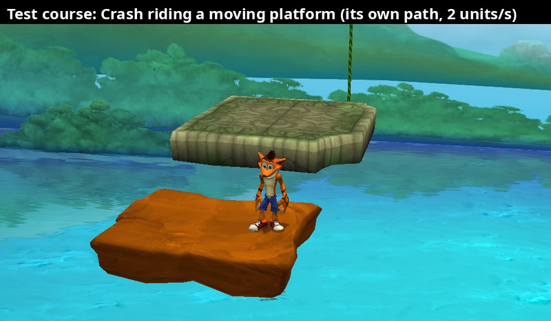
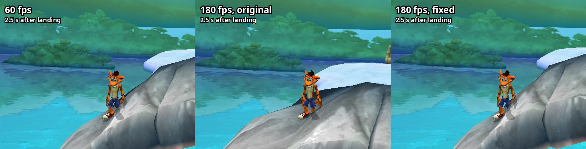

# 69. Collision meshes on disc: the road to a test course and custom maps

2026-11-19. Research start. **Why:** checking frame-rate fixes on real game
spots is slow: the bugs depend on a level's own triangles, spots have to be
found from traces, and climbs and ledges are hard to reach by script. A
**test course** (slopes of known angles, steps of known heights, ledges,
later climbables) would let the probe kit (findings/22 s.10) sweep each
quirk at 30 / 60 / 120 / 180 fps in a controlled way. It is also the first
step towards custom maps (roadmap phase 5, mods). The format is decoded and a
tree builder exists (scratch tools); nothing is in the game yet.

## 1. What a level is made of

A level folder in `default.rcf` (`levels/L0` = Crash's house, `L1`...`L9`)
holds only small files: scripts (`objectives`, `props_*`, `spawn_*`,
`sound_*`, `streamgraph`, `NonSpawnableTemplateActor`, `cameraoverrides`;
Lua 5.1 bytecode, findings/19 s.1), `cameradata.p3d`, `Skybox.p3d` and
`LevelPackages.p3d`. The last one lists the level's packages by name, e.g.
for L0 `L0/aec5f73c` ("joined_assets") and `L0/4463ada` ("room", L0_R1);
the packages themselves are `package/<level>/<name>.p3d`.
`levels/GlobalPackagesNoHash.p3d` keeps readable names for the global list.

Pure3D packages are chunk trees, **little-endian** after the `P3D\xff` file
header: `u32 id, u32 own size (12-byte header + own data), u32 total size
(+ children)`. The house room package holds textures (`0x19000`), materials
(`0x11000`), meshes (`0x10000`, e.g. `roomShape`, `tableShape`), effects,
a scenery root (`0x121000`) and **one collision object**, `room_collision`.

## 2. The collision object

| Chunk | Contents (house room: 286 triangles) | Loaded into (mesh object) |
|---|---|---|
| `07010025` | collision object: name, then children | `sub_8244DCF0` / `sub_82450DE0` |
| `07010001` | 12 bytes (zero in the house), holds the mesh | |
| `0701000A` | mesh header: u32 5, 2 u32, box min + max (6 floats) | mesh `+32` min, `+44` max; `+56/+60/+64` = 1/size per axis (computed) |
| `07000003` | u32 count, corners (3 floats each); 145 | `+8` corners, `+24` u16 count |
| `07000006` | u32 count, triangles: u16 corners x3 + u16 flags; 286 | `+16`, 8 bytes each (16 with `+28` set: then 3 more u16 from `07000005`), `+26` u16 count; flags rotated by 4 bits on load |
| `07000008` | u32 count, u16 words; 1,754 | `+12`: the **search tree** over the triangles (section 3) |
| `07000748` | u32 count, 36-byte entries, one per triangle | `+20`, 12 bytes each: 3 u16 = the triangles across each edge (the neighbours), `+6` = 0xFFFF, `+11` = a byte scaled from the 7th word; 3 floats (1.9 in the house) skipped |
| `07016000` | surface materials (`07016012` "SurfaceMaterialData": per-triangle numbers) | through a registered callback (`[0x82597390]` area) |

The mesh loader is `sub_82450140` (chunk loop: `sub_82355848` = next chunk
id, `sub_82354FA0` = read). The in-memory layout matches what the ground
fix reads in a running game (findings/22 s.11: `+0x08` corners, `+0x10`
triangles, `+0x18`/`+0x1A` counts, `+0x1C` the 16-byte flag). The `07000748`
neighbour list is the game's own triangle adjacency, which the ground fix
currently rebuilds by sharing corners.

## 3. The search tree, decoded

Static searches for the walker found nothing (the mesh pointer is handed
along first), so it was caught in the act: a hardware read watchpoint
(gdb `rwatch`) on two words of Crash's ground mesh tree on Wumpa Island,
armed from a breakpoint on the reach check `sub_8217D668`. First reader:
`sub_8244E760`, called by `sub_8244E5F0` <- `sub_8244D838` <- `sub_8224ECF8`.
(A SIGINT to the game doesn't reach gdb: the game blocks it.)

**The grid.** `sub_8244BA60` turns a point into three u16:
`trunc((p - box min) x 65535 / (box max - box min))`, clamped to 0..65535 per
axis (the scales are the loader's `+56/+60/+64`). The query
(`sub_8244E5F0`) makes the grid box of what it looks for, widens it by 2
steps on each side, then walks the tree.

**A node** is a run of u16 words starting with a head word `w`:

| Bits of `w` | Meaning |
|---|---|
| 14-15 | split axis: 0 x, 1 y, 2 z; **3 = leaf** |
| 12-13 | type: bit 0 = the LEFT side is an inline triangle list, bit 1 = the RIGHT side is one |
| rest, type 0 | `here` = w & 0xFFF |
| rest, type 1 | left count = (w >> 6) & 63, `here` = w & 63 |
| rest, type 2 | right count = (w >> 6) & 63, `here` = w & 63 |
| rest, type 3 | left = (w >> 8) & 15, right = (w >> 4) & 15, `here` = w & 15 |

After the head: `here` triangle numbers (always reported), then for a
non-leaf the **split** (a grid coordinate), then the left side (an inline
list of triangle numbers, or ONE word: the child's offset in words from
this node's head), then the right side the same way. The walk visits the
left side when the query's min on the axis is <= split, the right side when
its max is >= split (the right child is a loop, not a call). A triangle
reaching both sides of a split is listed on both.

**Checked** with `notes/scratch-tools/maps/coltree.py`: on the house and on
all 43 collision objects of Wumpa Island (30,369 triangles) the walk reads
every tree word, lists every triangle, and each triangle's own box finds
it. On the island some words are visited twice: identical subtrees are
shared, which the walker allows.

**Building one:** `coltree_build.py` makes a tree from any triangle list
(middle-of-box splits, type-0 nodes and leaves only, crossing triangles on
both sides, bigger leaves when the tree would pass 65,536 words: offsets are
u16). 3,000 random-box queries per mesh against brute force find every
overlapping triangle. Candidates per query: house 5.9 (disc tree 6.2), the
island's largest meshes 10-23 (disc 4.5-7.4); the disc's trees are tighter
because they also pack short triangle lists into the nodes (types 1-3).
Fine for a test course of a few hundred triangles; worth matching later
for whole maps.

## 4. The test course

`--test_course=true` (src/world/test_course.cpp) adds an invisible course to
Wumpa Island's piece `L1/9db06066` (a "room" package: LevelPackages type 14,
path category 15). The log lists each lane's start spot ("Test course: lane
ramp30 starts at 315.00 27.43 -398.00"), reached with `goto 1 <spot>`.

**What it is:** 10 lanes side by side (8 wide, 9 apart), each running along
+x: a 6-unit flat start pad, the feature, a 6-unit end pad at y 20, all on a
1-unit triangle grid. Ramps of 10, 20, 30, 40, 50 degrees (12 long), stairs
of 10 steps of 0.10, 0.25, 0.50, 1.00 units (1-unit treads, vertical risers),
a 15-degree slope with +-0.12 bumps per grid corner. A flat catch floor at
y 12 under everything. 4,848 triangles; the piece goes from 3,987 to 8,835,
its tree from 29,141 to 43,084 words. Placed at x 312-344, z -420..-331, in
the piece's box and clear of every Wumpa Island piece's collision (a first
place at x 300 stood half inside another piece, `L1/185bac9c`, which fills
x 290-310 at z -390..-340: Crash stopped dead at an invisible wall).

**What the patch writes**, in the game's own formats: corners (shared ones
merged, stored as 32-bit floats), triangles with the edge flags (bit k =
edge k open or a ridge: checked on the island's 3,987 triangles, where open
and ridge edges carry it and flat joins and valleys don't), the per-triangle
entries (neighbours across each edge, 1.9 x3, the normal), the surface
material 19 (the island's usual ground) in "SurfaceMaterialData", and a new
tree for the whole mesh. The tint / saturation streams list only some
triangles and are left alone. Nothing is drawn.

**Checked:** Crash stands on the pads at their exact heights (22.12 on the
10-degree ramp's pad, 30.00 on the top of the 1.0 stairs), with a ground
contact. The Python prototype (notes/scratch-tools/maps/course.py +
p3d_patch.py) and the C++ patch make the same bytes
(`--debug_test_course_dump`).

**Driving it:** out there no camera volume holds the camera, so the stick's
world direction differs per lane after a teleport. `maps/course.sh` runs every
lane in one session (exact replays, fixed step); `maps/aim.py` measures each
lane's heading from a 30 fps walk and turns that lane's stick to go straight
down it.

## 5. First results: slopes fixed, real steps not

Run (3 s, full stick) and walk (4 s, 0.73 stick) down every lane, ground
grace off, exact replays. "Short" = a ground loss under 150 ms dropping less
than 0.6 units (what the move logic hears as a split-second fall); falls off
the end pads are real and not counted.

| Short losses | 30 fps (original) | 60 fps | 180 fps | 60, no handover | 180, no handover |
|---|---|---|---|---|---|
| ramps 10-50° + bumpy, 12 runs | 2 | **0** | **0** | 9 | 17 |
| stairs, run | 12 (33-100 ms) | 19 (17-50 ms) | 20 (11-56 ms) | same | same |
| stairs, walk | 3 | 8 (17-83 ms) | 36 (mostly 6 ms) | same | same |

* **Slopes:** with the triangle handover (findings/22 s.11) the move logic
  hears fewer split-second losses at 60 and 180 fps than the original does
  at 30. Without it, the 20-degree ramp alone gives 9 at 180 fps.
* **Real steps:** every step down is a real short drop, at 30 fps too (the
  original loses the ground for one 33 ms frame at each 0.25 step when
  running). The handover doesn't touch them (same numbers without it). At
  high frame rates the losses are longer in time when running (50 ms against
  33) and, walking, come as several one-frame losses per step (0.25 stairs
  walked at 180 fps: 21 losses of 6 ms, at 30 fps: none). With the ground
  grace off, each is heard by the move logic. So the ground grace still has
  work on real stairs; the next fix belongs at the source, the step-down.
  (Built: findings/22 s.12, `ground_touch_keeps_contact`: 60 fps stairs now
  match the original; at 180 fps the walk's losses go from 36 to 11.)

## 6. Next

1. ~~A copy of a real spot~~ (section 7).
2. ~~A step-down fix~~ (findings/22 s.12; partly: 180 fps still leans on the grace). A step-down fix at the source (when the reach check drops the contact
   and ground lies within a small step below, as at 30 fps where one frame
   covers the whole drop), checked on the stair lanes against 30 fps.
3. More lanes: ledges, a moving platform, steep "slide" slopes, an edge
   for titans; drawing the course (a plain mesh, or lines over the picture).
4. Climbables and other special surfaces (objects with their own
   behaviours, placed by level data), then a level of its own (packages,
   scripts, a spawn point, a `LevelPackages` entry). Started: a rope and a
   platform (section 8).

## 7. A copy of a real spot: the Ratcicle Kingdom courtyard's descent

**Why:** the lanes are not like real ground. Walked in a straight line
(`maps/ground_compare.py`, a sample every 5 cm), the courtyard descent of
findings/22 and the lanes give:

| | courtyard descent | 20° / 30° ramp lanes | bumpy lane |
|---|---|---|---|
| a new triangle every | 0.44-0.51 units | 1.0 | 1.0 |
| steepness on the way | 0-54°, changing all the time | one angle | 0-24° |
| joins that bend (2° or more) | 16-20 of 20-30 | 1 (the top) | 16 of 16 |
| largest bend | 27-54° | the ramp's angle, once | 16° |

The ground losses of findings/22 s.10-11 happened at those bends. So the
course also holds a **copy of the descent**: every triangle of Ice Kingdom's
piece `L2/8514dde0` whose middle is in x 252..284, z -148..-104, read from
the player's disc at run time, with its own edge flags and surface
materials, moved by (+48, 0, -330) into free air south of the lanes. The
Wumpa piece's box grows to hold it (z down to -480, y -16..60, so the walls
around the descent, y -14 to 56, come along whole; no other Wumpa Island
piece reaches there). Edges cut at the border are open edges; a catch floor
at y -15.5. 574 triangles from 2,441; the slope probe's spot
(262.329, 31.5, -126.734) is (310.329, 31.5, -456.734).

**The copy matches:** along the three walks above, the same triangles,
slopes and bends (one walk meets one triangle more near the border); Crash
stands at the probe spot at the original's height (30.905).

**How it was compared:** the 16 walks of findings/22 s.11 (run and walk, 8
directions; there started right after leaving a titan) were walked on the
copy in the same WORLD directions: the stick angle measured once per spot
(`maps/headings.py`), then each walk tuned by its own heading error, to
within 1° for the walks. 13 of 16 end within about 1 unit of where the
original ends. Earlier tries showed what matters: a copy cut tight around
the path gave extra losses at its border (2 units from the start), and
without the walls (first cut at the Wumpa box's y 47) the runs left the
copy where the original stops at a wall.

Grace off, short losses (under 150 ms, under 0.6 units) / real falls, 16 walks:

| | 30 fps | 60 fps | 180 fps | 180 fps, no handover |
|---|---|---|---|---|
| the copy | 1 / 2 | **0** / 3 | **0** / 2 | 7 / 4 |
| the original (Ice Kingdom) | | 0 / 4 | 3 / 3 | 14 / 3 |

Without the triangle handover the copy trips on the same walks as the
original (the downhill runs). With it, both are clean at 60 fps; at 180 the
copy is clean and the original's 3 all come from one walk (w5) whose path
parts from the copy's early (the start differs: after a titan in the
original, a teleport here). Differences left: Crash's facing at the start,
and anything of the Ice Kingdom that isn't in that one piece (props,
other pieces' collision).

## 8. Real game objects in the course: a rope and a platform

**Why:** ropes, moving platforms, climbing walls and harpoon targets are
places a save can't reach, and online each PC's own camera has to be checked
there (findings/68). The course can hold them.

**How a level places them.** A level folder's `props_*.blua` scripts (Lua 5.1
bytecode in Radical's layout; `dis50.py` reads them) make every prop with one
call:

    InstantiateActorFromTemplate('.:', 'L2_Set13_Rope1', 'WorldObjects:HangingRope2D', position, rotation)

The template names its kind of object; its settings come from a template
script (`script/SpawnableTemplateActor.blua`, or the level's
`NonSpawnableTemplateActor.blua` for level-only templates), e.g. a rope =
`newActor(HangingRope, ...)` with `SetBehaviourDataHangingRope` (radius 0.08,
texture `rope.bmp`; the Ice Kingdom variant adds `axis_locked_state`).

**What can be made anywhere.** A template with a package group of its own in
`levels/GlobalPackages.p3d` (`package/<Group>_<Name>.p3d`) loads in any level
through the spawn code (cheats/spawn.cpp: a reference on its inventory
section loads it, then `sub_82168620` creates the actor). Two such:

| Template | Group package | In the course |
| --- | --- | --- |
| `WorldObjects:HangingRope` | yes | grabbed by jumping at it, swings |
| `StaticProps:env_Whumpa:prp_pformL1_platformA` | yes | solid, Crash stands on it; still |
| `...:prp_pformL1_spinningPlatformA` (bridge flaps), `WorldObjects:HangingRope2D` | no (inside a level's pieces) | refused: "not in the game's packages" |

A spawned platform stays still: its movement comes from the level's own
scripts, not from the template.

**The course's objects** (`--test_course`): two GAP lanes (two pads with
nothing between them: `ropegap` 6 units, `platgap` 8 units) with a catch
floor at y 12 under them. 2 s of game time after player 1's Crash first
exists, the course asks the spawn code for the rope (top at y 34, ~15 units
long, its end just under the pads) and the platform, at exact spots (the
spawn code's new `at x y z` form; not counted as a cheat).
`--test_course_start=<lane>` puts the players at that lane's start on the
same frame. On game time with the fixed step on, so every PC of an online
session does both on the same frame.

**Where.** First put beside the other lanes (z -330..-313), the gap lanes ran
into a Wumpa Island structure (photos: Crash walking against grey slabs). A
map of every L1 piece's collision (corners and triangle middles, y 0..50, 6-unit
cells) showed everything south of z -434 clear; the gap lanes now start at
x 344, z -470 (ropegap) and -461 (platgap), east of the courtyard copy.

| Test | Result |
| --- | --- |
| Run + jump from `ropegap`'s start | Crash on the rope, swinging, over open sea |
| Jump from `platgap`'s start | Crash standing on the platform in the gap |
| Online, two copies, own cameras: host does the rope jump, guest joins | the course and its objects alike on both PCs; player 1 on the rope at the same spot; world and controllers identical on all 1,306 frames |

Still to do: ~~moving platforms~~ (section 9), climbing walls (is "climbable" a surface material?), harpoon targets, a
second player away from the first in these tests.

## 9. A moving platform: a path made by the port

**Why:** moving platforms carry the player at a frame-rate-dependent speed
(findings/22 s.9 fixed one soft-lock of that kind); the course needs one to
probe them at 30, 60 and 180 fps.

**How a level moves one.** A plain `Platform` template doesn't move by
itself: its `CPathFollowingBehaviour` rides a PATH that the level's props
script builds right after making it (Desert, `L4_R1_MovingPlatform2`):

    WorldManager:CreatePath('.:L4_R1_MovingPlatform2:L4_R1_MovingPlatform2Path1')
    SetPathType(1) SetPathSpeed(0, 10) SetPathRotType(0)
    per point: AddPathPoint(name, i, {x, y, z}) SetPathPointDuration(3)
               SetPathPointWaitType(3) SetPathPointAdditionalSpeed(0) CompletePoint()

The script methods (registered by `sub_822F98B8`) are thin wrappers:

| Script method | Game function | What it does |
| --- | --- | --- |
| `CreatePath` | `sub_822FA1D0` | splits the name at its last two colons (actor = the segment before the last), looks the path up (`sub_822FA4C0`), else `new` 0x4C bytes + constructor `sub_822FB960` (vtable `0x82046CFC`, room for 100 points) and attaches it under the actor's name (`sub_822FA2C8`) |
| `SetPathType` / `SetPathSpeed` / `SetPathRotType` | `sub_822FBB90` / `sub_822FBB98` / `sub_822FBBA8` | path +60 type, +64/+72 speed kind and speed, +68 rotation type |
| `AddPathPoint` | `sub_822FBB30` | a 24-byte point: xyz, +12 duration, +16 additional speed, +20 wait type (default 1) |
| `SetPathPointDuration` / `SetPathPointWaitType` | `sub_822EAB78` / `sub_82240598` | the point's +12 / +20 |

The paths live in a map at WorldManager (`*(*(0x8259B190) + 120)`) +8,
keyed by the actor's 8-byte name object. Wait types in the levels: 0 (800
points), 1 (25), 3 (165: the platforms that wait for a
`DO_PlatformMessage(..., "NEXT_WAIT_POINT")`).

**Three traps on the way:**

* The game's `new` asserts while no heap is chosen: the path and its map
  insertion are made under heap 1 (`sub_823574E8`), as the path's own
  constructor uses for its points.
* The key is the actor's own name object (its +8 and +12 words), as the
  follower builds it every frame (`sub_82158830` -> `sub_82158758`). A
  spawned actor's name isn't its template's hash, so attaching under the
  template name never matched. (`sub_8236ABC0` returns those two words in
  ONE 64-bit register: a call that keeps 32 bits lost the first word.)
* The follower looks for its path ONCE, at its first update, then clears
  its "look for a path" byte (+77, at `0x821587F0`) found or not. The
  platform is already running when the path is made, so the byte is set
  again; the follower finds the path on its next update.

A path is followed RELATIVE to where the platform starts (its first point =
its spot). Type 2 loops by jumping back to the first point at the end, so
the course's path is A -> B -> A with the platform made at A: the jump back
lands where it already is.

**In the course** (`--test_course`): lane `movegap` (a 12-unit gap), the
Desert's floating platform `StaticProps:env_Desert:prp_pformFloating_Desert`
(its own GlobalPackages group, loads anywhere), shuttling 3 units each way
of the gap's middle at 2 units/s (`SetPathSpeed(0, 2)`, the levels' most
used speed). The console got `cheat path <actor|last> <type> <speed> <wait>
<duration> <x y z>...` and `cheat platform <actor|last> <message>` (a level
script's `DO_PlatformMessage`: the actor message 0x1A built by
`sub_820B6C68`, handed over by `sub_820B0B70`).
The message carries a small CODE, not the name: `sub_820B6CE0` turns the
name object into it (NEXT_WAIT_POINT 4, PAUSE 5, CONTINUE 6,
ROTATION_SPEED1 7, ROTATION_SPEED2 8, RESET 9, IS_CRASH_ATTACHED 10,
IS_NPC_ATTACHED 13, ROT_SPEED 14, SOUND 15, GO_NORTH .. GO_DOWN 16-21, any
other name -1), and the path follower's message slot (`sub_82158DE8`,
vtable `0x8202FA1C` slot 5) switches on it: 4 / 5 / 9 set its +0x50 to
1 / 2 / 3, 6 calls `sub_822922E8`, 16-21 their own moves. (A first version
sent the name's hash word: nothing matched, nothing happened.) On the
course's platform: PAUSE holds it still (357.668 for 2.3 s), CONTINUE
starts it again at 2 units/s; an unknown name is refused in the log.

| Test (fixed step, console) | 30 fps | 60 fps | 180 fps |
| --- | --- | --- | --- |
| Platform's run | 353.07 .. 358.93, 2.0 units/s, one loop 6.6 s | same | same |
| Crash put on it, 7 s watched | rides, height 20.009 steady, no slip against the platform | same | same |
| Timed jumps from the start pad (8, stick aimed down the lane) | 2 land on it and ride, 6 fall onto the catch floor | | |

So the platform carries Crash the same way at every frame rate tested. Next:
a platform that waits (wait type 3 + `NEXT_WAIT_POINT`), vertical travel
(lifts: landing on a rising floor), and the same probes with titans.
Tilting and rolling platforms: section 10.

## 10. Tilting and rolling platforms: the frame time counted twice

**Why:** some platforms move because Crash stands on them: icebergs and
props that tip under his weight and spring back, and "rolling logs" that
spin as he walks on them, where the player has to keep his balance. Above
60 fps they react much more slowly.

**Which platforms.** In the template scripts they are `Platform` actors
whose data sets a `m_BounceBehaviour` (C++ `CBounceBehaviour`, vtable
`0x8202C2D4`): `mass_number`, `spring_coef_x/z_number`,
`rotation_dampening_coef_x/z_number`, `rotation_min/max_x/z_angle_number`,
`rotation_max_speed_number`, `rotation_x/z_on_state`, and for the rolling
ones `rotation_type_enumvalue = ERotType_ROLLING_LOG_Z`. Among them:

| Template | Kind | Where | Own package (spawnable anywhere) |
| --- | --- | --- | --- |
| `StaticProps:env_Ice:prp_pformTilty_iceburg_A` | tilts (x and z, 38 / 30 degrees) | Ice levels | yes |
| `StaticProps:env_Ice:prp_pformL2_C_shaped_wheel` | rolls (z, up to 180 degrees) | Ratcicle Kingdom | yes |
| `StaticProps:env_Ice:prp_pformdonut` | rolls (z) | Ratcicle Kingdom | no |
| `StaticProps:env_Whumpa:prp_pformWhumpaTiltyProp1` | tilts | Wumpa Island | no |
| `StaticProps:env_Desert:prp_pformCoop_tilting_propB`, `env_Phantom:...propC` | tilts | Desert, (name TBD) | B yes, C no |
| `StaticProps:env_Nina:prp_pformL5_tiltyPlatformA` | tilts | (name TBD) | yes |
| `StaticProps:env_Junk:prp_pformL6_spinningSphere`, `..._rotatingGearA` | rolls / turns | (name TBD) | no |

**How they move.** Update (slot 4, `sub_8212ABB0`) runs the tilt physics
`sub_8212BDC0`, which cuts the frame time into slices: 1/60 s
(`0x8201FB80`) while more than 0.0183 s is left, then the rest (30 fps =
two slices of 1/60, 60 fps = one, 180 fps = one of 1/180). Per slice and
axis (x `sub_8212B8B8`, z `sub_8212B988`, rolling log `sub_8212BCD8`,
scripted turn `sub_8212BA08`) the behaviour builds a push in +0x130 (x) /
+0x138 (z):

    push = torque x dt + (1/mass) x -(damping x v + spring x angle) x dt

(torques arrive by message, `sub_8212AF10` -> `sub_8212C890`: force at a
point -> torque x 1/mass, added up during the frame), then steps
(`sub_8212B7F8`):

    v     = v + push x dt          (0x8212B84C fmadds f11,f0,f29,f12)
    v     = clamp(v, +-max speed)
    angle = angle + v x dt, held at its limits

Layout: angles +0x118 (x) / +0x11C / +0x120 (z), angular speeds +0x124 /
+0x12C, 1/mass +0x164, springs +0x168 / +0x16C, damping +0x170 / +0x174,
limits +0x178 / +0x17C (x) +0x180 / +0x184 (z), max speed +0x14C, mode
+0x190.

**The bug:** dt counts twice in the velocity change. Over a second the
speed gains a x dt (the sum of a x dt^2 over the slices): with 1/60-s
slices (30 and 60 fps) the intended amount, with 1/180-s slices a third of
it. The motion is the one the designers tuned at 30 fps only while the
slices stay 1/60 s.

**The fix** (`src/world/tilting_platforms.cpp`, midasm hook
`CrashMomTiltSliceStep` at `0x8212B84C`, `--tilting_platform_fix`): a slice
shorter than 1/60 s gets its push scaled by (1/60)/dt, so the speed gains
push x 1/60 per slice: the same per second as at 30/60, while the angle
still moves every frame. Slices of 1/60 s are untouched (30 and 60 fps
stay bit for bit the original).

**In the course:** lanes `tiltgap` (the iceberg) and `rollgap` (the stone
wheel), 12-unit gaps, objects placed like section 8's. Probe: Crash put on
the object off its middle (1 unit for the iceberg, 0.7 for the wheel), the
behaviour's angle read every game frame with the console's `watch`, fixed
step:

| Angle after 3 s of game time | 30 fps | 60 fps | 180 fps, original | 180 fps, fixed |
| --- | --- | --- | --- | --- |
| Iceberg tipping (z) | -21.9 degrees | -22.3 | -12.2 | -22.4 |
| Stone wheel rolling (z) | -59.3 | -61.9 | -19.2 | -63.3 |

30 and 60 fps are unchanged by the fix (same numbers to the last digit).

Still to check: walking on a rolling log to keep balance (the player's feel,
not only the passive roll), the same with titans on them.
